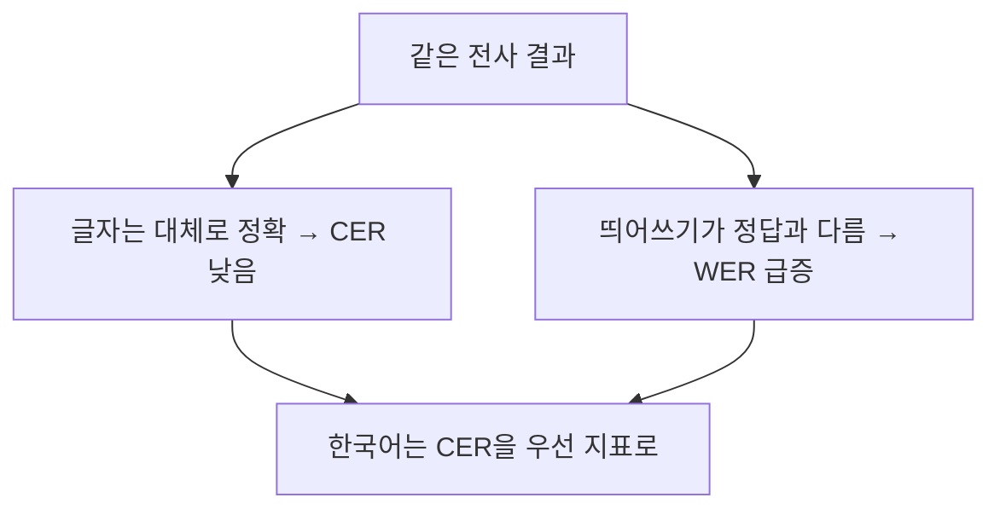

# STT 엔진 벤치마크 종합 정리 (레포 · 결과 · 해석)

> 동일한 오디오 소스를 여러 STT(음성→텍스트) 엔진에 태워 **정확도(WER/CER)**와 **속도(RTF)**로 채점한 결과를 정리한 문서다.
> 영어·한국어 두 언어를 각각 사람이 작성한 수동 자막을 정답으로 삼아 측정했다.
>
> **측정 환경**: CPU — 12th Gen Intel Core i7-12850HX (2.10 GHz) · GPU — NVIDIA RTX A2000 8GB Laptop GPU.
> RTF 수치는 별도 표기가 없으면 GPU 기준이며, `(CPU)` 표기가 붙은 항목(SenseVoice-GGUF·Parakeet·Moonshine)은 위 CPU에서 측정한 값이다.

---

## 1. 사용 엔진별 관련 레포 리스트업

벤치마크에 올린 엔진은 크게 **Whisper 계열**, **Paraformer(SenseVoice) 계열**, **NVIDIA Parakeet**, **Moonshine**, **LLM 기반 ASR** 다섯 갈래다. `관련 레포` 열은 두 가지를 담는다 — **앞줄**은 엔진 자체의 레포(모델·연구 **원본 개발 레포** 또는 그 모델을 돌리는 **런타임 구현 레포**), **뒷줄 `채택 앱`**은 그 엔진을 실제로 갖다 쓴 다운스트림 앱(실시간 자막·후처리 참조로 조사한 6종 중 해당 엔진 사용 앱)이다.

| 엔진 | 계열 | 관련 레포 | 지원 언어 | 특징 |
|---|---|---|---|---|
| **faster-whisper** | OpenAI Whisper | [SYSTRAN/faster-whisper](https://github.com/SYSTRAN/faster-whisper) · [openai/whisper](https://github.com/openai/whisper) **채택 앱**: [WhisperLive](https://github.com/collabora/WhisperLive) · [Hearsay](https://github.com/parkscloud/Hearsay) · [meetily](https://github.com/Zackriya-Solutions/meetily) · [Handy](https://github.com/cjpais/Handy) · [speech-to-speech](https://github.com/huggingface/speech-to-speech) · [VoiceStudio](https://github.com/debpalash/VoiceStudio) | 99개 | CTranslate2 런타임으로 최적화된 Whisper 표준 구현. 다국어에 강건 |
| **SenseVoice** | Paraformer(비자기회귀) | [FunAudioLLM/SenseVoice](https://github.com/FunAudioLLM/SenseVoice) · [modelscope/FunASR](https://github.com/modelscope/FunASR) **채택 앱**: [speech-to-speech](https://github.com/huggingface/speech-to-speech) · [VoiceStudio](https://github.com/debpalash/VoiceStudio) | 50+ (ko/en/zh/ja/yue) | 비자기회귀 구조로 매우 빠름. 중국어 중심 다국어 모델 |
| **SenseVoice-GGUF** | SenseVoice(동일 모델/다른 런타임) | llama.cpp 기반 GGUF 런타임 | 50+ | SenseVoice와 같은 모델을 CPU에서 구동하는 경량 런타임(Q8 양자화) |
| **Parakeet** | NVIDIA NeMo FastConformer-TDT | [NVIDIA/NeMo](https://github.com/NVIDIA/NeMo) · [istupakov/onnx-asr](https://github.com/istupakov/onnx-asr)(런타임) **채택 앱**: [meetily](https://github.com/Zackriya-Solutions/meetily) · [Handy](https://github.com/cjpais/Handy) · [speech-to-speech](https://github.com/huggingface/speech-to-speech) · [VoiceStudio](https://github.com/debpalash/VoiceStudio) | 영어 + 유럽어 25종 (**한국어 미지원**) | 속도를 앞세운 다국어 ASR. CPU 효율이 좋아 관련 앱에 다수 채택 |
| **Moonshine** | Useful Sensors Moonshine | [usefulsensors/moonshine](https://github.com/usefulsensors/moonshine) **채택 앱**: [VoiceStudio](https://github.com/debpalash/VoiceStudio) | 영어 전용 | 저전력·저지연 ONNX 단문형 모델. 임베디드/온디바이스 지향. CPU효율 좋음 |
| **MOSS** | LLM 기반 ASR | [OpenMOSS/MOSS-Transcribe-Diarize](https://github.com/OpenMOSS/MOSS-Transcribe-Diarize) | 50+ | Whisper 인코더 + 소형 LLM 디코더. 화자 분리(diarization) 지원 |

> 6개 앱 모두 **Whisper 계열(faster-whisper / whisper.cpp / WhisperX)을 핵심·기본 엔진으로 사용**하며, 관련 앱에 반복 등장하던 **Parakeet·Moonshine**도 이번에 영어로 추가 검토했다(결과는 §2). `whisper.cpp`·`WhisperX`·TensorRT·OpenVINO·`sherpa-onnx` 등은 새 엔진이 아니라 기존 모델의 **다른 런타임**이다.

### Whisper 계열에서 채점한 모델 라인업

faster-whisper 하나로 여러 크기·변형 모델을 교체하며 채점했다.

- **small / medium** — 기본 크기 라인
- **large-v3** — 풀사이즈 최신 세대
- **large-v3-turbo** — large-v3의 경량·고속 변형
- **distil-large-v3 / distil-large-v3.5** — 증류(distillation)된 초고속 변형(영어 위주)

### 참고: 조사했으나 범위 밖으로 제외한 레포 (STT 아님)

STT 후보로 함께 훑었으나 TTS·보이스클론·번역 등 **음성 인식이 아니어서** 벤치마크에서 제외한 레포들이다.

| 레포 / 이름 | 성격 |
|---|---|
| pocket-tts · dots.tts · Qwen3-TTS · kokoro · supertonic | TTS (텍스트→음성) |
| VoxCPM · voicebox · Seed-VC | 음성 합성 / 보이스 클론·변환 |
| translategemma · AirTranslate · Synthalingua | 번역 / 자막 번역 파이프라인 |

---

## 2. 엔진/모델별 벤치마크 결과 (한국어 · 영어)

> 평가 구간은 두 언어 모두 **앞 10분(600초)**, 정답은 **사람이 작성한 수동 자막**이다.
> 수치는 낮을수록 좋다(WER/CER). RTF도 낮을수록 빠르다.

### 2-1. 영어 결과 (정규화 기준)

| 엔진 / 모델 | WER | CER | RTF |
|---|---|---|---|
| SenseVoice | 0.2613 | 0.0966 | **0.010** |
| SenseVoice-GGUF (CPU) | 0.2902 | 0.1269 | 0.034 |
| Parakeet · v3 (CPU) | 0.2469 | 0.1702 | 0.079 |
| Moonshine · base (CPU) | 0.1341 | 0.0816 | 0.152 |
| faster-whisper · small | 0.1774 | 0.1163 | 0.030 |
| faster-whisper · medium | 0.0908 | 0.0627 | 0.066 |
| faster-whisper · large-v3 | 0.0736 | 0.0540 | 0.377 |
| **faster-whisper · large-v3-turbo** | **0.0681** | **0.0485** | 0.128 |
| faster-whisper · distil-large-v3 | 0.0901 | 0.0581 | 0.075 |
| faster-whisper · distil-large-v3.5 | 0.1919 | 0.1573 | 0.083 |

- 영어 정확도 1위는 **large-v3-turbo**로, 풀사이즈 large-v3보다도 정확하면서 약 3배 빠르다.
- **distil-large-v3**는 medium급 정확도를 최고 속도(RTF 0.075)로 내는 영어 가성비 옵션이다.
- **Moonshine(base)**는 초경량 영어 전용 모델임에도 WER 0.1341로 whisper-small(0.1774)보다 우수해, 온디바이스·저전력 영어 받아쓰기에 매력적이다.
- **Parakeet(v3)**는 WER 0.2469로 이 클립 영어에서 기대만큼 높지 않았다. 주된 원인은 v3가 **다국어 통합 모델**이라 영어 특화(v2)보다 불리한 것이며, 아래 단서의 고정창 분할 영향은 (경계가 4개뿐이라) 미미하다.

> **측정 단서(공정성)**:
> - **평가 구간은 동일하다.** 모든 엔진이 같은 600초(앞 10분) 클립을 채점하므로 이 부분은 공정하다.
> - **엔진 내부 분할 방식은 다르다.** 이전 엔진들은 침묵 경계에서 자르는 **VAD 분할**을 쓴다(faster-whisper=Silero VAD, SenseVoice·GGUF=FSMN-VAD, 최대 30초 캡). 반면 신규 두 엔진은 **고정 시간창**으로 나눴다 — Parakeet는 장문 통짜 추론이 런타임 한계로 실패해 120초 창, Moonshine은 단문형 모델이라 30초 창. 고정창은 단어 경계와 무관하게 잘리므로 WER이 다소 부풀 수 있다. 다만 Parakeet 120초 창은 경계가 약 4개뿐이라 영향이 미미하고, Moonshine 30초 창은 경계가 약 19개로 약간의 페널티가 있다.
> - **RTF는 CPU(ONNX) 기준**이라(Parakeet·Moonshine·SenseVoice-GGUF), GPU로 잰 Whisper RTF와 직접 비교하면 안 된다. 정확도 비교의 핵심은 WER/CER이다.

### 2-2. 한국어 결과 (정규화 기준)

| 엔진 / 모델 | WER | CER | RTF |
|---|---|---|---|
| SenseVoice | 0.6946 | 0.2164 | **0.010** |
| SenseVoice-GGUF (CPU) | 0.7032 | 0.2383 | 0.034 |
| faster-whisper · small | 0.2541 | 0.1022 | 0.038 |
| faster-whisper · medium | 0.2079 | 0.0918 | 0.093 |
| faster-whisper · large-v3 | 0.2207 | 0.1207 | 0.486 |
| **faster-whisper · large-v3-turbo** | **0.1865** | **0.0855** | 0.141 |
| faster-whisper · distil-large-v3 | 0.9949 | 0.8459 | 0.193 |
| faster-whisper · distil-large-v3.5 | 0.9957 | 0.8592 | 0.113 |
| Parakeet · v3 | — (미지원) | — | — |
| Moonshine | — (영어 전용) | — | — |

- 한국어 정확도 1위 역시 **large-v3-turbo**로, 유일하게 medium보다 개선된 모델이다.
- **distil 계열은 한국어에서 사용 불가**(WER ~0.99). 영어 위주로 증류돼 다국어 능력이 제거된 탓이다.
- **SenseVoice 계열은 한국어에서 크게 뒤처진다**(WER ~0.70). 중국어 중심 다국어 모델의 한계.
- **Parakeet(v3)**는 지원 언어에 한국어가 없어(영어+유럽어 25종) 한국어 채점에서 제외했다. **Moonshine**은 영어 전용 모델이라 애초에 대상이 아니다.

### 2-3. 속도(RTF) 요약

| 순위 | 엔진 | RTF | 실시간 대비 |
|---|---|---|---|
| 1 | SenseVoice | 0.010 | 약 100배 빠름 |
| 2 | faster-whisper (small~turbo) | 0.03~0.14 | 약 7~33배 빠름 |
| 3 | faster-whisper large-v3 | 0.38~0.49 | 약 2~3배 빠름 |
| — | MOSS | 0.33+ | 짧은 클립 약 3배, 장문에서 급격히 저하 |

> MOSS는 자기회귀 디코딩 병목으로 장문 전사 시 속도가 급격히 떨어져 연속 라이브 캡션에는 부적합하다.

---

## 3. 벤치마크 수치 용어 설명과 최종 해석

### 3-1. 용어 설명

| 용어 | 뜻 | 해석 |
|---|---|---|
| **WER** (Word Error Rate) | 단어 오류율. 정답 대비 틀린/빠진/더해진 **단어** 비율 | 0에 가까울수록 정확. 띄어쓰기(어절 경계)에 민감 |
| **CER** (Character Error Rate) | 문자 오류율. 같은 계산을 **글자 단위**로 | 띄어쓰기 영향이 작아 한국어에서 더 신뢰할 수 있는 지표 |
| **RTF** (Real-Time Factor) | 실시간 계수 = 처리 시간 ÷ 오디오 길이 | RTF 0.1 = 10분 오디오를 1분에 처리(실시간의 10배). 낮을수록 빠름 |
| **정규화(normalized)** | 소문자화 + 문장부호·화자표시 제거 + 공백 정리 후 채점 | 표기 차이로 인한 과도한 오답을 걷어낸, 더 공정한 수치 |

### 3-2. WER과 CER이 갈리는 이유 (특히 한국어)

한국어에서 SenseVoice는 **WER은 매우 높은데 CER은 상대적으로 낮은** 괴리가 나타난다.
내용(글자)은 대체로 맞지만 **띄어쓰기(어절 경계)가 정답과 달라** 단어 단위 WER이 대량 오답 처리되기 때문이다.
띄어쓰기는 정답 자체가 주관적일 수 있으므로, **한국어 정확도는 CER을 우선 지표로 보는 것이 타당하다.**

### 3-3. 정답 품질이 수치에 미치는 영향

초기엔 YouTube 자동생성 자막을 정답으로 썼으나, 이는 STT 엔진과 **같은 계열의 ASR 오류를 공유**해 오류가 상쇄되면서 수치가 낙관적으로 낮게 나오는 편향이 있었다.
이후 정답을 **사람이 작성한 수동 자막**으로 교체하자 상쇄 효과가 사라져 WER이 소폭 상승했고, 이것이 더 정직한 절대 정확도다. **본 문서의 결과는 모두 수동 자막 기준이다.**

### 3-4. 핵심 경향 정리

1. **모델을 키우면 정확도가 오르지만, 이득은 언어마다 다르다.** small→medium에서 영어 WER은 거의 절반으로 줄지만(학습 데이터에 영어 비중이 큼), 한국어 개선폭은 작다.
2. **더 크다고 항상 좋은 건 아니다.** 풀사이즈 large-v3보다 경량 변형 **large-v3-turbo**가 양 언어 모두에서 더 정확하고 훨씬 빨랐다.
3. **속도-정확도는 대체로 트레이드오프**지만, turbo·distil 같은 최적화 변형은 이 곡선을 유리하게 당긴다.
4. **다국어 강건성이 중요하다.** Whisper 계열은 언어를 바꿔도 완만하게 열화하지만, 영어에 특화된(distil) 또는 중국어 중심(SenseVoice) 모델은 한국어에서 급격히 무너진다.

### 3-5. 최종 결과 해석 및 추천

| 상황 | 추천 |
|---|---|
| 영어 정확도 최우선 | **large-v3-turbo** (WER 0.0681, large-v3보다도 정확) |
| 영어 최고속(정확도 타협 적음) | **distil-large-v3** (RTF 0.075, WER ≈ medium) |
| 영어 온디바이스·초경량 CPU | **Moonshine** (WER 0.1341, whisper-small보다 우수한 초경량 영어 모델) |
| 한국어 정확도 최우선 | **large-v3-turbo** (WER 0.1865 / CER 0.0855) |
| 최저 지연·초경량(정확도 양보) | **SenseVoice** (RTF 0.010, 단 한국어는 부정확) |
| CPU 전용 환경 | **SenseVoice-GGUF**(다국어) / **Moonshine**(영어) |
| 한국어에 Parakeet·Moonshine·distil | 금지 (Parakeet·Moonshine 한국어 미지원, distil WER ~0.99) |
| 라이브 캡션 종합 추천 | **large-v3-turbo** (양 언어 최고 정확도 + RTF<0.15 여유) |

**종합**: 정확도·속도의 균형점은 대부분의 상황에서 **faster-whisper의 large-v3-turbo**다.
극단적 저지연이 필요하면 SenseVoice, GPU가 없으면 SenseVoice-GGUF, 화자 분리가 필요하면 MOSS(장문·라이브 부적합)를 고려한다.
**영어 전용 온디바이스**라면 초경량 **Moonshine**이 whisper-small을 웃도는 정확도로 좋은 선택지다.
distil 계열·Parakeet·Moonshine은 **영어에서만** 쓰고 한국어에는 쓰지 않는다.

> 수치는 특정 오디오 클립(영어 TED 강연 / 한국어 시사 영상) 기준의 상대 비교이며, 도메인·화자·녹음 품질에 따라 달라질 수 있다.
