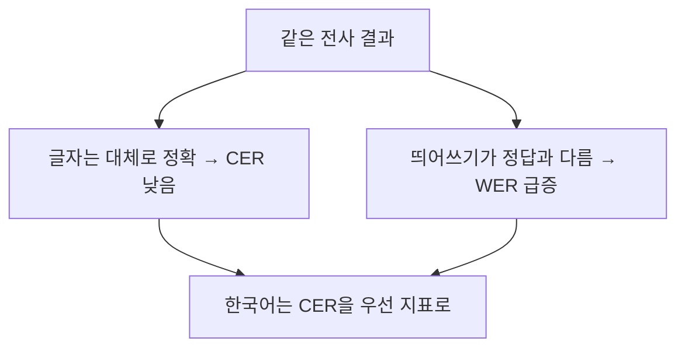

# STT 엔진 벤치마크 종합 정리 (레포 · 결과 · 해석)

> 동일한 오디오 소스를 여러 STT(음성→텍스트) 엔진에 태워 **정확도(WER/CER)**와 **속도(RTF)**로 채점한 결과를 정리한 문서다.
> 영어·한국어 두 언어를 각각 사람이 작성한 수동 자막을 정답으로 삼아 측정했다.
>
> **측정 환경**: CPU — 12th Gen Intel Core i7-12850HX (2.10 GHz) · GPU — NVIDIA RTX A2000 8GB Laptop GPU.
> RTF 수치는 별도 표기가 없으면 GPU 기준이며, `(CPU)` 표기가 붙은 항목(SenseVoice-GGUF·Parakeet·Moonshine·VibeVoice-BitNet·Underdog-Bark-3.0·faster-whisper large-v3-turbo·LFM3-Audio(영어만))은 위 CPU에서 측정한 값이다.

---

## 1. 사용 엔진별 관련 레포 리스트업

벤치마크에 올린 엔진은 크게 **Whisper 계열**, **Paraformer(SenseVoice) 계열**, **NVIDIA NeMo(Parakeet·Nemotron)**, **Moonshine**, **LLM 기반 ASR** 다섯 갈래다. `관련 레포` 열은 두 가지를 담는다 — **앞줄**은 엔진 자체의 레포(모델·연구 **원본 개발 레포** 또는 그 모델을 돌리는 **런타임 구현 레포**), **뒷줄 `채택 앱`**은 그 엔진을 실제로 갖다 쓴 다운스트림 앱(실시간 자막·후처리 참조로 조사한 6종 중 해당 엔진 사용 앱)이다.

| 엔진 | 계열 | 관련 레포 | 지원 언어 | 특징 |
|---|---|---|---|---|
| **faster-whisper** | OpenAI Whisper | [SYSTRAN/faster-whisper](https://github.com/SYSTRAN/faster-whisper) · [openai/whisper](https://github.com/openai/whisper) **채택 앱**: [WhisperLive](https://github.com/collabora/WhisperLive) · [Hearsay](https://github.com/parkscloud/Hearsay) · [meetily](https://github.com/Zackriya-Solutions/meetily) · [Handy](https://github.com/cjpais/Handy) · [speech-to-speech](https://github.com/huggingface/speech-to-speech) · [VoiceStudio](https://github.com/debpalash/VoiceStudio) | 99개 | CTranslate2 런타임으로 최적화된 Whisper 표준 구현. 다국어에 강건 |
| **SenseVoice** | Paraformer(비자기회귀) | [FunAudioLLM/SenseVoice](https://github.com/FunAudioLLM/SenseVoice) · [modelscope/FunASR](https://github.com/modelscope/FunASR) **채택 앱**: [speech-to-speech](https://github.com/huggingface/speech-to-speech) · [VoiceStudio](https://github.com/debpalash/VoiceStudio) | 50+ (ko/en/zh/ja/yue) | 비자기회귀 구조로 매우 빠름. 중국어 중심 다국어 모델 |
| **SenseVoice-GGUF** | SenseVoice(동일 모델/다른 런타임) | llama.cpp 기반 GGUF 런타임 | 50+ | SenseVoice와 같은 모델을 CPU에서 구동하는 경량 런타임(Q8 양자화) |
| **Parakeet** | NVIDIA NeMo FastConformer-TDT | [NVIDIA/NeMo](https://github.com/NVIDIA/NeMo) · [istupakov/onnx-asr](https://github.com/istupakov/onnx-asr)(런타임) **채택 앱**: [meetily](https://github.com/Zackriya-Solutions/meetily) · [Handy](https://github.com/cjpais/Handy) · [speech-to-speech](https://github.com/huggingface/speech-to-speech) · [VoiceStudio](https://github.com/debpalash/VoiceStudio) | 영어 + 유럽어 25종 (**한국어 미지원**) | 속도를 앞세운 다국어 ASR. CPU 효율이 좋아 관련 앱에 다수 채택 |
| **Moonshine** | Useful Sensors Moonshine | [usefulsensors/moonshine](https://github.com/usefulsensors/moonshine) **채택 앱**: [VoiceStudio](https://github.com/debpalash/VoiceStudio) | 영어 전용 | 저전력·저지연 ONNX 단문형 모델. 임베디드/온디바이스 지향. CPU효율 좋음 |
| **MOSS** | LLM 기반 ASR | [OpenMOSS/MOSS-Transcribe-Diarize](https://github.com/OpenMOSS/MOSS-Transcribe-Diarize) | 50+ | Whisper 인코더 + 소형 LLM 디코더. 화자 분리(diarization) 지원 |
| **Qwen3-ASR** | LLM 기반 ASR | [QwenLM/Qwen3-ASR](https://github.com/QwenLM/Qwen3-ASR) | 52개 (ko/en 포함) | Qwen3 LLM 백본 기반 전사 모델. 0.6B/1.7B 두 크기로 채점(같은 레포의 ForcedAligner-0.6B는 정답 텍스트→오디오 타임스탬프 정렬 전용이라 전사 채점 대상 아님). 한국어 파인튜닝(TeamUNIVA/qwen3_asr_1.7b_ko_beta)도 함께 채점 |
| **Granite-Speech** | LLM 기반 ASR | [ibm-granite/granite-speech-models](https://github.com/ibm-granite/granite-speech-models) | 영어 + 유럽어 5종 (**한국어 미지원**) | IBM Granite-Speech 3.3 — Whisper 인코더 + Granite LLM 의 2-pass 구조. transformers 로 GPU 구동(peft 필요) |
| **NeMo (2026)** | NVIDIA NeMo FastConformer/RNNT | [NVIDIA/NeMo](https://github.com/NVIDIA/NeMo) | 영어 전용 2종 + 40개(ko 포함, Nemotron-3.5) | 2026년 NeMo 신모델 3종 — Parakeet-Unified·Nemotron-Speech(영어), Nemotron-3.5(다국어, `prompt` 로 언어 지정). 위 onnx Parakeet(v3)와 같은 NeMo 계보지만 별개 신모델이며, 전용 Python 3.12 venv 필요·600초 통짜 GPU 추론 |
| **VibeVoice-ASR** | LLM 기반 ASR | [microsoft/VibeVoice](https://github.com/microsoft/VibeVoice) · [microsoft/VibeASR.cpp](https://github.com/microsoft/VibeASR.cpp)(BitNet 런타임) | 50+ (ko/en 포함) | 연속형 음향+의미 음성 토크나이저(7.5 Hz) + Qwen2.5 LLM 디코더. ASR + 화자 분리 + 타임스탬프를 한 번에 출력하며, 언어 지정 파라미터 없음(자동 감지)·핫워드/컨텍스트 지원. 7B(4-bit, GPU)와 BitNet 1.5B(CPU, VibeASR.cpp) 두 변형으로 채점. Streaming-7B 변형은 4-bit로도 8GB GPU에 올라가지 않아 제외 |
| **Underdog-Bark-3.0** | NVIDIA NeMo FastConformer-TDT 파인튜닝 | [ConwayResearch/Underdog-Bark-3.0](https://huggingface.co/ConwayResearch/Underdog-Bark-3.0) · 기반 [nvidia/parakeet-tdt-0.6b-v3](https://huggingface.co/nvidia/parakeet-tdt-0.6b-v3) | 영어 전용 | Parakeet-TDT-0.6B-v3를 영어로 파인튜닝한 0.6B 모델. 자체 ANS 압축 포맷(`model.bark`, 163MB)을 공식 로더로 풀어 transformers `ParakeetForTDT`(FP32)에 올려 구동하며, 카드 지침대로 앞에 0.25초 무음을 붙인다. 전용 venv(`.venv-bark`, transformers ≥5.19 + constriction) 필요. 라이선스 **CC-BY-NC-4.0(비상업)** |
| **LFM3-Audio** | LLM 기반 ASR (오디오 LLM) | [LiquidAI/LFM3-Audio-2B](https://huggingface.co/LiquidAI/LFM3-Audio-2B) | 18개 (ko/en 포함) | LFM3 백본 + 인과(causal) 오디오 인코더 + LiquidCodec의 any-to-any 오디오 LLM(ASR·TTS·번역·음성 대화). 시스템 프롬프트 "Perform ASR in English./Korean."로 전사하며 bf16·무양자화. 전용 venv(`.venv-lfm3`, transformers ≥5.20.2) 필요. LFM Open License v1.0 |
| **Notesoop-STT-Ko** | 임베딩 모델 기반 CTC ASR | [Phsoft-ai/Notesoop-STT-Ko-v1](https://huggingface.co/Phsoft-ai/Notesoop-STT-Ko-v1) | 한국어 전용 | embeddinggemma-2 오디오 타워(동결) + 경량 Conformer 리더 + 25k 형태소 어휘 + KenLM 3-gram 빔서치. 비자기회귀이며 모델 자체의 16초 창(1초 겹침)으로 처리한다. 전용 venv(`.venv-notesoop`, Python 3.12, transformers 5.x, kenlm은 MinGW g++로 소스 빌드) 필요. Apache-2.0 |

> 6개 앱 모두 **Whisper 계열(faster-whisper / whisper.cpp / WhisperX)을 핵심·기본 엔진으로 사용**하며, 관련 앱에 반복 등장하던 **Parakeet·Moonshine**도 이번에 영어로 추가 검토했다(결과는 §2). LLM 기반 ASR 계열엔 MOSS 외에 **Qwen3-ASR**도 함께 검토했는데, Qwen3-ASR은 영어·한국어 두 언어 모두 채점했다. 여기에 더해 **NVIDIA가 2026년 공개한 NeMo 신모델 3종**(Parakeet-Unified·Nemotron-Speech·Nemotron-3.5)도 채점에 추가했다(영어 3종, 한국어는 다국어인 Nemotron-3.5만). 이어서 **IBM Granite-Speech 3.3(영어)**과 **Qwen3-ASR 한국어 파인튜닝(TeamUNIVA/qwen3_asr_1.7b_ko_beta)**도 추가 채점했다. **Deepgram**은 STT지만 유료 클라우드 API(키+인터넷 필수)라 로컬 벤치에서 제외했고, **VibeVoice**는 계열이다 — VibeVoice-TTS·VibeVoice-Realtime은 TTS라 아래 범위 밖 표에 포함했지만, **VibeVoice-ASR은 STT**라 채점했다(GPU 7B 4-bit, CPU BitNet 1.5B. Streaming-7B는 8GB VRAM에서 구동 불가). 이어서 **Underdog-Bark-3.0**(Parakeet-TDT v3 파인튜닝, 영어)·**LFM3-Audio-2B**(LiquidAI 오디오 LLM, 영어·한국어)·**Notesoop-STT-Ko-v1**(한국어 전용)도 채점했다. `whisper.cpp`·`WhisperX`·TensorRT·OpenVINO·`sherpa-onnx` 등은 새 엔진이 아니라 기존 모델의 **다른 런타임**이다.

### Whisper 계열에서 채점한 모델 라인업

faster-whisper 하나로 여러 크기·변형 모델을 교체하며 채점했다.

- **small / medium** — 기본 크기 라인
- **large-v3** — 풀사이즈 최신 세대
- **large-v3-turbo** — large-v3의 경량·고속 변형
- **distil-large-v3 / distil-large-v3.5** — 증류(distillation)된 초고속 변형(영어 위주)

### 참고: 조사했으나 범위 밖으로 제외한 레포 (STT 아님)

STT 후보로 함께 훑었으나 TTS·보이스클론·번역 등 **음성 인식이 아니어서** 벤치마크에서 제외한 레포들이다.

| 레포 / 이름 | 성격 |
|---|---|
| pocket-tts · dots.tts · Qwen3-TTS · kokoro · supertonic · VibeVoice-TTS · VibeVoice-Realtime | TTS (텍스트→음성) |
| VoxCPM · voicebox · Seed-VC | 음성 합성 / 보이스 클론·변환 |
| translategemma · AirTranslate · Synthalingua | 번역 / 자막 번역 파이프라인 |

---

## 2. 엔진/모델별 벤치마크 결과 (한국어 · 영어)

> 평가 구간은 두 언어 모두 **앞 10분(600초)**, 정답은 **사람이 작성한 수동 자막**이다.
> 수치는 낮을수록 좋다(WER/CER). RTF도 낮을수록 빠르다.

### 2-1. 영어 결과 (정규화 기준)

> **2026-11-20 2차 전 엔진 재측정(RAM 포함, 표 값)**(동일 600초 클립, CPU 사용률·VRAM·RAM 추가): CPU%는 시스템 전체(psutil, 전 코어), VRAM은 NVML/nvidia-smi의 시스템 전체 전용 VRAM 사용량(다른 프로세스 기본 점유 포함, 8GB 물리 카드 상한)으로, 모델 로드를 제외한 전사 구간에서만 약 0.5초 간격(CPU 실행은 nvidia-smi 경유 약 1.2초)으로 샘플링했다. 각 칸은 최소 / 평균 / 최대(CPU는 %, VRAM·RAM은 GB)다. RAM은 전사 중 측정 프로세스와 자식 프로세스의 RSS 합이다(VibeVoice-BitNet은 VibeASR.cpp 자식 프로세스 포함). VRAM 최대값 ≈ 해당 모델의 최소 VRAM 요구량 가늠치(시스템 전체 전용 VRAM 기준, 다른 프로세스 기본 점유 포함), RAM 최대값 ≈ 최소 시스템 RAM 요구량 가늠치(CPU 전용 모델의 핵심 사양)다. 각주가 붙은 행은 측정마다 값이 달라진 행이며(이력: 11-19 또는 이전 → 11-20 1차 → 11-20 2차 = 표 값, 표 아래 참조), RTF ≥ 2(실시간보다 2배 이상 느림)인 행은 측정 제외했다.
>
> NeMo 3종은 11-20 2차 재측정에서 8GB 카드 대비 torch peak 16.0~16.9GB가 할당돼(Nemotron-3.5는 11-19·11-20 1차에서 18.65GB) **공유 시스템 메모리로 스필**했으므로 RTF를 다른 엔진과 직접 비교하면 안 된다. VRAM 열은 전용 VRAM(8GB 상한)만 집계하고 공유메모리로 넘친 양(torch peak: Parakeet-Unified 16.01 GB, Nemotron-Speech 16.02 GB, Nemotron-3.5 16.85 GB)은 미포함이며, 실제 요구량 ≈ torch peak로 8GB 카드에서는 공유메모리로 동작한다. NeMo 전사 중 RAM 12~14GB는 스필한 공유 GPU 메모리를 포함할 가능성이 있다(미확인).

| 엔진 / 모델 | WER | CER | RTF | CPU% (최소/평균/최대) | VRAM GB (최소/평균/최대) | RAM GB (최소/평균/최대) |
|---|---|---|---|---|---|---|
| SenseVoice | 0.2613 | 0.0966 | **0.010**¹ | 5.0 / 14.7 / 28.3 | 1.21 / 2.02 / 3.64 | 1.95 / 2.19 / 2.30 |
| SenseVoice-GGUF (CPU) | 0.2902 | 0.1269 | 0.058 | 29.2 / 41.2 / 45.5 | 0.00 / 0.00 / 0.00 | 0.54 / 0.82 / 0.84 |
| Parakeet · v3 (CPU) | 0.2469 | 0.1702 | 0.078 | 72.5 / 78.4 / 89.8 | 0.00 / 0.00 / 0.00 | 6.07 / 6.31 / 6.42 |
| Underdog-Bark-3.0 · 0.6B | 0.2270 | 0.1509 | 0.030 | 4.3 / 8.5 / 11.8 | 2.61 / 3.33 / 3.36 | 0.93 / 1.45 / 1.48 |
| Underdog-Bark-3.0 · 0.6B (CPU) | 0.2270 | 0.1509 | 0.087 | 10.7 / 40.1 / 68.4 | 0.00 / 0.00 / 0.15 | 4.54 / 5.02 / 5.14 |
| Moonshine · base (CPU) | 0.1341 | 0.0816 | 0.137 | 30.2 / 59.6 / 87.6 | 0.00 / 0.00 / 0.00 | 0.60 / 0.95 / 1.18 |
| Qwen3-ASR · 0.6B | 0.1747 | 0.1113 | 0.145² | 8.5 / 12.0 / 33.6 | 3.58 / 3.58 / 3.58 | 2.06 / 2.15 / 2.15 |
| Qwen3-ASR · 1.7B | 0.1417 | 0.0981 | 0.183 | 5.9 / 11.7 / 31.5 | 4.97 / 5.53 / 5.75 | 2.06 / 2.15 / 2.15 |
| Qwen3-ASR · 1.7B-ko (파인튜닝) | 0.1809 | 0.1180 | 0.430³ | 9.2 / 12.4 / 25.5 | 4.97 / 5.53 / 5.75 | 2.06 / 2.15 / 2.16 |
| Granite-Speech 3.3 · 2B | 0.1224 | 0.0896 | 0.169 | 8.4 / 11.6 / 16.7 | 6.07 / 6.07 / 6.07 | 1.87 / 1.87 / 1.87 |
| NeMo · Parakeet-Unified (공유메모리 스필) | 0.1190 | 0.0843 | 0.160 | 4.4 / 9.2 / 23.6 | 7.97 / 7.97 / 7.97 | 3.79 / 13.69 / 14.03 |
| NeMo · Nemotron-Speech (공유메모리 스필) | 0.1664 | 0.1074 | 0.141 | 4.0 / 10.0 / 18.3 | 3.25 / 7.86 / 7.97 | 2.23 / 12.17 / 12.55 |
| NeMo · Nemotron-3.5 (공유메모리 스필) | 0.1623 | 0.1001 | 0.145 | 4.2 / 10.2 / 17.7 | 3.25 / 7.75 / 7.98 | 2.17 / 12.20 / 12.80 |
| VibeVoice-ASR · 7B (4-bit) | 0.2318 | 0.1546 | 0.616 | 5.2 / 10.0 / 24.8 | 6.66 / 7.59 / 7.63 | 1.60 / 1.82 / 1.83 |
| VibeVoice-ASR-BitNet · 1.5B (CPU) | 0.2785 | 0.1797 | 0.429 | 12.6 / 41.0 / 53.2 | 0.00 / 0.00 / 0.15 | 0.54 / 12.15 / 13.95 |
| LFM3-Audio · 2B | 0.1107 | 0.0718 | 0.108 | 8.5 / 12.3 / 23.8 | 4.05 / 4.05 / 4.05 | 1.74 / 1.74 / 1.76 |
| LFM3-Audio · 2B (CPU) | 0.1080 | 0.0694 | 1.292 | 19.3 / 44.5 / 63.6 | 0.00 / 0.00 / 0.15 | 8.55 / 8.56 / 8.60 |
| faster-whisper · small | 0.1774 | 0.1163 | 0.030 | 8.1 / 15.7 / 31.9 | 0.78 / 0.96 / 1.02 | 1.09 / 1.12 / 1.27 |
| faster-whisper · medium | 0.0908 | 0.0627 | 0.065 | 10.3 / 14.6 / 26.0 | 2.06 / 2.38 / 2.46 | 1.05 / 1.12 / 1.25 |
| faster-whisper · large-v3 | 0.0750⁴ | 0.0554 | 0.164⁴ | 9.3 / 14.4 / 40.8 | 3.91 / 4.56 / 5.42 | 1.06 / 1.12 / 1.27 |
| **faster-whisper · large-v3-turbo** | **0.0681** | **0.0485** | 0.042⁵ | 8.9 / 13.5 / 28.5 | 2.16 / 2.38 / 2.49 | 1.06 / 1.11 / 1.24 |
| faster-whisper · large-v3-turbo (CPU) | 0.0763 | 0.0517 | 0.362 | 19.1 / 25.8 / 32.9 | 0.00 / 0.01 / 0.15 | 1.47 / 1.64 / 1.89 |
| faster-whisper · distil-large-v3 | 0.0901 | 0.0581 | 0.028⁶ | 7.5 / 14.0 / 20.6 | 2.03 / 2.23 / 2.33 | 1.06 / 1.11 / 1.26 |
| faster-whisper · distil-large-v3.5 | 0.2380⁷ | 0.1823 | 0.032⁷ | 8.5 / 12.9 / 20.6 | 2.03 / 2.25 / 2.33 | 1.06 / 1.12 / 1.22 |

> ¹ SenseVoice: RTF 측정마다 변동: 이전 0.010 → 11-20(1차) 0.020 → 11-20(2차, 표 값) 0.010 — 기계 상태 차이 추정, 미확인.
>
> ² Qwen3-ASR · 0.6B: RTF 측정마다 변동: 11-19 0.151 → 11-20(1차) 0.402 → 11-20(2차, 표 값) 0.145 — 기계 상태 차이 추정, 미확인.
>
> ³ Qwen3-ASR · 1.7B-ko (파인튜닝): RTF 측정마다 변동: 11-19 0.189 → 11-20(1차) 0.190 → 11-20(2차, 표 값) 0.430 — 기계 상태 차이 추정, 미확인.
>
> ⁴ faster-whisper · large-v3: WER norm 측정마다 변동: 08-22 0.0736 → 11-20(1차) 0.1327 → 11-20(2차, 표 값) 0.0750 (CER norm 0.0540 → 0.0950 → 0.0554) — 동일 설정, 온도 폴백 비결정성 추정. 11-20(1차) 실행에는 환각 세그먼트가 포함됨. RTF 측정마다 변동: 이전 0.377 → 11-20(1차) 0.176 → 11-20(2차, 표 값) 0.164 — 기계 상태 차이 추정, 미확인.
>
> ⁵ faster-whisper · large-v3-turbo: RTF 측정마다 변동: 이전 0.128 → 11-20(1차) 0.042 → 11-20(2차, 표 값) 0.042 — 기계 상태 차이 추정, 미확인.
>
> ⁶ faster-whisper · distil-large-v3: RTF 측정마다 변동: 이전 0.075 → 11-20(1차) 0.027 → 11-20(2차, 표 값) 0.028 — 기계 상태 차이 추정, 미확인.
>
> ⁷ faster-whisper · distil-large-v3.5: WER norm 측정마다 변동: 이전 0.1919 → 11-20(1차) 0.1623 → 11-20(2차, 표 값) 0.2380 (CER norm 0.1573 → 0.1133 → 0.1823) — 동일 설정, 온도 폴백 비결정성 추정. RTF 측정마다 변동: 이전 0.083 → 11-20(1차) 0.032 → 11-20(2차, 표 값) 0.032 — 기계 상태 차이 추정, 미확인.

- 영어 정확도 1위는 **large-v3-turbo**로, 풀사이즈 large-v3(0.0681 vs 0.0750)보다도 정확하면서 약 4배 빠르다(RTF 0.042 vs 0.164). large-v3는 2차에서 다시 상위권으로 돌아왔지만 WER이 측정마다 흔들렸다(08-22 0.0736 → 11-20 1차 0.1327 → 2차 0.0750, 각주 4).
- **large-v3-turbo (CPU·int8)**는 GPU(FP16)와 정확도가 사실상 같다 — WER 0.0681→0.0763(약 +1%p), CER 0.0485→0.0517. 대신 RTF는 0.042→0.362(이전 측정은 0.48~0.68)로 약 9배 느리다. 즉 int8 양자화는 정확도가 아니라 속도에만 주로 비용이 간다.
- **distil-large-v3**는 medium급 정확도를 Whisper 계열 최고 속도(RTF 0.028)로 내는 영어 가성비 옵션이다.
- **Moonshine(base)**는 초경량 영어 전용 모델임에도 WER 0.1341로 whisper-small(0.1774)보다 우수해, 온디바이스·저전력 영어 받아쓰기에 매력적이다.
- **Parakeet(v3)**는 WER 0.2469로 이 클립 영어에서 기대만큼 높지 않았다. 주된 원인은 v3가 **다국어 통합 모델**이라 영어 특화(v2)보다 불리한 것이며, 아래 단서의 고정창 분할 영향은 (경계가 4개뿐이라) 미미하다.
- **Qwen3-ASR(1.7B)**는 WER 0.1417로 whisper-small(0.1774)보다 낫지만 medium(0.0908)에는 못 미친다. 발화 단위(short-form) 모델이라 600초를 통짜로 넣으면 앞부분이 통째로 누락되는 등 장문 처리가 불안정해(예: 통짜 입력 시 0.6B WER이 0.4697까지 치솟음), Parakeet·Moonshine과 마찬가지로 120초 고정창으로 나눠 처리했다.
- **NeMo(2026) 3종**은 영어 WER 0.119~0.166으로, 최상위 **Parakeet-Unified(0.1190)**가 whisper-medium(0.0908)에는 못 미치지만 whisper-small(0.1774)·Qwen3-ASR·Moonshine보다 낫다. onnx Parakeet(v3)와 달리 세 모델 모두 **600초를 통짜로 GPU 추론**(청킹 없음)해 RTF는 GPU 기준이나, 2026-11-19·11-20 재측정에서 8GB 카드 대비 torch peak 최대 16.0~16.9GB가 할당돼(공유 메모리 스필) RTF(0.141~0.160)를 Whisper와 직접 비교하기는 어렵다. 단 Parakeet-Unified는 도입부 첫 문장을 통째로 놓쳐(약 38단어 삭제) 그만큼 손해를 봤음에도 NeMo 3종 중 1위였다.
- **Qwen3-ASR 한국어 파인튜닝(1.7b-ko)**은 영어 WER 0.1809로 base 1.7B(0.1417)보다 소폭 하락했다. 한국어 특화 학습의 대가로 영어 일반 성능이 약간 희생된 것이다.
- **Granite-Speech 3.3(2B)**는 영어 WER 0.1224로 Moonshine(0.1341)·Qwen3-ASR 1.7B(0.1417)·whisper-small(0.1774)을 웃돌고 medium(0.0908)에 근접한 강한 영어 성능이다. 단문형(short-form) 설계라 30초 고정창으로 나눠 처리했다.
- **VibeVoice-ASR**은 영어 WER 0.2318(7B, 4-bit) / 0.2785(BitNet 1.5B, CPU)로 표 하위권(7B는 distil-large-v3.5·Parakeet·SenseVoice·SenseVoice-GGUF보다만 앞섬)이지만, 아래 단서처럼 **verbatim(있는 그대로) 전사**라는 점을 감안해야 한다. BitNet의 RAM 열(최대 13.95GB)에는 VibeASR.cpp 자식 프로세스가 포함된다.
- **Underdog-Bark-3.0(0.6B, 영어 전용)**은 WER 0.2270 / CER 0.1509로, 기반 모델인 Parakeet v3(0.2469)보다 약 2%p 낫지만 표 상위권과는 거리가 있다. GPU와 CPU의 WER/CER은 동일하고 RTF만 0.030 vs 0.087로 다르다(Parakeet v3 CPU 0.078과 비슷, CPU 최대 RAM 5.14GB). 라이선스가 **CC-BY-NC-4.0(비상업)**이라 상용 앱에는 쓸 수 없다.
- **LFM3-Audio(2B)**는 영어 WER 0.1107 / CER 0.0718(GPU)로 Granite-Speech 3.3(0.1224)·NeMo Parakeet-Unified(0.1190)·Qwen3-ASR 1.7B(0.1417)보다 낫고, large-v3-turbo(0.0681 GPU / 0.0763 CPU)·large-v3(0.0750)·distil-large-v3(0.0901)·medium(0.0908)에는 못 미친다(11-20 1차에서는 large-v3가 0.1327로 이보다 뒤처졌다, 각주 4). Whisper 계열을 제외하면 이 표의 영어 1위다. CPU(fp32)는 WER 0.1080 / CER 0.0694로 GPU(bf16)와 사실상 같고 CPU 최대 RAM은 8.60GB다. 속도(RTF 0.108 / CPU 1.292)는 선택적 `causal_conv1d` 커널 없이 PyTorch 폴백으로 잰 값이라 커널을 쓰면 더 빨라질 수 있다.

> **VibeVoice 단서 (verbatim 전사)**: VibeVoice는 군말(filler)과 반복을 그대로 살리는데 정답인 TED 자막에는 이런 것이 없다(7B 영어 가설: "um" 38회, "uh" 45회 / 정답: 0회). 7B 영어 채점지 기준 대체(substitution)는 56건뿐이고 삽입(insertion)이 275건으로, 오류 대부분이 삽입이다. 보조 확인(이전 측정 기준 7B WER 0.2325 / CER 0.1541, 11-20 재측정은 0.2311 / 0.1541)으로 가설에서 um/uh만 제거하고 나머지 정규화·채점을 동일하게 적용하면 7B WER 0.2325→0.1768, CER 0.1541→0.1234, BitNet WER 0.2785→0.2221, CER 0.1797→0.1487이다. 표의 수치는 다른 모든 엔진과 같은 프로토콜의 무수정 값을 유지한다.

> **LFM3·Bark 단서 (분할 방식)**: LFM3-Audio는 **30초 고정창**으로 처리했다. 600초 통짜는 VRAM 13GB가 필요하고 출력이 잘렸으며, 120초 창은 내용 누락이 생겨(영어 WER 0.277) 창 길이를 비교했다 — 영어 60초 0.118 / 30초 0.111, 한국어 60초 0.459 / 30초 0.357. 이 창 길이(30초)는 **채점에 쓴 이 클립 자체에서 골랐으므로** 약간 낙관적일 수 있다. Underdog-Bark-3.0은 공식 수치를 Parakeet과 같은 **120초 창**으로 냈다. 600초 통짜 GPU 1회 추론은 WER 0.1857 / CER 0.1289로 더 낮지만 최대 10.18GB를 써서 8GB 카드의 공유 메모리로 넘쳤고(RTF 0.066은 비교 불가), 그래서 표에는 120초 창 값만 넣었다.

> **측정 단서(공정성)**:
> - **평가 구간은 동일하다.** 모든 엔진이 같은 600초(앞 10분) 클립을 채점하므로 이 부분은 공정하다.
> - **엔진 내부 분할 방식은 다르다.** 이전 엔진들은 침묵 경계에서 자르는 **VAD 분할**을 쓴다(faster-whisper=Silero VAD, SenseVoice·GGUF=FSMN-VAD, 최대 30초 캡). 반면 신규 엔진들(Parakeet·Moonshine·Qwen3-ASR)은 **고정 시간창**으로 나눴다 — Parakeet는 장문 통짜 추론이 런타임 한계로 실패해 120초 창, Moonshine은 단문형 모델이라 30초 창을 썼다. Qwen3-ASR도 120초 창을 썼는데, 이는 런타임 한계가 아니라 **모델 자체가 발화 단위(short-form) 설계라 장문 통짜 입력 시 조용히 나쁜 결과(앞부분 누락 등)를 내는 불안정성 때문에 처음부터 의도적으로 청킹**한 것이다. 고정창은 단어 경계와 무관하게 잘리므로 WER이 다소 부풀 수 있다. 다만 Parakeet 120초 창은 경계가 약 4개뿐이라 영향이 미미하고, Moonshine 30초 창은 경계가 약 19개로 약간의 페널티가 있다. Granite-Speech도 단문형이라 Moonshine과 동일한 30초 창, Qwen3-ASR 한국어 파인튜닝(1.7b-ko)은 base와 동일한 120초 창을 썼다.
> - **NeMo(2026) 3종은 청킹 없이 600초를 통짜로 GPU 추론**했다. 고정창 분할을 쓴 위 신규 엔진(onnx Parakeet·Moonshine·Qwen3-ASR)과 달리 경계 절단 페널티가 없다. RTF는 GPU 기준이나, 8GB 카드 대비 torch peak 최대 16.0~16.9GB가 할당돼(2026-11-19·11-20 재측정) 공유 시스템 메모리로 스필했으므로 RTF 비교에 주의해야 한다.
> - **RTF는 CPU 기준**이라(Parakeet·Moonshine·SenseVoice-GGUF는 ONNX/GGUF, VibeVoice-BitNet은 네이티브 바이너리; BitNet의 wall RTF에는 60초 청크마다 모델 로드 약 1.1초가 포함되며 로드 제외 시 0.314 / 0.393, 이전 측정 기준), GPU로 잰 Whisper·NeMo RTF와 직접 비교하면 안 된다. 정확도 비교의 핵심은 WER/CER이다.

### 2-2. 한국어 결과 (정규화 기준)

> 표에 넣지 않은 행: LFM3-Audio · 2B (CPU)¹⁸, Notesoop-STT-Ko-v1 (CPU)¹⁹ — RTF ≥ 2로 측정 제외(아래 각주).

| 엔진 / 모델 | WER | CER | RTF | CPU% (최소/평균/최대) | VRAM GB (최소/평균/최대) | RAM GB (최소/평균/최대) |
|---|---|---|---|---|---|---|
| SenseVoice | 0.6946 | 0.2164 | **0.009**⁸ | 6.4 / 16.1 / 27.6 | 1.21 / 1.73 / 2.50 | 1.95 / 2.17 / 2.29 |
| SenseVoice-GGUF (CPU) | 0.7032 | 0.2383 | 0.064 | 29.9 / 41.2 / 46.2 | 0.00 / 0.00 / 0.00 | 0.83 / 0.83 / 0.85 |
| Qwen3-ASR · 0.6B | 0.3849 | 0.1773 | 0.237 | 7.2 / 11.6 / 32.6 | 3.58 / 3.58 / 3.58 | 2.08 / 2.16 / 2.17 |
| Qwen3-ASR · 1.7B | 0.2626 | 0.1076 | 0.538 | 6.9 / 12.0 / 30.3 | 4.97 / 5.63 / 5.75 | 2.06 / 2.14 / 2.15 |
| Qwen3-ASR · 1.7B-ko (파인튜닝) | 0.2164 | 0.0851 | 1.432⁹ | 6.9 / 11.6 / 24.3 | 4.97 / 5.68 / 5.81 | 2.06 / 2.13 / 2.16 |
| NeMo · Nemotron-3.5 (공유메모리 스필) | 0.3644 | 0.1735 | 0.147 | 4.1 / 10.7 / 26.4 | 3.25 / 7.76 / 7.98 | 2.18 / 12.21 / 12.81 |
| VibeVoice-ASR · 7B (4-bit) | 0.3028¹⁰ | 0.1255 | 0.760 | 4.7 / 10.0 / 29.6 | 6.66 / 7.60 / 7.63 | 1.60 / 1.82 / 1.83 |
| VibeVoice-ASR-BitNet · 1.5B (CPU) | 0.5423 | 0.2175 | 0.501 | 12.4 / 40.7 / 50.5 | 0.00 / 0.00 / 0.15 | 0.54 / 12.38 / 13.95 |
| LFM3-Audio · 2B | 0.3567 | 0.1877 | 0.149¹¹ | 9.1 / 12.2 / 18.3 | 4.05 / 4.05 / 4.05 | 1.76 / 1.76 / 1.76 |
| Notesoop-STT-Ko-v1 | 0.4979 | 0.2561 | 0.026¹² | 9.4 / 27.7 / 64.8 | 1.86 / 2.38 / 2.41 | 2.14 / 2.27 / 2.28 |
| faster-whisper · small | 0.2541 | 0.1022 | 0.037 | 8.7 / 18.8 / 28.2 | 0.78 / 0.97 / 1.05 | 1.09 / 1.12 / 1.24 |
| faster-whisper · medium | 0.2079 | 0.0918 | 0.095 | 9.8 / 17.5 / 37.6 | 2.06 / 2.38 / 2.49 | 1.05 / 1.11 / 1.19 |
| faster-whisper · large-v3 | 0.2866¹³ | 0.1735 | 0.251¹³ | 8.2 / 14.8 / 31.2 | 3.91 / 4.73 / 5.42 | 1.06 / 1.12 / 1.26 |
| faster-whisper · large-v3-turbo | 0.1873¹⁴ | 0.0826 | 0.050¹⁴ | 7.7 / 14.9 / 27.2 | 2.16 / 2.40 / 2.49 | 1.06 / 1.11 / 1.22 |
| **faster-whisper · large-v3-turbo (CPU)** | **0.1591** | **0.0663** | 0.421¹⁵ | 19.5 / 26.0 / 33.8 | 0.00 / 0.00 / 0.15 | 1.52 / 1.66 / 1.89 |
| faster-whisper · distil-large-v3 | 0.9949 | 0.8412 | 0.054¹⁶ | 8.5 / 12.9 / 25.4 | 2.03 / 2.23 / 2.33 | 1.06 / 1.13 / 1.20 |
| faster-whisper · distil-large-v3.5 | 0.9991 | 0.9016 | 0.035¹⁷ | 8.6 / 12.6 / 24.6 | 2.03 / 2.24 / 2.33 | 1.06 / 1.13 / 1.23 |
| Parakeet · v3 | — (미지원) | — | — | — | — | — |
| Moonshine | — (영어 전용) | — | — | — | — | — |
| NeMo · Parakeet-Unified / Nemotron-Speech | — (영어 전용) | — | — | — | — | — |
| Granite-Speech 3.3 | — (영어 전용) | — | — | — | — | — |
| Underdog-Bark-3.0 | — (영어 전용) | — | — | — | — | — |

> ⁸ SenseVoice: RTF 측정마다 변동: 11-20(1차) 0.018 → 11-20(2차, 표 값) 0.009 — 기계 상태 차이 추정, 미확인.
>
> ⁹ Qwen3-ASR · 1.7B-ko (파인튜닝): RTF 측정마다 변동: 11-19 0.743 → 11-20(1차) 0.735 → 11-20(2차, 표 값) 1.432 — 기계 상태 차이 추정, 미확인.
>
> ¹⁰ VibeVoice-ASR · 7B (4-bit): WER norm 측정마다 변동: 11-20(1차) 0.3122 → 11-20(2차, 표 값) 0.3028 (CER norm 0.1302 → 0.1255) — 동일 설정, 온도 폴백 비결정성 추정.
>
> ¹¹ LFM3-Audio · 2B: RTF 측정마다 변동: 11-19 0.145 → 11-20(1차) 0.351 → 11-20(2차, 표 값) 0.149 — 기계 상태 차이 추정, 미확인.
>
> ¹² Notesoop-STT-Ko-v1: RTF 측정마다 변동: 11-19 0.028 → 11-20(1차) 0.061 → 11-20(2차, 표 값) 0.026 — 기계 상태 차이 추정, 미확인.
>
> ¹³ faster-whisper · large-v3: WER norm 측정마다 변동: 이전 0.2207 → 11-20(1차) 0.2421 → 11-20(2차, 표 값) 0.2866 (CER norm 0.1207 → 0.1595 → 0.1735) — 동일 설정, 온도 폴백 비결정성 추정. RTF 측정마다 변동: 이전 0.486 → 11-20(1차) 0.226 → 11-20(2차, 표 값) 0.251 — 기계 상태 차이 추정, 미확인.
>
> ¹⁴ faster-whisper · large-v3-turbo: WER norm 측정마다 변동: 이전 0.1865 → 11-20(1차) 0.1694 → 11-20(2차, 표 값) 0.1873 (CER norm 0.0855 → 0.0659 → 0.0826) — 동일 설정, 온도 폴백 비결정성 추정. RTF 측정마다 변동: 이전 0.141 → 11-20(1차) 0.052 → 11-20(2차, 표 값) 0.050 — 기계 상태 차이 추정, 미확인.
>
> ¹⁵ faster-whisper · large-v3-turbo (CPU): RTF 측정마다 변동: 이전 0.941 → 11-20(1차) 0.395 → 11-20(2차, 표 값) 0.421 — 기계 상태 차이 추정, 미확인.
>
> ¹⁶ faster-whisper · distil-large-v3: RTF 측정마다 변동: 이전 0.193 → 11-20(1차) 0.064 → 11-20(2차, 표 값) 0.054 — 기계 상태 차이 추정, 미확인.
>
> ¹⁷ faster-whisper · distil-large-v3.5: RTF 측정마다 변동: 이전 0.113 → 11-20(1차) 0.043 → 11-20(2차, 표 값) 0.035 — 기계 상태 차이 추정, 미확인.
>
> ¹⁸ LFM3-Audio · 2B (CPU): RTF ≥ 2(실시간보다 2배 이상 느림)로 측정 제외 — 측정 RTF 2.656.
>
> ¹⁹ Notesoop-STT-Ko-v1 (CPU): RTF ≥ 2(실시간보다 2배 이상 느림)로 측정 제외 — 측정 RTF 2.210(1차 측정 값; 재측정은 중단됨).

- 한국어 정확도 1위 역시 **large-v3-turbo**로, 유일하게 medium보다 개선된 모델이다(GPU WER은 측정마다 달라졌다: 11-20 1차 0.1694 → 2차 0.1873, 각주 14).
- **large-v3-turbo (CPU·int8)**는 한국어에서 WER 0.1591 / CER 0.0663로, GPU(FP16)의 0.1873 / 0.0826보다 오히려 낮다. 영어에선 CPU가 GPU보다 소폭 나빴던 것과 반대로, 이 클립에서는 int8 양자화 노이즈가 빔서치를 정답 방향으로 밀어낸 우연으로 보인다(일반적 경향이 아님). RTF는 0.050→0.421로 약 8.4배 느리다(각주 15).
- **distil 계열은 한국어에서 사용 불가**(WER ~0.99). 영어 위주로 증류돼 다국어 능력이 제거된 탓이다.
- **SenseVoice 계열은 한국어에서 크게 뒤처진다**(WER ~0.70). 중국어 중심 다국어 모델의 한계.
- **Qwen3-ASR(1.7B)**는 WER 0.2626으로 whisper-small(0.2541)과 비슷한 수준이며, medium(0.2079)·large-v3-turbo(GPU 0.1873)에는 못 미친다.
- **Qwen3-ASR 한국어 파인튜닝(1.7b-ko)**은 한국어 WER 0.2164 / CER 0.0851로 base 1.7B(WER 0.2626 / CER 0.1076)보다 **한국어가 확실히 개선**됐다. CER 0.0851은 large-v3-turbo(GPU 0.0826 / CPU 0.0663)에 이은 글자 정확도다. 다만 RTF가 1.432라 2차 측정에서는 실시간보다 느렸다(11-20 1차 0.735, 각주 9).
- **Parakeet(v3)**는 지원 언어에 한국어가 없어(영어+유럽어 25종) 한국어 채점에서 제외했다. **Moonshine**은 영어 전용 모델이라 애초에 대상이 아니다. **Granite-Speech**도 영어+유럽어 5종만 지원해 한국어 대상에서 제외했다.
- **NeMo Nemotron-3.5**는 한국어 WER 0.3644 / CER 0.1735로, 40개 언어를 지원하는 다국어 모델치고는 준수하지만 Qwen3-ASR(1.7B)·whisper 계열에는 못 미친다. 나머지 NeMo 2종(Parakeet-Unified·Nemotron-Speech)은 영어 전용이라 한국어 대상에서 제외했다.
- **VibeVoice-ASR**은 한국어 WER 0.3028 / CER 0.1255(7B, 4-bit; 11-20 1차 0.3122 / 0.1302, 각주 10)로 CER은 준수하다 — large-v3-turbo·medium·small과 Qwen3-ASR 1.7B에는 못 미치지만 large-v3(0.1735)·Nemotron-3.5(0.1735)보다는 낫다. **BitNet(1.5B, CPU)**은 WER 0.5423 / CER 0.2175로 훨씬 약하다. 숫자 표기가 정답과 달라(예: "팔월" vs "8월") 띄어쓰기가 사라지는 문제가 겹쳐 WER이 부풀려졌다.
- **LFM3-Audio(2B)**는 한국어 WER 0.3567 / CER 0.1877(GPU)로 중하위권이다. WER은 Nemotron-3.5(0.3644)·Qwen3-ASR 0.6B(0.3849)보다 낫지만 CER은 두 모델(0.1735 / 0.1773)보다 약간 나쁘고, VibeVoice 7B(0.1255)·Whisper(small·medium·large-v3·turbo)·Qwen3-ASR 1.7B에는 못 미친다. CPU 실행(11-19 측정 WER 0.3636 / CER 0.1918)은 11-20 재측정 RTF가 2.656이라 RTF ≥ 2로 표에서 제외했다(각주 18). 한국어는 영어보다 창 길이에 민감했다(30초 0.357 vs 60초 0.459).
- **Notesoop-STT-Ko-v1**(한국어 전용)은 GPU WER 0.4979 / CER 0.2561, RTF 0.026(약 38배 빠름; 11-19 측정 0.028, 11-20 1차 0.061, 각주 12)로 매우 빠르지만 이 클립에서는 정확도가 낮다 — CER이 VibeVoice 7B의 약 2배이며 한국어 표 전체에서 가장 높다(SenseVoice 0.2164·SenseVoice-GGUF 0.2383보다도 높음). 모델 카드의 강의 CER 22.46%는 AI Hub **강의 음성**으로 학습·평가한 값인데, 이 클립은 강의가 아닌 주식 시장 해설형 영상이라 도메인이 다르다. CPU 실행(11-19 측정 WER 0.4944 / CER 0.2552로 GPU와 사실상 같음)은 11-20 1차 측정 RTF가 2.210이고 재측정이 중단돼 RTF ≥ 2로 표에서 제외했다(각주 19). GPU 최대 VRAM은 1.91GB(RAM 최대 2.28GB). 영어는 지원하지 않아 영어 표에는 없다.

### 2-3. 속도(RTF) 요약

| 순위 | 엔진 | RTF | 실시간 대비 |
|---|---|---|---|
| 1 | SenseVoice | 0.009~0.010 | 약 100배 빠름 |
| 2 | faster-whisper (small~turbo) | 0.028~0.095 | 약 10~36배 빠름 |
| 3 | faster-whisper large-v3 | 0.16~0.25 | 약 4~6배 빠름 |
| — | MOSS | 0.33+ | 짧은 클립 약 3배, 장문에서 급격히 저하 |
| — | VibeVoice-ASR 7B (4-bit, GPU) | 0.62~0.76 | 약 1.3~1.6배 빠름 |
| — | VibeVoice-ASR-BitNet (CPU, 8스레드) | 0.43~0.50 | 약 2.0~2.3배 빠름 (CPU에서 실시간 가능) |
| — | Notesoop-STT-Ko-v1 (GPU) | 0.026 | 약 38배 빠름 |
| — | Underdog-Bark-3.0 (GPU, 120초 창) | 0.030 | 약 33배 빠름 |
| — | Underdog-Bark-3.0 (CPU) | 0.087 | 약 12배 빠름 |
| — | LFM3-Audio 2B (GPU, 30초 창) | 0.11~0.15 | 약 7~9배 빠름 |
| — | LFM3-Audio 2B (CPU, 영어만) | 1.292 | 약 0.8배 (실시간보다 느림) |

> MOSS는 자기회귀 디코딩 병목으로 장문 전사 시 속도가 급격히 떨어져 연속 라이브 캡션에는 부적합하다.
>
> LFM3-Audio 한국어 CPU(RTF 2.656)와 Notesoop 한국어 CPU(RTF 2.210)는 RTF ≥ 2라 제외했다(§2-2 각주 18, 19).

### 2-4. 실행 환경별 특성 (스트리밍 적합도 · CPU · GPU 하드웨어 호환성)

> 정확도·속도(§2-1~2-3)와 별개로, 각 엔진을 **어디서(어떤 하드웨어) 돌릴 수 있는지**를 이 레포 어댑터가 실제로 쓰는 런타임 기준으로 정리한다.
> - **스트리밍 적합도**는 처리량(RTF)이 아니라 *말하는 도중 낮은 지연으로 결과를 내는* 온라인/스트리밍 아키텍처 지원 여부다. 본 벤치는 전부 오프라인 배치로 측정했으므로 이 열은 아키텍처 잠재력 기준이다.
> - **GPU 하드웨어**의 "NVIDIA만"은 런타임이 CUDA 전용이라 AMD·Apple·Intel GPU로는 가속이 안 된다는 뜻이다.

| 엔진 / 모델 | 런타임(백엔드) | 스트리밍 적합도 | CPU 지원 | GPU 하드웨어 호환성 | 컨텍스트/핫워드 | 언어 auto 감지 |
|---|---|---|---|---|---|---|
| **faster-whisper** | CTranslate2 | 부적합 (오프라인 배치, Silero VAD) | 지원 (int8 최적화) | **NVIDIA만** — CTranslate2가 CUDA/cuDNN 전용 | 지원 (initial_prompt·hotwords·prefix, 단 어댑터 미전달) | 지원 (language=None, 첫 30초 창 1회) |
| **SenseVoice** | PyTorch (FunASR) | 준적합 (비자기회귀·짧은 청크 지연) | 지원 | NVIDIA — 어댑터가 cuda/cpu 고정 (torch라 ROCm/MPS는 이론상) | 미지원 (SenseVoice에 hotword 인자 없음) | 지원 (language="auto", 세그먼트별 LID 태그) |
| **SenseVoice-GGUF** | ggml / llama.cpp (네이티브 바이너리) | 준적합 (동일 모델, subprocess라 배치 성향) | 지원 (**CPU 전용**) | 없음 — 배포 바이너리가 CPU 빌드 (ggml 재빌드 시 Metal/CUDA/Vulkan 무관) | 미지원 (경량 CLI, 바이어싱 API 없음) | 지원 (SenseVoice 모델 내장 LID) |
| **Parakeet** | onnxruntime | 준적합 (FastConformer 계열, onnx 경로는 오프라인) | 지원 (이 레포 CPU 구동) | **벤더 유연** — 이 레포는 CPU, onnxruntime-gpu(CUDA)·DirectML(AMD/Intel)·CoreML 가능 | 미지원 (onnx 텍스트 힌트 경로 없음) | 지원 (다국어 내부 인식, 언어 인자 없음·한국어 범위 밖) |
| **Moonshine** | onnxruntime (기본) / transformers (폴백) | 적합 (저지연 온디바이스 설계) | 지원 (onnx 경로) | onnx=CPU/DirectML 유연, transformers 폴백은 NVIDIA(device=0) | 미지원 | 해당없음 (영어 전용) |
| **MOSS** | PyTorch (transformers) | 부적합 (자기회귀 디코딩 병목, 장문 급저하) | 가능하나 비권장 (float32) | NVIDIA — cuda면 bf16, 아니면 cpu | 프롬프트 가능 (Qwen3 LLM 디코더, 어댑터 미노출) | 지원 (다국어, Whisper 인코더 기반·언어 미지정) |
| **Qwen3-ASR** | PyTorch (transformers, bf16) | 부적합 (발화 단위 배치·LLM) | 가능하나 비권장 (bf16 LLM) | NVIDIA — cuda:0/bf16 | 지원 (context 자유 텍스트, 단 어댑터 미전달) | 모델 지원·어댑터 고정 (어댑터가 언어 명시) |
| **NeMo (2026)** | NVIDIA NeMo (torch) | **적합** (nemotron 체크포인트가 streaming 변형·cache-aware) | 가능하나 비실용 (GPU 전제) | **NVIDIA만** — NeMo가 CUDA 생태계 | 제한적 (prompt는 로케일 지정용, 어휘 부스팅 아님) | 미지원 (nemotron-3.5는 prompt로 언어 지정, 나머지 영어 전용) |
| **Granite-Speech** | PyTorch (transformers, bf16 + peft) | 부적합 (LLM 2-pass·30초 배치) | 가능하나 비권장 (bf16 2-pass) | NVIDIA — cuda:0/bf16 | 프롬프트 가능 (LLM 디코더 apply_chat_template) | 해당없음 (영어+EU 5종, 자동감지 인자 없음) |
| **VibeVoice-ASR** | PyTorch (transformers ≥5.3, bitsandbytes nf4) · BitNet 변형: VibeASR.cpp (네이티브 바이너리) | 부적합 (오프라인 통짜 / 60초 청크 배치, 별도 Streaming-7B 모델은 구동 불가) | 7B: 가능하나 비실용 · BitNet: 지원 (**CPU 전용**, 8스레드 RTF 약 0.43~0.50, 최대 RAM 약 14.0GB(VibeASR.cpp 자식 프로세스 포함)) | NVIDIA — 7B 4-bit 최대 약 7.4GB VRAM (8GB 한계 근접), Streaming-7B는 8GB에 안 올라감, BitNet은 GPU 경로 없음 | 지원 (핫워드/컨텍스트, 단 어댑터 미전달) | 지원 (언어 파라미터 없음, 자동 감지) |
| **Underdog-Bark-3.0** | PyTorch (transformers ≥5.19 ParakeetForTDT, constriction) | 준적합 (FastConformer-TDT 계열이나 이 어댑터는 120초 창 오프라인 배치) | 지원 (RTF 약 0.09, 최대 RAM 약 5.1GB, CPU는 처음부터 120초 창) | NVIDIA — 120초 창 최대 약 3.3GB VRAM (600초 통짜는 10.2GB로 8GB 초과) | 미지원 | 해당없음 (영어 전용) |
| **LFM3-Audio** | PyTorch (transformers ≥5.20.2, trust_remote_code, GPU bf16 / CPU fp32) | 부적합 (오디오 LLM, 30초 창 배치) | 가능하나 실시간보다 느림 (영어 RTF 약 1.3·최대 RAM 약 8.6GB, 한국어 2.7은 측정 제외) | NVIDIA — 30초 창 최대 약 4.1GB VRAM (600초 통짜는 13GB 필요) | 프롬프트 가능 (시스템 프롬프트, 어댑터는 언어만 지정) | 모델 지원·어댑터 고정 (어댑터가 English/Korean 명시) |
| **Notesoop-STT-Ko** | PyTorch (transformers 5.x, embedding_gemma2 + kenlm 빔서치) | 준적합 (비자기회귀 CTC이나 16초 창 배치) | 가능하나 느림 (11-20 1차 측정 CPU RTF 2.2로 측정 제외, 재측정 중단) | NVIDIA — 최대 약 1.9GB VRAM (어댑터가 cuda/cpu 고정) | 미지원 (KenLM 3-gram 고정, 외부 힌트 경로 없음) | 해당없음 (한국어 전용) |

**해설**

- **"NVIDIA만"의 진짜 의미** — faster-whisper(CTranslate2)와 NeMo는 런타임 자체가 CUDA/cuDNN에 묶여 있어 AMD·Apple·Intel GPU로는 GPU 가속이 안 된다. torch 기반(SenseVoice·MOSS·Qwen3·Granite)은 이론상 ROCm(AMD)·MPS(Apple)도 가능하지만, 이 레포 어댑터가 `cuda:0`/`cpu`로만 분기해 실질적으로 NVIDIA 전용이다.
- **가장 하드웨어-유연한 축은 onnx 계열** — Parakeet·Moonshine이 쓰는 onnxruntime은 CPU 외에 DirectML(모든 DX12 GPU: AMD·Intel 포함)·CoreML(Apple)·CUDA로 실행 프로바이더만 바꾸면 된다. 단 이 레포는 둘 다 CPU로 돌렸다(그래서 §2 RTF에 `(CPU)` 표기가 붙었다).
- **CPU 실행의 최소 시스템 RAM** — §2-1·§2-2의 RAM 최대값(측정 프로세스+자식 프로세스 RSS, 2026-11-20 2차 측정)이 최소 시스템 RAM 가늠치다: SenseVoice-GGUF 약 0.9GB, Moonshine 약 1.2GB, faster-whisper turbo int8 약 1.9GB, Bark 약 5.1GB, Parakeet v3 약 6.4GB, LFM3-Audio 약 8.6GB, VibeVoice-BitNet 약 14.0GB(VibeASR.cpp 자식 프로세스 포함).
- **GGUF는 CPU 전용으로 배포** — SenseVoice-GGUF는 사전 빌드된 `llama-funasr-sensevoice.exe`를 subprocess로 CPU 호출한다. ggml 자체는 Metal·CUDA·Vulkan 백엔드로 재빌드하면 GPU도 되지만, 현재 확보한 자산은 CPU 빌드다.
- **CPU 지원 "지원" vs "가능하나 비권장"** — "지원"은 CPU에서 실용 속도가 나오는 경우(faster-whisper int8, SenseVoice, onnx 계열, GGUF)다. "가능하나 비권장"(MOSS·Qwen3·NeMo·Granite)은 코드상 CPU 분기는 있으나 bf16 LLM·NeMo처럼 GPU를 전제해 CPU로는 매우 느리거나 비실용적이다.
- **스트리밍 적합도는 아키텍처 기준** — 적합(Moonshine·NeMo streaming 변형)은 온라인/저지연 설계, 준적합(SenseVoice·Parakeet)은 비자기회귀나 청크로 유사 스트리밍이 가능한 정도, 부적합(faster-whisper·MOSS·Qwen3·Granite)은 발화/청크 배치 모델이다. 본 벤치의 RTF는 전부 오프라인 배치 측정치라 스트리밍 지연을 직접 잰 값이 아니다. 영어에 한해 스트리밍 모델을 실시간 재생으로 실제 측정한 결과는 §2-5를 참고한다.
- **컨텍스트/핫워드 네이티브 지원은 둘뿐** — 전용 인자를 가진 건 Qwen3-ASR(`context` 자유 텍스트)와 faster-whisper(`initial_prompt`·`hotwords`·`prefix`)다. 다만 현재 두 어댑터 모두 이 인자를 넘기지 않으므로, 쓰려면 파라미터 통로만 추가하면 된다. granite-speech·MOSS는 LLM 디코더라 프롬프트로 문맥을 주입할 수 있으나 전용 API는 아니고, NeMo의 `prompt`는 어휘 부스팅이 아니라 로케일 지정용이다. SenseVoice·SenseVoice-GGUF·Parakeet·Moonshine은 텍스트 힌트 입력 경로 자체가 없다.
- **언어 auto 감지는 "1회 감지"가 기본** — 자동 감지를 지원해도 대개 시작(또는 세그먼트 시작)에 한 번 판정해 그 구간을 고정한다. SenseVoice는 비자기회귀+세그먼트 LID라 발화 경계 전환에 상대적으로 유연하고, faster-whisper는 첫 30초 창에서 1회 감지한다. Qwen3-ASR은 모델 자체는 다국어 자동이 가능하나 이 레포 어댑터가 언어를 명시(English/Korean)해 고정하며, NeMo(nemotron-3.5)는 자동 감지가 아니라 `prompt`로 언어를 지정하는 방식이다. 어느 경우든 한 발화 안에서 언어가 섞이면(code-switching) 그 세그먼트는 한 언어로 처리된다.
- **VibeVoice-ASR 런타임 메모** — 7B는 LM Linear에만 nf4 4-bit를 적용하며 전용 Python 3.12 venv(`.venv-vibevoice`)가 필요하고, 이 8GB GPU에서 최대 약 7.4GB VRAM을 쓴다(첫 실행은 12.5GB까지 올라 공유 메모리로 넘쳐 폐기했고, GQA-in-SDPA 경로 비활성화 + 음향 토크나이저 10초 청크 적용 후 재측정). **Streaming-7B**는 4-bit로도 8GB GPU에 올라가지 않아(모델만 7.98GB, 10분 실행 시 공유 GPU 메모리로 넘쳐 30분 이상 걸려도 끝나지 않음) "8GB VRAM에서 구동 불가"로 기록했고, 공식 저장소(transformers <5 고정)와 별도 venv `.venv-vibevoice-stream`이 필요하다. **BitNet**은 VibeASR.cpp를 MinGW-w64 GCC로 빌드(MSVC 미지원)해 CPU 8스레드·greedy·60초 청크로 구동한다(600초 단일 호출은 VAE가 약 138GB 연산 arena를 요구해 실패). 모든 변형이 화자 라벨과 타임스탬프를 함께 출력하며 언어 파라미터는 없다.
- **Underdog-Bark-3.0 / LFM3-Audio / Notesoop 런타임 메모** — 셋 모두 전용 venv가 필요하다(`.venv-bark`: transformers 5.19 + constriction, `.venv-lfm3`: transformers ≥5.20.2·설치 5.22.2·torch 2.8.0+cu128, `.venv-notesoop`: Python 3.12·transformers 5.x·kenlm). Bark는 `model.bark`(자체 ANS 압축)를 공식 로더로 FP32로 풀어 올리며, 600초 통짜 GPU 추론은 10.18GB로 8GB를 넘어 공유 메모리로 넘쳤고 CPU는 통짜 어텐션이 할당 실패해 둘 다 120초 창으로 돌렸다. LFM3는 bf16·무양자화이며 600초 통짜가 13GB VRAM을 요구하고 출력이 잘려 30초 창(이 클립에서 선택, 위 단서 참고)을 썼고, 속도 수치는 `causal_conv1d` 커널 없이 PyTorch 폴백으로 측정했다. Notesoop은 KenLM이 없으면 조용히 Greedy CTC로 떨어지므로 어댑터가 `load()`에서 명시적으로 막으며, Windows에서는 kenlm을 MinGW g++로 소스 빌드해야 한다.

### 2-5. 영어 실시간 스트리밍 결과 (정규화 기준)

> 진짜 스트리밍 모델만 대상으로 했다(NeMo Nemotron·Kyutai·Voxtral·sherpa-onnx Zipformer). 예외로 NeMo Parakeet-Unified는 **버퍼 스트리밍**으로 표시해 함께 측정했다 — 설치된 NeMo 3.0.0이 이 모델의 스트리밍용 합성곱 방식(`conv_context_style: dcc`)을 구현하지 않고 모델 카드도 버퍼 스트리밍만 지원한다고 적어, 청크마다 [왼쪽 5.6초 | 청크 | 오른쪽] 오디오를 다시 인코딩하는 NeMo 버퍼 방식으로 측정했기 때문이다.
> 입력은 영어 TED 600초 클립이며, 오디오를 **실시간 속도로 재생하며 모델 고유 청크 단위로** 넣었고 외부 VAD는 쓰지 않았다. **실시간 유지(O)**는 RTF < 1 이고 마지막 청크 처리 시점의 뒤처짐이 2초 이하일 때이며, 실패하면 1회 재시도하고 뒤처짐이 30초를 넘으면 중단한다. 30초 확인 테스트에서 두 번 실패한 설정은 본 측정에서 제외했다.
> CPU 행은 측정 프로세스를 **P-core(논리 CPU 0~15)에 고정**해 측정했고 GPU 행은 고정하지 않았다. 단어 출력·확정 지연은 faster-whisper large-v3-turbo의 단어 타임스탬프를 단어 끝 시각 기준(근사)으로 쓴다. 측정일 2026-11-24, CPU%·VRAM·RAM은 §2-1과 같은 방식이다. 굵은 값은 GPU 그룹·CPU 그룹 각각의 최저 WER이다. 상세: `.docs/2026-11-23 145043 stt-streaming-en-benchmark.ko.md`

| 모델 | 장치 | 스트리밍 설정 | WER | CER | RTF | 청크 처리 평균 / p95 (ms) | 실시간 유지 (최대 뒤처짐 s) | 첫 결과 지연 (ms) | 단어 출력 지연 평균 / p95 (ms) | 확정 지연 평균 / p95 (ms) | CPU% 최소/평균/최대 | VRAM(GB) 최소/평균/최대 | RAM(GB) 최소/평균/최대 |
|---|---|---|---|---|---|---|---|---|---|---|---|---|---|
| NeMo Nemotron-Speech | GPU | [70,1] 160ms | 0.1884 | 0.1218 | 0.482 | 77 / 138 | O (0.26) | 1899 | 366 / 647 | 339 / 638 | 2.1 / 5.0 / 37.5 | 2.74 / 2.74 / 2.74 | 4.02 / 4.02 / 4.04 |
| NeMo Nemotron-Speech | GPU | [70,6] 560ms | 0.1829 | 0.1196 | 0.184 | 103 / 190 | O (0.22) | 1897 | 562 / 955 | 540 / 943 | 0.6 / 3.4 / 19.6 | 2.74 / 2.74 / 2.74 | 4.02 / 4.02 / 4.04 |
| NeMo Nemotron-Speech | GPU | [70,13] 1120ms | 0.1719 | 0.1124 | 0.111 | 124 / 200 | O (0.24) | 2424 | 857 / 1442 | 838 / 1426 | 0.4 / 2.7 / 23.0 | 2.74 / 2.74 / 2.74 | 4.02 / 4.02 / 4.04 |
| NeMo Nemotron-3.5 | GPU | [56,3] 320ms | 0.1664 | 0.1039 | 0.325 | 104 / 170 | O (0.21) | 2529 | 487 / 747 | 443 / 718 | 1.5 / 4.4 / 18.9 | 2.82 / 2.82 / 2.82 | 4.32 / 4.32 / 4.34 |
| NeMo Nemotron-3.5 | GPU | [56,6] 560ms | 0.1609 | 0.0998 | 0.173 | 97 / 206 | O (0.24) | 2981 | 582 / 938 | 545 / 916 | 0.9 / 3.7 / 35.6 | 2.82 / 2.82 / 2.82 | 4.32 / 4.32 / 4.34 |
| NeMo Nemotron-3.5 | GPU | [56,13] 1120ms | 0.1630 | 0.1016 | 0.152 | 170 / 250 | O (0.29) | 3688 | 929 / 1491 | 893 / 1435 | 0.9 / 4.6 / 25.0 | 2.82 / 2.82 / 2.82 | 3.83 / 3.83 / 3.83 |
| NeMo Parakeet-Unified (버퍼) | GPU | [70,2,0] 160ms | 0.1224 | 0.0775 | 0.828 | 133 / 173 | O (1.49) | -11983 | 599 / 1016 | 570 / 1016 | 3.6 / 8.5 / 29.2 | 2.65 / 2.66 / 2.66 | 4.01 / 4.19 / 4.71 |
| NeMo Parakeet-Unified (버퍼) | GPU | [70,2,1] 160ms + 80ms | 0.1066 | 0.0652 | 0.710 | 114 / 149 | O (0.28) | 1204 | 445 / 629 | 418 / 621 | 3.2 / 6.3 / 21.0 | 2.65 / 2.66 / 2.66 | 4.03 / 4.09 / 4.19 |
| NeMo Parakeet-Unified (버퍼) | GPU | [70,7,0] 560ms | 0.1059 | 0.0646 | 0.243 | 136 / 195 | O (0.28) | 1901 | 1164 / 1470 | 1136 / 1460 | 1.4 / 3.9 / 24.0 | 2.65 / 2.66 / 2.66 | 4.08 / 4.37 / 4.74 |
| NeMo Parakeet-Unified (버퍼) | GPU | [70,7,1] 560ms + 80ms | 0.0928 | 0.0588 | 0.241 | 135 / 193 | O (0.28) | 1340 | 665 / 980 | 640 / 978 | 1.5 / 3.8 / 19.6 | 2.65 / 2.66 / 2.66 | 4.08 / 4.36 / 4.71 |
| NeMo Parakeet-Unified (버퍼) | GPU | [70,13,0] 1040ms | 0.0935 | 0.0591 | 0.134 | 139 / 272 | O (0.31) | 2465 | 1872 / 2383 | 1845 / 2366 | 0.6 / 3.5 / 22.4 | 2.65 / 2.68 / 2.68 | 4.08 / 4.15 / 4.18 |
| NeMo Parakeet-Unified (버퍼) | GPU | [70,13,1] 1040ms + 80ms | 0.1025 | 0.0645 | 0.128 | 133 / 267 | O (0.29) | 1363 | 896 / 1408 | 871 / 1395 | 0.7 / 3.0 / 19.5 | 2.65 / 2.68 / 2.68 | 4.08 / 4.16 / 4.18 |
| Kyutai STT 1B | GPU | 지연 0.5s | 0.2098 | 0.1799 | 0.601 | 48 / 66 | O (0.66) | 991 | 665 / 889 | 638 / 839 | 39.5 / 54.9 / 75.7 | 2.80 / 2.80 / 2.80 | 1.67 / 1.69 / 1.73 |
| Kyutai STT 2.6B | GPU | 지연 2.5s | **0.0839** | 0.0553 | 0.949 | 76 / 88 | O (0.15) | 4154 | 2389 / 2588 | 2353 / 2542 | 7.0 / 49.6 / 60.1 | 5.91 / 5.91 / 5.91 | 1.66 / 1.69 / 1.72 |
| Voxtral Mini Realtime | GPU | 지연 480ms | — | — | — | — | X (30초 확인 3회 실패, 제외) | — | — | — | — | — | — |
| NeMo Nemotron-Speech | CPU | [70,1] 160ms | — | — | — | — | X (30초 확인 2회 실패, 제외) | — | — | — | — | — | — |
| NeMo Nemotron-Speech | CPU | [70,6] 560ms | 0.1829 | 0.1196 | 0.383 | 214 / 281 | O (0.38) | 2107 | 677 / 1062 | 655 / 1049 | 44.0 / 51.0 / 61.5 | 0.00 / 0.00 / 0.15 | 5.05 / 5.06 / 5.08 |
| NeMo Nemotron-Speech | CPU | [70,13] 1120ms | 0.1726 | 0.1129 | 0.202 | 226 / 301 | O (0.37) | 2524 | 959 / 1534 | 941 / 1519 | 19.9 / 28.5 / 37.6 | 0.00 / 0.00 / 0.15 | 5.05 / 5.06 / 5.08 |
| NeMo Nemotron-3.5 | CPU | [56,3] 320ms | 0.1664 | 0.1037 | 0.649 | 207 / 260 | O (0.33) | 2724 | 596 / 848 | 551 / 822 | 66.2 / 69.2 / 77.1 | 0.00 / 0.00 / 0.15 | 4.24 / 4.25 / 4.26 |
| NeMo Nemotron-3.5 | CPU | [56,6] 560ms | 0.1609 | 0.0998 | 0.391 | 219 / 288 | O (0.39) | 3096 | 711 / 1079 | 673 / 1045 | 41.0 / 52.0 / 65.5 | 0.00 / 0.00 / 0.15 | 4.23 / 4.25 / 4.26 |
| NeMo Nemotron-3.5 | CPU | [56,13] 1120ms | 0.1630 | 0.1016 | 0.176 | 197 / 252 | O (0.41) | 3698 | 960 / 1535 | 923 / 1476 | 8.7 / 27.0 / 38.9 | 0.00 / 0.00 / 0.15 | 4.23 / 4.25 / 4.26 |
| NeMo Parakeet-Unified (버퍼) | CPU | [70,2,0] 160ms | — | — | — | — | X (30초 확인 2회 실패, 제외) | — | — | — | — | — | — |
| NeMo Parakeet-Unified (버퍼) | CPU | [70,2,1] 160ms + 80ms | — | — | — | — | X (30초 확인 2회 실패, 제외) | — | — | — | — | — | — |
| NeMo Parakeet-Unified (버퍼) | CPU | [70,7,0] 560ms | 0.1059 | 0.0646 | 0.586 | 328 / 397 | O (0.49) | 2057 | 1357 / 1668 | 1329 / 1657 | 40.8 / 64.6 / 75.5 | 0.00 / 0.00 / 0.15 | 5.41 / 5.54 / 5.72 |
| NeMo Parakeet-Unified (버퍼) | CPU | [70,7,1] 560ms + 80ms | **0.0928** | 0.0588 | 0.842 | 471 / 541 | O (0.60) | 1560 | 1006 / 1326 | 981 / 1316 | 52.8 / 70.3 / 78.3 | 0.00 / 0.00 / 0.15 | 5.28 / 5.44 / 5.70 |
| NeMo Parakeet-Unified (버퍼) | CPU | [70,13,0] 1040ms | 0.0935 | 0.0591 | 0.400 | 416 / 496 | O (0.58) | 2744 | 2150 / 2653 | 2124 / 2643 | 13.8 / 42.9 / 56.8 | 0.00 / 0.00 / 0.15 | 5.33 / 5.55 / 5.69 |
| NeMo Parakeet-Unified (버퍼) | CPU | [70,13,1] 1040ms + 80ms | 0.1025 | 0.0645 | 0.404 | 420 / 504 | O (0.59) | 1666 | 1185 / 1696 | 1160 / 1695 | 19.4 / 43.3 / 67.3 | 0.00 / 0.01 / 0.15 | 5.24 / 5.52 / 5.69 |
| Kyutai STT 1B | CPU | 지연 0.5s | — | — | — | — | X (30초 확인 2회 실패, 제외) | — | — | — | — | — | — |
| Kyutai STT 2.6B | CPU | 지연 2.5s | — | — | — | — | X (30초 확인 2회 실패, 제외) | — | — | — | — | — | — |
| Voxtral Mini Realtime | CPU | 지연 480ms | — | — | — | — | X (30초 확인 2회 실패, 제외) | — | — | — | — | — | — |
| sherpa-onnx Zipformer | CPU | chunk-16 (약 320ms) | 0.4319 | 0.2477 | 0.093 | 30 / 43 | O (0.08) | 1227 | 770 / 990 | 701 / 918 | 44.0 / 59.2 / 71.6 | 0.00 / 0.00 / 0.15 | 0.41 / 0.41 / 0.42 |

> 빈 행·제외 행 각주 (2026-11-24)
>
> 1. Voxtral Mini Realtime GPU (지연 480ms, 4-bit): 30초 확인에서 RTF 1.10 / 1.10 / 1.12로 3회 모두 실시간보다 느려 본 측정에서 제외했다(청크 처리 평균 약 88ms > 청크 80ms). bf16 원본은 가중치가 8.86GB라 8GB VRAM에 들어가지 않아 4-bit로만 시도했다.
> 2. CPU 제외 행 (P-core 고정 30초 확인 2회 실패, 1차 / 2차 RTF): Nemotron-Speech [70,1] 160ms (1.10 / 1.10, 청크 처리 평균 175ms), Parakeet-Unified(버퍼) [70,2,0] 160ms (2.14 / 2.17, 347ms), [70,2,1] 160ms + 80ms (2.16 / 2.15, 344ms), Kyutai STT 1B (2.20 / 2.25, 180ms, 청크 80ms), Kyutai STT 2.6B (5.33 / 5.30, 424ms), Voxtral Mini Realtime (7.41 / 7.21, 577ms). 처리 시간이 청크 길이보다 길어 실시간을 따라가지 못한다.
> 3. CPU 행 측정 조건: CPU 행은 측정 프로세스를 P-core(논리 CPU 0~15)에 고정해 측정했다(하네스 `--affinity 0-15`). 고정 전 측정에서는 Windows가 프로세스를 E-core(저전력 코어)에 배치해 처리 속도가 2~6배 흔들렸고, Nemotron-3.5 [56,3]·Parakeet-Unified [70,7,0]·[70,7,1]이 실시간 유지에 실패했다. 고정 후에는 세 설정 모두 통과했다. 고정 전 결과는 `.temp/2026-11-24-stream-bench/`에 보관한다. GPU 행은 고정 전 측정값이다.

> 스트리밍 설정: 모델이 글자를 내보내기 전에 뒤쪽 소리를 얼마나 더 듣는지(룩어헤드·지연) 정하는 값이다. 작을수록 글자가 빨리 뜨지만 덜 정확하고, 클수록 늦게 뜨지만 더 정확하다. 프레임 1개 = 80ms.
>
> - NeMo Nemotron 계열 `[왼쪽, 오른쪽]` (`att_context_size`): 왼쪽 = 참고하는 과거 프레임 수, 오른쪽 = 미리 보는 미래 프레임 수. 청크 = (오른쪽 + 1) × 80ms. 예: `[70,6]` → 과거 70프레임(5.6초)을 참고하며 560ms 단위로 처리.
> - NeMo Parakeet-Unified `[왼쪽, 청크, 오른쪽]` (`att_chunk_context_size`): 청크 = 청크 프레임 수 × 80ms, 오른쪽 = 청크 뒤에 더 듣는 프레임 수(1 = 80ms 미리 듣기). 예: `[70,7,1]` → 560ms 청크 + 80ms 미리 듣기.
> - Kyutai `지연 Ns`: 모델에 고정된 출력 지연. 80ms 프레임 단위로 처리하며, 말한 뒤 약 N초 후 글자를 낸다.
> - Voxtral `지연 480ms`: 실행할 때 정하는 출력 지연(설정 범위 80ms~2.4s 중 권장값).
> - Zipformer `chunk-16`: 모델 학습 때 정해진 청크 크기(약 320ms, 측정 시 확인).

---

## 3. 벤치마크 수치 용어 설명과 최종 해석

### 3-1. 용어 설명

| 용어 | 뜻 | 해석 |
|---|---|---|
| **WER** (Word Error Rate) | 단어 오류율. 정답 대비 틀린/빠진/더해진 **단어** 비율 | 0에 가까울수록 정확. 띄어쓰기(어절 경계)에 민감 |
| **CER** (Character Error Rate) | 문자 오류율. 같은 계산을 **글자 단위**로 | 띄어쓰기 영향이 작아 한국어에서 더 신뢰할 수 있는 지표 |
| **RTF** (Real-Time Factor) | 실시간 계수 = 처리 시간 ÷ 오디오 길이 | RTF 0.1 = 10분 오디오를 1분에 처리(실시간의 10배). 낮을수록 빠름 |
| **정규화(normalized)** | 소문자화 + 문장부호·화자표시 제거 + 공백 정리 후 채점 | 표기 차이로 인한 과도한 오답을 걷어낸, 더 공정한 수치 |
| **CPU%** | 시스템 전체 CPU 사용률(24개 논리 코어 평균, 0~100%). 측정 구간 약 0.5초 간격 샘플의 최소/평균/최대 | 측정 프로세스만의 값이 아니라 다른 앱 사용분도 포함. §2-5 CPU 행은 P-core 16개에 고정했으므로(§2-1·2-2는 고정 안 함) 16개를 모두 써도 전체 기준 약 67%(16/24)가 사실상 상한 |
| **VRAM(GB)** | 시스템 전체 전용 VRAM 사용량(NVML/nvidia-smi). 같은 방식의 최소/평균/최대 | 프로세스별 값이 아니며 다른 앱이 이미 쓰던 양(최소값 0.15GB 안팎)도 포함. 8GB 카드 상한이고 공유 GPU 메모리로 넘친 양은 미포함 |
| **RAM(GB)** | 측정 프로세스와 자식 프로세스의 RSS 합(현재 사용량, 시작 대비 증가량이 아님). 같은 방식의 최소/평균/최대 | 모델 가중치·Python/torch 라이브러리·CUDA 호스트 메모리 포함, 다른 앱과 OS 파일 캐시는 미포함. 최대값을 최소 사양 가늠치로 봄 |

### 3-2. WER과 CER이 갈리는 이유 (특히 한국어)

한국어에서 SenseVoice는 **WER은 매우 높은데 CER은 상대적으로 낮은** 괴리가 나타난다.
내용(글자)은 대체로 맞지만 **띄어쓰기(어절 경계)가 정답과 달라** 단어 단위 WER이 대량 오답 처리되기 때문이다.
띄어쓰기는 정답 자체가 주관적일 수 있으므로, **한국어 정확도는 CER을 우선 지표로 보는 것이 타당하다.**

### 3-3. 정답 품질이 수치에 미치는 영향

초기엔 YouTube 자동생성 자막을 정답으로 썼으나, 이는 STT 엔진과 **같은 계열의 ASR 오류를 공유**해 오류가 상쇄되면서 수치가 낙관적으로 낮게 나오는 편향이 있었다.
이후 정답을 **사람이 작성한 수동 자막**으로 교체하자 상쇄 효과가 사라져 WER이 소폭 상승했고, 이것이 더 정직한 절대 정확도다. **본 문서의 결과는 모두 수동 자막 기준이다.**

### 3-4. 핵심 경향 정리

1. **모델을 키우면 정확도가 오르지만, 이득은 언어마다 다르다.** small→medium에서 영어 WER은 거의 절반으로 줄지만(학습 데이터에 영어 비중이 큼), 한국어 개선폭은 작다.
2. **더 크다고 항상 좋은 건 아니다.** 풀사이즈 large-v3보다 경량 변형 **large-v3-turbo**가 양 언어 모두에서 더 정확하고 훨씬 빨랐다.
3. **속도-정확도는 대체로 트레이드오프**지만, turbo·distil 같은 최적화 변형은 이 곡선을 유리하게 당긴다.
4. **다국어 강건성이 중요하다.** Whisper 계열은 언어를 바꿔도 완만하게 열화하지만, 영어에 특화된(distil) 또는 중국어 중심(SenseVoice) 모델은 한국어에서 급격히 무너진다.
5. **verbatim 전사 모델은 군말 때문에 손해를 본다.** VibeVoice-ASR은 정답에 없는 "um"/"uh"와 반복을 그대로 살려, 영어 WER(0.2318)이 실제 내용 오류(um/uh 제거 시 0.1768, 이전 0.2325 측정 기준)보다 과대 표시된다. 공식 표는 무수정 수치를 유지한다. 또한 화자 분리·타임스탬프를 함께 내는데, 이 레포의 Whisper 계열 어댑터는 그렇지 않다.
6. **VibeVoice-BitNet은 CPU 실시간이 가능한 선택지**(8스레드 RTF 약 0.43~0.50, 최대 RAM 약 14GB)이나 영어 정확도는 보통(WER 0.2785), 한국어는 약하다(WER 0.5423). 8GB GPU에서 7B 4-bit는 겨우 들어간다(약 7.4GB).
7. **영어 오픈 모델 중 Whisper 다음은 LFM3-Audio-2B다.** 영어 WER 0.1107로 Granite-Speech·Parakeet-Unified·Qwen3-ASR을 앞서지만 large-v3-turbo(0.0681)·large-v3(11-20 2차 0.0750, 1차에서는 0.1327로 LFM3-Audio보다 뒤처졌다)·medium·distil-large-v3에는 못 미친다. 창 길이(30초)를 이 클립에서 골랐다는 점은 감안해야 한다.
8. **파인튜닝·도메인 특화 모델은 도메인이 맞아야 한다.** Underdog-Bark-3.0은 기반 Parakeet v3보다 영어 WER이 약 2%p 개선(0.2469→0.2270)에 그쳤고 비상업(CC-BY-NC-4.0) 라이선스다. Notesoop은 RTF 0.026으로 매우 빠르지만 강의로 학습돼 주식 시장 해설 클립에서는 CER 0.2561로 약했다.

### 3-5. 최종 결과 해석 및 추천

| 상황 | 추천 |
|---|---|
| 영어 정확도 최우선 | **large-v3-turbo** (WER 0.0681, large-v3보다도 정확) |
| 영어 최고속(정확도 타협 적음) | **distil-large-v3** (RTF 0.028, WER ≈ medium) |
| 영어 온디바이스·초경량 CPU | **Moonshine** (WER 0.1341, whisper-small보다 우수한 초경량 영어 모델) |
| 영어 GPU·통짜 추론(청킹 불필요) | **NeMo Parakeet-Unified** (WER 0.1190, 600초 통짜 GPU 추론) |
| 영어 GPU·단문형(LLM 2-pass) | **Granite-Speech 3.3 (2B)** (WER 0.1224, whisper-small·Moonshine 능가) |
| 한국어 정확도 최우선 | **large-v3-turbo** (GPU WER 0.1873 / CER 0.0826, 이 클립에서 CPU int8은 0.1591 / 0.0663) |
| 한국어 오픈소스 파인튜닝 대안 | **Qwen3-ASR 1.7b-ko** (WER 0.2164, base 1.7B 대비 개선, 2차 측정 RTF 1.432로 실시간보다 느림) |
| 최저 지연·초경량(정확도 양보) | **SenseVoice** (RTF 0.009~0.010, 단 한국어는 부정확) |
| CPU 전용 환경 | **SenseVoice-GGUF**(다국어) / **Moonshine**(영어) |
| 한국어에 Parakeet·Moonshine·distil | 금지 (Parakeet·Moonshine 한국어 미지원, distil WER ~0.99) |
| 라이브 캡션 종합 추천 | **large-v3-turbo** (양 언어 최고 정확도 + RTF<0.06 여유) |

**종합**: 정확도·속도의 균형점은 대부분의 상황에서 **faster-whisper의 large-v3-turbo**다.
극단적 저지연이 필요하면 SenseVoice, GPU가 없으면 SenseVoice-GGUF, 화자 분리가 필요하면 MOSS(장문·라이브 부적합)를 고려한다.
**영어 전용 온디바이스**라면 초경량 **Moonshine**이 whisper-small을 웃도는 정확도로 좋은 선택지다.
distil 계열·Parakeet·Moonshine은 **영어에서만** 쓰고 한국어에는 쓰지 않는다.

- **영어 라이브 캡션(스트리밍)**: 진짜 스트리밍 중 최고 정확도는 **Kyutai STT 2.6B(GPU)**로 WER 0.0839이지만 단어 출력 지연 평균 2389 ms에 RTF 0.949로 실시간 한계에 가깝다. 정확도와 지연의 균형은 **NeMo Nemotron-3.5 [56,6] 560ms(GPU, WER 0.1609)**, 최저 지연은 **Nemotron-Speech [70,1] 160ms(GPU)**(단어 출력 지연 평균 366 ms, WER 0.1884)다. 버퍼 스트리밍인 Parakeet-Unified [70,7,1] 560ms + 80ms는 GPU에서 WER 0.0928로 가장 정확하다. CPU는 P-core 고정 시 320 ms 이상 설정은 실시간을 유지하지만 160 ms 설정과 Kyutai·Voxtral은 제외됐고, Voxtral은 GPU(4-bit)에서도 RTF 1.10으로 제외됐다. sherpa-onnx Zipformer는 가장 빠르지만(RTF 0.093) WER 0.4319로 정확도가 낮다. (§2-5)

> 수치는 특정 오디오 클립(영어 TED 강연 / 한국어 시사 영상) 기준의 상대 비교이며, 도메인·화자·녹음 품질에 따라 달라질 수 있다.
