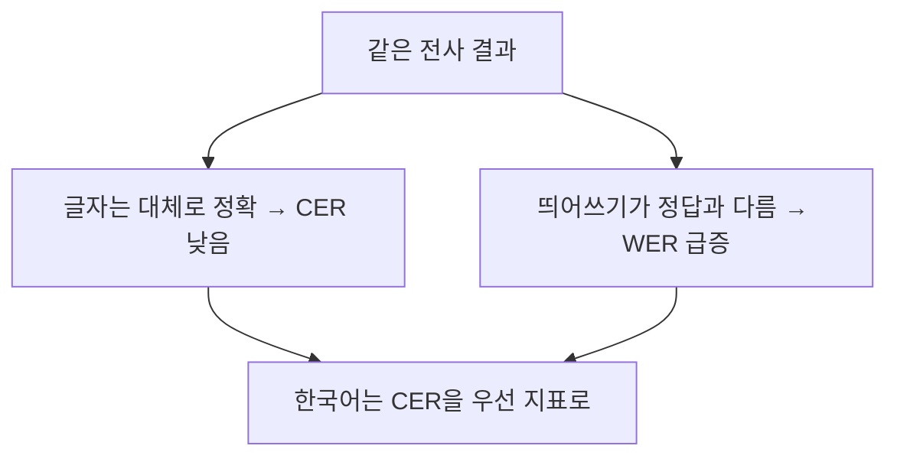

# STT 엔진 벤치마크 종합 정리 (레포 · 결과 · 해석)

> 동일한 오디오 소스를 여러 STT(음성→텍스트) 엔진에 태워 **정확도(WER/CER)**와 **속도(RTF)**로 채점한 결과를 정리한 문서다.
> 영어·한국어 두 언어를 각각 사람이 작성한 수동 자막을 정답으로 삼아 측정했다.
>
> **측정 환경**: CPU — 12th Gen Intel Core i7-12850HX (2.10 GHz) · GPU — NVIDIA RTX A2000 8GB Laptop GPU.
> RTF 수치는 별도 표기가 없으면 GPU 기준이며, `(CPU)` 표기가 붙은 항목(SenseVoice-GGUF·Parakeet·Moonshine·VibeVoice-BitNet)은 위 CPU에서 측정한 값이다.

---

## 1. 사용 엔진별 관련 레포 리스트업

벤치마크에 올린 엔진은 크게 **Whisper 계열**, **Paraformer(SenseVoice) 계열**, **NVIDIA NeMo(Parakeet·Nemotron)**, **Moonshine**, **LLM 기반 ASR** 다섯 갈래다. `관련 레포` 열은 두 가지를 담는다 — **앞줄**은 엔진 자체의 레포(모델·연구 **원본 개발 레포** 또는 그 모델을 돌리는 **런타임 구현 레포**), **뒷줄 `채택 앱`**은 그 엔진을 실제로 갖다 쓴 다운스트림 앱(실시간 자막·후처리 참조로 조사한 6종 중 해당 엔진 사용 앱)이다.

| 엔진 | 계열 | 관련 레포 | 지원 언어 | 특징 |
|---|---|---|---|---|
| **faster-whisper** | OpenAI Whisper | [SYSTRAN/faster-whisper](https://github.com/SYSTRAN/faster-whisper) · [openai/whisper](https://github.com/openai/whisper) **채택 앱**: [WhisperLive](https://github.com/collabora/WhisperLive) · [Hearsay](https://github.com/parkscloud/Hearsay) · [meetily](https://github.com/Zackriya-Solutions/meetily) · [Handy](https://github.com/cjpais/Handy) · [speech-to-speech](https://github.com/huggingface/speech-to-speech) · [VoiceStudio](https://github.com/debpalash/VoiceStudio) | 99개 | CTranslate2 런타임으로 최적화된 Whisper 표준 구현. 다국어에 강건 |
| **SenseVoice** | Paraformer(비자기회귀) | [FunAudioLLM/SenseVoice](https://github.com/FunAudioLLM/SenseVoice) · [modelscope/FunASR](https://github.com/modelscope/FunASR) **채택 앱**: [speech-to-speech](https://github.com/huggingface/speech-to-speech) · [VoiceStudio](https://github.com/debpalash/VoiceStudio) | 50+ (ko/en/zh/ja/yue) | 비자기회귀 구조로 매우 빠름. 중국어 중심 다국어 모델 |
| **SenseVoice-GGUF** | SenseVoice(동일 모델/다른 런타임) | llama.cpp 기반 GGUF 런타임 | 50+ | SenseVoice와 같은 모델을 CPU에서 구동하는 경량 런타임(Q8 양자화) |
| **Parakeet** | NVIDIA NeMo FastConformer-TDT | [NVIDIA/NeMo](https://github.com/NVIDIA/NeMo) · [istupakov/onnx-asr](https://github.com/istupakov/onnx-asr)(런타임) **채택 앱**: [meetily](https://github.com/Zackriya-Solutions/meetily) · [Handy](https://github.com/cjpais/Handy) · [speech-to-speech](https://github.com/huggingface/speech-to-speech) · [VoiceStudio](https://github.com/debpalash/VoiceStudio) | 영어 + 유럽어 25종 (**한국어 미지원**) | 속도를 앞세운 다국어 ASR. CPU 효율이 좋아 관련 앱에 다수 채택 |
| **Moonshine** | Useful Sensors Moonshine | [usefulsensors/moonshine](https://github.com/usefulsensors/moonshine) **채택 앱**: [VoiceStudio](https://github.com/debpalash/VoiceStudio) | 영어 전용 | 저전력·저지연 ONNX 단문형 모델. 임베디드/온디바이스 지향. CPU효율 좋음 |
| **MOSS** | LLM 기반 ASR | [OpenMOSS/MOSS-Transcribe-Diarize](https://github.com/OpenMOSS/MOSS-Transcribe-Diarize) | 50+ | Whisper 인코더 + 소형 LLM 디코더. 화자 분리(diarization) 지원 |
| **Qwen3-ASR** | LLM 기반 ASR | [QwenLM/Qwen3-ASR](https://github.com/QwenLM/Qwen3-ASR) | 52개 (ko/en 포함) | Qwen3 LLM 백본 기반 전사 모델. 0.6B/1.7B 두 크기로 채점(같은 레포의 ForcedAligner-0.6B는 정답 텍스트→오디오 타임스탬프 정렬 전용이라 전사 채점 대상 아님). 한국어 파인튜닝(TeamUNIVA/qwen3_asr_1.7b_ko_beta)도 함께 채점 |
| **Granite-Speech** | LLM 기반 ASR | [ibm-granite/granite-speech-models](https://github.com/ibm-granite/granite-speech-models) | 영어 + 유럽어 5종 (**한국어 미지원**) | IBM Granite-Speech 3.3 — Whisper 인코더 + Granite LLM 의 2-pass 구조. transformers 로 GPU 구동(peft 필요) |
| **NeMo (2026)** | NVIDIA NeMo FastConformer/RNNT | [NVIDIA/NeMo](https://github.com/NVIDIA/NeMo) | 영어 전용 2종 + 40개(ko 포함, Nemotron-3.5) | 2026년 NeMo 신모델 3종 — Parakeet-Unified·Nemotron-Speech(영어), Nemotron-3.5(다국어, `prompt` 로 언어 지정). 위 onnx Parakeet(v3)와 같은 NeMo 계보지만 별개 신모델이며, 전용 Python 3.12 venv 필요·600초 통짜 GPU 추론 |
| **VibeVoice-ASR** | LLM 기반 ASR | [microsoft/VibeVoice](https://github.com/microsoft/VibeVoice) · [microsoft/VibeASR.cpp](https://github.com/microsoft/VibeASR.cpp)(BitNet 런타임) | 50+ (ko/en 포함) | 연속형 음향+의미 음성 토크나이저(7.5 Hz) + Qwen2.5 LLM 디코더. ASR + 화자 분리 + 타임스탬프를 한 번에 출력하며, 언어 지정 파라미터 없음(자동 감지)·핫워드/컨텍스트 지원. 7B(4-bit, GPU)와 BitNet 1.5B(CPU, VibeASR.cpp) 두 변형으로 채점. Streaming-7B 변형은 4-bit로도 8GB GPU에 올라가지 않아 제외 |

> 6개 앱 모두 **Whisper 계열(faster-whisper / whisper.cpp / WhisperX)을 핵심·기본 엔진으로 사용**하며, 관련 앱에 반복 등장하던 **Parakeet·Moonshine**도 이번에 영어로 추가 검토했다(결과는 §2). LLM 기반 ASR 계열엔 MOSS 외에 **Qwen3-ASR**도 함께 검토했는데, Qwen3-ASR은 영어·한국어 두 언어 모두 채점했다. 여기에 더해 **NVIDIA가 2026년 공개한 NeMo 신모델 3종**(Parakeet-Unified·Nemotron-Speech·Nemotron-3.5)도 채점에 추가했다(영어 3종, 한국어는 다국어인 Nemotron-3.5만). 이어서 **IBM Granite-Speech 3.3(영어)**과 **Qwen3-ASR 한국어 파인튜닝(TeamUNIVA/qwen3_asr_1.7b_ko_beta)**도 추가 채점했다. **Deepgram**은 STT지만 유료 클라우드 API(키+인터넷 필수)라 로컬 벤치에서 제외했고, **VibeVoice**는 계열이다 — VibeVoice-TTS·VibeVoice-Realtime은 TTS라 아래 범위 밖 표에 포함했지만, **VibeVoice-ASR은 STT**라 채점했다(GPU 7B 4-bit, CPU BitNet 1.5B. Streaming-7B는 8GB VRAM에서 구동 불가). `whisper.cpp`·`WhisperX`·TensorRT·OpenVINO·`sherpa-onnx` 등은 새 엔진이 아니라 기존 모델의 **다른 런타임**이다.

### Whisper 계열에서 채점한 모델 라인업

faster-whisper 하나로 여러 크기·변형 모델을 교체하며 채점했다.

- **small / medium** — 기본 크기 라인
- **large-v3** — 풀사이즈 최신 세대
- **large-v3-turbo** — large-v3의 경량·고속 변형
- **distil-large-v3 / distil-large-v3.5** — 증류(distillation)된 초고속 변형(영어 위주)

### 참고: 조사했으나 범위 밖으로 제외한 레포 (STT 아님)

STT 후보로 함께 훑었으나 TTS·보이스클론·번역 등 **음성 인식이 아니어서** 벤치마크에서 제외한 레포들이다.

| 레포 / 이름 | 성격 |
|---|---|
| pocket-tts · dots.tts · Qwen3-TTS · kokoro · supertonic · VibeVoice-TTS · VibeVoice-Realtime | TTS (텍스트→음성) |
| VoxCPM · voicebox · Seed-VC | 음성 합성 / 보이스 클론·변환 |
| translategemma · AirTranslate · Synthalingua | 번역 / 자막 번역 파이프라인 |

---

## 2. 엔진/모델별 벤치마크 결과 (한국어 · 영어)

> 평가 구간은 두 언어 모두 **앞 10분(600초)**, 정답은 **사람이 작성한 수동 자막**이다.
> 수치는 낮을수록 좋다(WER/CER). RTF도 낮을수록 빠르다.

### 2-1. 영어 결과 (정규화 기준)

| 엔진 / 모델 | WER | CER | RTF |
|---|---|---|---|
| SenseVoice | 0.2613 | 0.0966 | **0.010** |
| SenseVoice-GGUF (CPU) | 0.2902 | 0.1269 | 0.034 |
| Parakeet · v3 (CPU) | 0.2469 | 0.1702 | 0.079 |
| Moonshine · base (CPU) | 0.1341 | 0.0816 | 0.152 |
| Qwen3-ASR · 0.6B | 0.1747 | 0.1113 | 0.159 |
| Qwen3-ASR · 1.7B | 0.1417 | 0.0981 | 0.189 |
| Qwen3-ASR · 1.7B-ko (파인튜닝) | 0.1809 | 0.1180 | 0.192 |
| Granite-Speech 3.3 · 2B | 0.1224 | 0.0896 | 0.212 |
| NeMo · Parakeet-Unified | 0.1190 | 0.0843 | 0.153 |
| NeMo · Nemotron-Speech | 0.1664 | 0.1074 | 0.146 |
| NeMo · Nemotron-3.5 | 0.1623 | 0.1001 | 0.159 |
| VibeVoice-ASR · 7B (4-bit) | 0.2325 | 0.1541 | 0.609 |
| VibeVoice-ASR-BitNet · 1.5B (CPU) | 0.2785 | 0.1797 | 0.344 |
| faster-whisper · small | 0.1774 | 0.1163 | 0.030 |
| faster-whisper · medium | 0.0908 | 0.0627 | 0.066 |
| faster-whisper · large-v3 | 0.0736 | 0.0540 | 0.377 |
| **faster-whisper · large-v3-turbo** | **0.0681** | **0.0485** | 0.128 |
| faster-whisper · large-v3-turbo (CPU) | 0.0763 | 0.0517 | 0.480 |
| faster-whisper · distil-large-v3 | 0.0901 | 0.0581 | 0.075 |
| faster-whisper · distil-large-v3.5 | 0.1919 | 0.1573 | 0.083 |

- 영어 정확도 1위는 **large-v3-turbo**로, 풀사이즈 large-v3보다도 정확하면서 약 3배 빠르다.
- **large-v3-turbo (CPU·int8)**는 GPU(FP16)와 정확도가 사실상 같다 — WER 0.0681→0.0763(약 +1%p), CER 0.0485→0.0517. 대신 RTF는 0.128→약 0.48(측정 편차 0.48~0.68)로 약 4~5배 느리다. 즉 int8 양자화는 정확도가 아니라 속도에만 주로 비용이 간다.
- **distil-large-v3**는 medium급 정확도를 최고 속도(RTF 0.075)로 내는 영어 가성비 옵션이다.
- **Moonshine(base)**는 초경량 영어 전용 모델임에도 WER 0.1341로 whisper-small(0.1774)보다 우수해, 온디바이스·저전력 영어 받아쓰기에 매력적이다.
- **Parakeet(v3)**는 WER 0.2469로 이 클립 영어에서 기대만큼 높지 않았다. 주된 원인은 v3가 **다국어 통합 모델**이라 영어 특화(v2)보다 불리한 것이며, 아래 단서의 고정창 분할 영향은 (경계가 4개뿐이라) 미미하다.
- **Qwen3-ASR(1.7B)**는 WER 0.1417로 whisper-small(0.1774)보다 낫지만 medium(0.0908)에는 못 미친다. 발화 단위(short-form) 모델이라 600초를 통짜로 넣으면 앞부분이 통째로 누락되는 등 장문 처리가 불안정해(예: 통짜 입력 시 0.6B WER이 0.4697까지 치솟음), Parakeet·Moonshine과 마찬가지로 120초 고정창으로 나눠 처리했다.
- **NeMo(2026) 3종**은 영어 WER 0.119~0.166으로, 최상위 **Parakeet-Unified(0.1190)**가 whisper-medium(0.0908)에는 못 미치지만 whisper-small(0.1774)·Qwen3-ASR·Moonshine보다 낫다. onnx Parakeet(v3)와 달리 세 모델 모두 **600초를 통짜로 GPU 추론**(청킹 없음)해 RTF도 GPU 기준이라 Whisper와 직접 비교된다. 단 Parakeet-Unified는 도입부 첫 문장을 통째로 놓쳐(약 38단어 삭제) 그만큼 손해를 봤음에도 NeMo 3종 중 1위였다.
- **Qwen3-ASR 한국어 파인튜닝(1.7b-ko)**은 영어 WER 0.1809로 base 1.7B(0.1417)보다 소폭 하락했다. 한국어 특화 학습의 대가로 영어 일반 성능이 약간 희생된 것이다.
- **Granite-Speech 3.3(2B)**는 영어 WER 0.1224로 Moonshine(0.1341)·Qwen3-ASR 1.7B(0.1417)·whisper-small(0.1774)을 웃돌고 medium(0.0908)에 근접한 강한 영어 성능이다. 단문형(short-form) 설계라 30초 고정창으로 나눠 처리했다.
- **VibeVoice-ASR**은 영어 WER 0.2325(7B, 4-bit) / 0.2785(BitNet 1.5B, CPU)로 표 하위권(SenseVoice·SenseVoice-GGUF·Parakeet보다만 앞섬)이지만, 아래 단서처럼 **verbatim(있는 그대로) 전사**라는 점을 감안해야 한다.

> **VibeVoice 단서 (verbatim 전사)**: VibeVoice는 군말(filler)과 반복을 그대로 살리는데 정답인 TED 자막에는 이런 것이 없다(7B 영어 가설: "um" 38회, "uh" 45회 / 정답: 0회). 7B 영어 채점지 기준 대체(substitution)는 56건뿐이고 삽입(insertion)이 275건으로, 오류 대부분이 삽입이다. 보조 확인으로 가설에서 um/uh만 제거하고 나머지 정규화·채점을 동일하게 적용하면 7B WER 0.2325→0.1768, CER 0.1541→0.1234, BitNet WER 0.2785→0.2221, CER 0.1797→0.1487이다. 표의 수치는 다른 모든 엔진과 같은 프로토콜의 무수정 값을 유지한다.

> **측정 단서(공정성)**:
> - **평가 구간은 동일하다.** 모든 엔진이 같은 600초(앞 10분) 클립을 채점하므로 이 부분은 공정하다.
> - **엔진 내부 분할 방식은 다르다.** 이전 엔진들은 침묵 경계에서 자르는 **VAD 분할**을 쓴다(faster-whisper=Silero VAD, SenseVoice·GGUF=FSMN-VAD, 최대 30초 캡). 반면 신규 엔진들(Parakeet·Moonshine·Qwen3-ASR)은 **고정 시간창**으로 나눴다 — Parakeet는 장문 통짜 추론이 런타임 한계로 실패해 120초 창, Moonshine은 단문형 모델이라 30초 창을 썼다. Qwen3-ASR도 120초 창을 썼는데, 이는 런타임 한계가 아니라 **모델 자체가 발화 단위(short-form) 설계라 장문 통짜 입력 시 조용히 나쁜 결과(앞부분 누락 등)를 내는 불안정성 때문에 처음부터 의도적으로 청킹**한 것이다. 고정창은 단어 경계와 무관하게 잘리므로 WER이 다소 부풀 수 있다. 다만 Parakeet 120초 창은 경계가 약 4개뿐이라 영향이 미미하고, Moonshine 30초 창은 경계가 약 19개로 약간의 페널티가 있다. Granite-Speech도 단문형이라 Moonshine과 동일한 30초 창, Qwen3-ASR 한국어 파인튜닝(1.7b-ko)은 base와 동일한 120초 창을 썼다.
> - **NeMo(2026) 3종은 청킹 없이 600초를 통짜로 GPU 추론**했다. 고정창 분할을 쓴 위 신규 엔진(onnx Parakeet·Moonshine·Qwen3-ASR)과 달리 경계 절단 페널티가 없고, RTF도 GPU 기준이라 Whisper와 같은 조건에서 직접 비교된다.
> - **RTF는 CPU 기준**이라(Parakeet·Moonshine·SenseVoice-GGUF는 ONNX/GGUF, VibeVoice-BitNet은 네이티브 바이너리; BitNet의 wall RTF에는 60초 청크마다 모델 로드 약 1.1초가 포함되며 로드 제외 시 0.314 / 0.393), GPU로 잰 Whisper·NeMo RTF와 직접 비교하면 안 된다. 정확도 비교의 핵심은 WER/CER이다.

### 2-2. 한국어 결과 (정규화 기준)

| 엔진 / 모델 | WER | CER | RTF |
|---|---|---|---|
| SenseVoice | 0.6946 | 0.2164 | **0.010** |
| SenseVoice-GGUF (CPU) | 0.7032 | 0.2383 | 0.034 |
| Qwen3-ASR · 0.6B | 0.3849 | 0.1773 | 0.255 |
| Qwen3-ASR · 1.7B | 0.2626 | 0.1076 | 0.314 |
| Qwen3-ASR · 1.7B-ko (파인튜닝) | 0.2164 | 0.0851 | 0.752 |
| NeMo · Nemotron-3.5 | 0.3644 | 0.1735 | 0.157 |
| VibeVoice-ASR · 7B (4-bit) | 0.3165 | 0.1279 | 0.751 |
| VibeVoice-ASR-BitNet · 1.5B (CPU) | 0.5423 | 0.2175 | 0.420 |
| faster-whisper · small | 0.2541 | 0.1022 | 0.038 |
| faster-whisper · medium | 0.2079 | 0.0918 | 0.093 |
| faster-whisper · large-v3 | 0.2207 | 0.1207 | 0.486 |
| **faster-whisper · large-v3-turbo** | **0.1865** | **0.0855** | 0.141 |
| faster-whisper · large-v3-turbo (CPU) | 0.1565 | 0.0641 | 0.941 |
| faster-whisper · distil-large-v3 | 0.9949 | 0.8459 | 0.193 |
| faster-whisper · distil-large-v3.5 | 0.9957 | 0.8592 | 0.113 |
| Parakeet · v3 | — (미지원) | — | — |
| Moonshine | — (영어 전용) | — | — |
| NeMo · Parakeet-Unified / Nemotron-Speech | — (영어 전용) | — | — |
| Granite-Speech 3.3 | — (영어 전용) | — | — |

- 한국어 정확도 1위 역시 **large-v3-turbo**로, 유일하게 medium보다 개선된 모델이다.
- **large-v3-turbo (CPU·int8)**는 한국어에서 WER 0.1565 / CER 0.0641로, GPU(FP16)의 0.1865 / 0.0855보다 오히려 낮다. 영어에선 CPU가 GPU보다 소폭 나빴던 것과 반대로, 이 클립에서는 int8 양자화 노이즈가 빔서치를 정답 방향으로 밀어낸 우연으로 보인다(일반적 경향이 아님). RTF는 0.141→0.941로 약 6.7배 느리다.
- **distil 계열은 한국어에서 사용 불가**(WER ~0.99). 영어 위주로 증류돼 다국어 능력이 제거된 탓이다.
- **SenseVoice 계열은 한국어에서 크게 뒤처진다**(WER ~0.70). 중국어 중심 다국어 모델의 한계.
- **Qwen3-ASR(1.7B)**는 WER 0.2626으로 whisper-small(0.2541)과 비슷한 수준이며, medium(0.2079)·large-v3-turbo(0.1865)에는 못 미친다.
- **Qwen3-ASR 한국어 파인튜닝(1.7b-ko)**은 한국어 WER 0.2164 / CER 0.0851로 base 1.7B(WER 0.2626 / CER 0.1076)보다 **한국어가 확실히 개선**됐다. CER 0.0851은 large-v3-turbo(0.0855)와 사실상 동률의 글자 정확도다.
- **Parakeet(v3)**는 지원 언어에 한국어가 없어(영어+유럽어 25종) 한국어 채점에서 제외했다. **Moonshine**은 영어 전용 모델이라 애초에 대상이 아니다. **Granite-Speech**도 영어+유럽어 5종만 지원해 한국어 대상에서 제외했다.
- **NeMo Nemotron-3.5**는 한국어 WER 0.3644 / CER 0.1735로, 40개 언어를 지원하는 다국어 모델치고는 준수하지만 Qwen3-ASR(1.7B)·whisper 계열에는 못 미친다. 나머지 NeMo 2종(Parakeet-Unified·Nemotron-Speech)은 영어 전용이라 한국어 대상에서 제외했다.
- **VibeVoice-ASR**은 한국어 WER 0.3165 / CER 0.1279(7B, 4-bit)로 CER은 준수하다 — Whisper 계열 전 크기와 Qwen3-ASR 1.7B에는 못 미치지만 Nemotron-3.5(0.1735)보다는 낫다. **BitNet(1.5B, CPU)**은 WER 0.5423 / CER 0.2175로 훨씬 약하다. 숫자 표기가 정답과 달라(예: "팔월" vs "8월") 띄어쓰기가 사라지는 문제가 겹쳐 WER이 부풀려졌다.

### 2-3. 속도(RTF) 요약

| 순위 | 엔진 | RTF | 실시간 대비 |
|---|---|---|---|
| 1 | SenseVoice | 0.010 | 약 100배 빠름 |
| 2 | faster-whisper (small~turbo) | 0.03~0.14 | 약 7~33배 빠름 |
| 3 | faster-whisper large-v3 | 0.38~0.49 | 약 2~3배 빠름 |
| — | MOSS | 0.33+ | 짧은 클립 약 3배, 장문에서 급격히 저하 |
| — | VibeVoice-ASR 7B (4-bit, GPU) | 0.61~0.75 | 약 1.3~1.6배 빠름 |
| — | VibeVoice-ASR-BitNet (CPU, 8스레드) | 0.34~0.42 | 약 2.4~2.9배 빠름 (CPU에서 실시간 가능) |

> MOSS는 자기회귀 디코딩 병목으로 장문 전사 시 속도가 급격히 떨어져 연속 라이브 캡션에는 부적합하다.

### 2-4. 실행 환경별 특성 (스트리밍 적합도 · CPU · GPU 하드웨어 호환성)

> 정확도·속도(§2-1~2-3)와 별개로, 각 엔진을 **어디서(어떤 하드웨어) 돌릴 수 있는지**를 이 레포 어댑터가 실제로 쓰는 런타임 기준으로 정리한다.
> - **스트리밍 적합도**는 처리량(RTF)이 아니라 *말하는 도중 낮은 지연으로 결과를 내는* 온라인/스트리밍 아키텍처 지원 여부다. 본 벤치는 전부 오프라인 배치로 측정했으므로 이 열은 아키텍처 잠재력 기준이다.
> - **GPU 하드웨어**의 "NVIDIA만"은 런타임이 CUDA 전용이라 AMD·Apple·Intel GPU로는 가속이 안 된다는 뜻이다.

| 엔진 / 모델 | 런타임(백엔드) | 스트리밍 적합도 | CPU 지원 | GPU 하드웨어 호환성 | 컨텍스트/핫워드 | 언어 auto 감지 |
|---|---|---|---|---|---|---|
| **faster-whisper** | CTranslate2 | 부적합 (오프라인 배치, Silero VAD) | 지원 (int8 최적화) | **NVIDIA만** — CTranslate2가 CUDA/cuDNN 전용 | 지원 (initial_prompt·hotwords·prefix, 단 어댑터 미전달) | 지원 (language=None, 첫 30초 창 1회) |
| **SenseVoice** | PyTorch (FunASR) | 준적합 (비자기회귀·짧은 청크 지연) | 지원 | NVIDIA — 어댑터가 cuda/cpu 고정 (torch라 ROCm/MPS는 이론상) | 미지원 (SenseVoice에 hotword 인자 없음) | 지원 (language="auto", 세그먼트별 LID 태그) |
| **SenseVoice-GGUF** | ggml / llama.cpp (네이티브 바이너리) | 준적합 (동일 모델, subprocess라 배치 성향) | 지원 (**CPU 전용**) | 없음 — 배포 바이너리가 CPU 빌드 (ggml 재빌드 시 Metal/CUDA/Vulkan 무관) | 미지원 (경량 CLI, 바이어싱 API 없음) | 지원 (SenseVoice 모델 내장 LID) |
| **Parakeet** | onnxruntime | 준적합 (FastConformer 계열, onnx 경로는 오프라인) | 지원 (이 레포 CPU 구동) | **벤더 유연** — 이 레포는 CPU, onnxruntime-gpu(CUDA)·DirectML(AMD/Intel)·CoreML 가능 | 미지원 (onnx 텍스트 힌트 경로 없음) | 지원 (다국어 내부 인식, 언어 인자 없음·한국어 범위 밖) |
| **Moonshine** | onnxruntime (기본) / transformers (폴백) | 적합 (저지연 온디바이스 설계) | 지원 (onnx 경로) | onnx=CPU/DirectML 유연, transformers 폴백은 NVIDIA(device=0) | 미지원 | 해당없음 (영어 전용) |
| **MOSS** | PyTorch (transformers) | 부적합 (자기회귀 디코딩 병목, 장문 급저하) | 가능하나 비권장 (float32) | NVIDIA — cuda면 bf16, 아니면 cpu | 프롬프트 가능 (Qwen3 LLM 디코더, 어댑터 미노출) | 지원 (다국어, Whisper 인코더 기반·언어 미지정) |
| **Qwen3-ASR** | PyTorch (transformers, bf16) | 부적합 (발화 단위 배치·LLM) | 가능하나 비권장 (bf16 LLM) | NVIDIA — cuda:0/bf16 | 지원 (context 자유 텍스트, 단 어댑터 미전달) | 모델 지원·어댑터 고정 (어댑터가 언어 명시) |
| **NeMo (2026)** | NVIDIA NeMo (torch) | **적합** (nemotron 체크포인트가 streaming 변형·cache-aware) | 가능하나 비실용 (GPU 전제) | **NVIDIA만** — NeMo가 CUDA 생태계 | 제한적 (prompt는 로케일 지정용, 어휘 부스팅 아님) | 미지원 (nemotron-3.5는 prompt로 언어 지정, 나머지 영어 전용) |
| **Granite-Speech** | PyTorch (transformers, bf16 + peft) | 부적합 (LLM 2-pass·30초 배치) | 가능하나 비권장 (bf16 2-pass) | NVIDIA — cuda:0/bf16 | 프롬프트 가능 (LLM 디코더 apply_chat_template) | 해당없음 (영어+EU 5종, 자동감지 인자 없음) |
| **VibeVoice-ASR** | PyTorch (transformers ≥5.3, bitsandbytes nf4) · BitNet 변형: VibeASR.cpp (네이티브 바이너리) | 부적합 (오프라인 통짜 / 60초 청크 배치, 별도 Streaming-7B 모델은 구동 불가) | 7B: 가능하나 비실용 · BitNet: 지원 (**CPU 전용**, 8스레드 RTF 약 0.3~0.4) | NVIDIA — 7B 4-bit 최대 약 7.4GB VRAM (8GB 한계 근접), Streaming-7B는 8GB에 안 올라감, BitNet은 GPU 경로 없음 | 지원 (핫워드/컨텍스트, 단 어댑터 미전달) | 지원 (언어 파라미터 없음, 자동 감지) |

**해설**

- **"NVIDIA만"의 진짜 의미** — faster-whisper(CTranslate2)와 NeMo는 런타임 자체가 CUDA/cuDNN에 묶여 있어 AMD·Apple·Intel GPU로는 GPU 가속이 안 된다. torch 기반(SenseVoice·MOSS·Qwen3·Granite)은 이론상 ROCm(AMD)·MPS(Apple)도 가능하지만, 이 레포 어댑터가 `cuda:0`/`cpu`로만 분기해 실질적으로 NVIDIA 전용이다.
- **가장 하드웨어-유연한 축은 onnx 계열** — Parakeet·Moonshine이 쓰는 onnxruntime은 CPU 외에 DirectML(모든 DX12 GPU: AMD·Intel 포함)·CoreML(Apple)·CUDA로 실행 프로바이더만 바꾸면 된다. 단 이 레포는 둘 다 CPU로 돌렸다(그래서 §2 RTF에 `(CPU)` 표기가 붙었다).
- **GGUF는 CPU 전용으로 배포** — SenseVoice-GGUF는 사전 빌드된 `llama-funasr-sensevoice.exe`를 subprocess로 CPU 호출한다. ggml 자체는 Metal·CUDA·Vulkan 백엔드로 재빌드하면 GPU도 되지만, 현재 확보한 자산은 CPU 빌드다.
- **CPU 지원 "지원" vs "가능하나 비권장"** — "지원"은 CPU에서 실용 속도가 나오는 경우(faster-whisper int8, SenseVoice, onnx 계열, GGUF)다. "가능하나 비권장"(MOSS·Qwen3·NeMo·Granite)은 코드상 CPU 분기는 있으나 bf16 LLM·NeMo처럼 GPU를 전제해 CPU로는 매우 느리거나 비실용적이다.
- **스트리밍 적합도는 아키텍처 기준** — 적합(Moonshine·NeMo streaming 변형)은 온라인/저지연 설계, 준적합(SenseVoice·Parakeet)은 비자기회귀나 청크로 유사 스트리밍이 가능한 정도, 부적합(faster-whisper·MOSS·Qwen3·Granite)은 발화/청크 배치 모델이다. 본 벤치의 RTF는 전부 오프라인 배치 측정치라 스트리밍 지연을 직접 잰 값이 아니다.
- **컨텍스트/핫워드 네이티브 지원은 둘뿐** — 전용 인자를 가진 건 Qwen3-ASR(`context` 자유 텍스트)와 faster-whisper(`initial_prompt`·`hotwords`·`prefix`)다. 다만 현재 두 어댑터 모두 이 인자를 넘기지 않으므로, 쓰려면 파라미터 통로만 추가하면 된다. granite-speech·MOSS는 LLM 디코더라 프롬프트로 문맥을 주입할 수 있으나 전용 API는 아니고, NeMo의 `prompt`는 어휘 부스팅이 아니라 로케일 지정용이다. SenseVoice·SenseVoice-GGUF·Parakeet·Moonshine은 텍스트 힌트 입력 경로 자체가 없다.
- **언어 auto 감지는 "1회 감지"가 기본** — 자동 감지를 지원해도 대개 시작(또는 세그먼트 시작)에 한 번 판정해 그 구간을 고정한다. SenseVoice는 비자기회귀+세그먼트 LID라 발화 경계 전환에 상대적으로 유연하고, faster-whisper는 첫 30초 창에서 1회 감지한다. Qwen3-ASR은 모델 자체는 다국어 자동이 가능하나 이 레포 어댑터가 언어를 명시(English/Korean)해 고정하며, NeMo(nemotron-3.5)는 자동 감지가 아니라 `prompt`로 언어를 지정하는 방식이다. 어느 경우든 한 발화 안에서 언어가 섞이면(code-switching) 그 세그먼트는 한 언어로 처리된다.
- **VibeVoice-ASR 런타임 메모** — 7B는 LM Linear에만 nf4 4-bit를 적용하며 전용 Python 3.12 venv(`.venv-vibevoice`)가 필요하고, 이 8GB GPU에서 최대 약 7.4GB VRAM을 쓴다(첫 실행은 12.5GB까지 올라 공유 메모리로 넘쳐 폐기했고, GQA-in-SDPA 경로 비활성화 + 음향 토크나이저 10초 청크 적용 후 재측정). **Streaming-7B**는 4-bit로도 8GB GPU에 올라가지 않아(모델만 7.98GB, 10분 실행 시 공유 GPU 메모리로 넘쳐 30분 이상 걸려도 끝나지 않음) "8GB VRAM에서 구동 불가"로 기록했고, 공식 저장소(transformers <5 고정)와 별도 venv `.venv-vibevoice-stream`이 필요하다. **BitNet**은 VibeASR.cpp를 MinGW-w64 GCC로 빌드(MSVC 미지원)해 CPU 8스레드·greedy·60초 청크로 구동한다(600초 단일 호출은 VAE가 약 138GB 연산 arena를 요구해 실패). 모든 변형이 화자 라벨과 타임스탬프를 함께 출력하며 언어 파라미터는 없다.

---

## 3. 벤치마크 수치 용어 설명과 최종 해석

### 3-1. 용어 설명

| 용어 | 뜻 | 해석 |
|---|---|---|
| **WER** (Word Error Rate) | 단어 오류율. 정답 대비 틀린/빠진/더해진 **단어** 비율 | 0에 가까울수록 정확. 띄어쓰기(어절 경계)에 민감 |
| **CER** (Character Error Rate) | 문자 오류율. 같은 계산을 **글자 단위**로 | 띄어쓰기 영향이 작아 한국어에서 더 신뢰할 수 있는 지표 |
| **RTF** (Real-Time Factor) | 실시간 계수 = 처리 시간 ÷ 오디오 길이 | RTF 0.1 = 10분 오디오를 1분에 처리(실시간의 10배). 낮을수록 빠름 |
| **정규화(normalized)** | 소문자화 + 문장부호·화자표시 제거 + 공백 정리 후 채점 | 표기 차이로 인한 과도한 오답을 걷어낸, 더 공정한 수치 |

### 3-2. WER과 CER이 갈리는 이유 (특히 한국어)

한국어에서 SenseVoice는 **WER은 매우 높은데 CER은 상대적으로 낮은** 괴리가 나타난다.
내용(글자)은 대체로 맞지만 **띄어쓰기(어절 경계)가 정답과 달라** 단어 단위 WER이 대량 오답 처리되기 때문이다.
띄어쓰기는 정답 자체가 주관적일 수 있으므로, **한국어 정확도는 CER을 우선 지표로 보는 것이 타당하다.**

### 3-3. 정답 품질이 수치에 미치는 영향

초기엔 YouTube 자동생성 자막을 정답으로 썼으나, 이는 STT 엔진과 **같은 계열의 ASR 오류를 공유**해 오류가 상쇄되면서 수치가 낙관적으로 낮게 나오는 편향이 있었다.
이후 정답을 **사람이 작성한 수동 자막**으로 교체하자 상쇄 효과가 사라져 WER이 소폭 상승했고, 이것이 더 정직한 절대 정확도다. **본 문서의 결과는 모두 수동 자막 기준이다.**

### 3-4. 핵심 경향 정리

1. **모델을 키우면 정확도가 오르지만, 이득은 언어마다 다르다.** small→medium에서 영어 WER은 거의 절반으로 줄지만(학습 데이터에 영어 비중이 큼), 한국어 개선폭은 작다.
2. **더 크다고 항상 좋은 건 아니다.** 풀사이즈 large-v3보다 경량 변형 **large-v3-turbo**가 양 언어 모두에서 더 정확하고 훨씬 빨랐다.
3. **속도-정확도는 대체로 트레이드오프**지만, turbo·distil 같은 최적화 변형은 이 곡선을 유리하게 당긴다.
4. **다국어 강건성이 중요하다.** Whisper 계열은 언어를 바꿔도 완만하게 열화하지만, 영어에 특화된(distil) 또는 중국어 중심(SenseVoice) 모델은 한국어에서 급격히 무너진다.
5. **verbatim 전사 모델은 군말 때문에 손해를 본다.** VibeVoice-ASR은 정답에 없는 "um"/"uh"와 반복을 그대로 살려, 영어 WER(0.2325)이 실제 내용 오류(um/uh 제거 시 0.1768)보다 과대 표시된다. 공식 표는 무수정 수치를 유지한다. 또한 화자 분리·타임스탬프를 함께 내는데, 이 레포의 Whisper 계열 어댑터는 그렇지 않다.
6. **VibeVoice-BitNet은 CPU 실시간이 가능한 선택지**(8스레드 RTF 약 0.3~0.4)이나 영어 정확도는 보통(WER 0.2785), 한국어는 약하다(WER 0.5423). 8GB GPU에서 7B 4-bit는 겨우 들어간다(약 7.4GB).

### 3-5. 최종 결과 해석 및 추천

| 상황 | 추천 |
|---|---|
| 영어 정확도 최우선 | **large-v3-turbo** (WER 0.0681, large-v3보다도 정확) |
| 영어 최고속(정확도 타협 적음) | **distil-large-v3** (RTF 0.075, WER ≈ medium) |
| 영어 온디바이스·초경량 CPU | **Moonshine** (WER 0.1341, whisper-small보다 우수한 초경량 영어 모델) |
| 영어 GPU·통짜 추론(청킹 불필요) | **NeMo Parakeet-Unified** (WER 0.1190, 600초 통짜 GPU 추론) |
| 영어 GPU·단문형(LLM 2-pass) | **Granite-Speech 3.3 (2B)** (WER 0.1224, whisper-small·Moonshine 능가) |
| 한국어 정확도 최우선 | **large-v3-turbo** (WER 0.1865 / CER 0.0855) |
| 한국어 오픈소스 파인튜닝 대안 | **Qwen3-ASR 1.7b-ko** (WER 0.2164, base 1.7B 대비 개선) |
| 최저 지연·초경량(정확도 양보) | **SenseVoice** (RTF 0.010, 단 한국어는 부정확) |
| CPU 전용 환경 | **SenseVoice-GGUF**(다국어) / **Moonshine**(영어) |
| 한국어에 Parakeet·Moonshine·distil | 금지 (Parakeet·Moonshine 한국어 미지원, distil WER ~0.99) |
| 라이브 캡션 종합 추천 | **large-v3-turbo** (양 언어 최고 정확도 + RTF<0.15 여유) |

**종합**: 정확도·속도의 균형점은 대부분의 상황에서 **faster-whisper의 large-v3-turbo**다.
극단적 저지연이 필요하면 SenseVoice, GPU가 없으면 SenseVoice-GGUF, 화자 분리가 필요하면 MOSS(장문·라이브 부적합)를 고려한다.
**영어 전용 온디바이스**라면 초경량 **Moonshine**이 whisper-small을 웃도는 정확도로 좋은 선택지다.
distil 계열·Parakeet·Moonshine은 **영어에서만** 쓰고 한국어에는 쓰지 않는다.

> 수치는 특정 오디오 클립(영어 TED 강연 / 한국어 시사 영상) 기준의 상대 비교이며, 도메인·화자·녹음 품질에 따라 달라질 수 있다.
