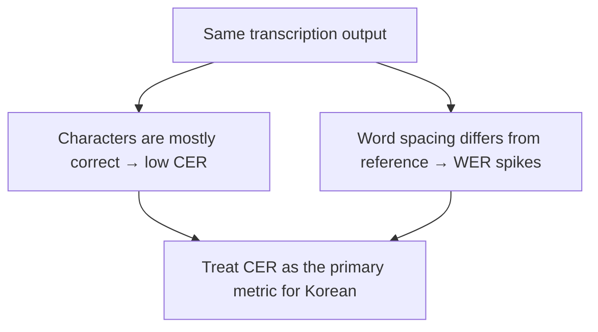

# STT Engine Benchmark — Summary (Repos · Results · Interpretation)

> This document summarizes results from running the same audio sources through multiple STT (speech-to-text) engines and scoring them on **accuracy (WER/CER)** and **speed (RTF)**.
> Both English and Korean were measured against human-written manual subtitles as the reference.
>
> **Measurement environment**: CPU — 12th Gen Intel Core i7-12850HX (2.10 GHz) · GPU — NVIDIA RTX A2000 8GB Laptop GPU.
> RTF figures are GPU-based unless noted otherwise; items marked `(CPU)` (SenseVoice-GGUF · Parakeet · Moonshine) were measured on the CPU above.

---

## 1. Related repos by engine used

The engines included in the benchmark fall into five broad families: **Whisper family**, **Paraformer (SenseVoice) family**, **NVIDIA NeMo (Parakeet · Nemotron)**, **Moonshine**, and **LLM-based ASR**. The `Related repos` column holds two things — the **first line** is the engine's own repo (either the **original research/development repo** for the model, or a **runtime implementation repo** that runs that model), and the **second line, `Adopting apps`**, lists the downstream apps that actually use that engine (drawn from a survey of 6 apps used as references for real-time captioning/post-processing, filtered to those using the given engine).

| Engine | Family | Related repos | Supported languages | Notes |
|---|---|---|---|---|
| **faster-whisper** | OpenAI Whisper | [SYSTRAN/faster-whisper](https://github.com/SYSTRAN/faster-whisper) · [openai/whisper](https://github.com/openai/whisper) **Adopting apps**: [WhisperLive](https://github.com/collabora/WhisperLive) · [Hearsay](https://github.com/parkscloud/Hearsay) · [meetily](https://github.com/Zackriya-Solutions/meetily) · [Handy](https://github.com/cjpais/Handy) · [speech-to-speech](https://github.com/huggingface/speech-to-speech) · [VoiceStudio](https://github.com/debpalash/VoiceStudio) | 99 | Standard Whisper implementation optimized with the CTranslate2 runtime. Robust across languages |
| **SenseVoice** | Paraformer (non-autoregressive) | [FunAudioLLM/SenseVoice](https://github.com/FunAudioLLM/SenseVoice) · [modelscope/FunASR](https://github.com/modelscope/FunASR) **Adopting apps**: [speech-to-speech](https://github.com/huggingface/speech-to-speech) · [VoiceStudio](https://github.com/debpalash/VoiceStudio) | 50+ (ko/en/zh/ja/yue) | Very fast thanks to its non-autoregressive architecture. A multilingual model with a Chinese-centric focus |
| **SenseVoice-GGUF** | SenseVoice (same model, different runtime) | llama.cpp-based GGUF runtime | 50+ | A lightweight runtime that runs the same SenseVoice model on CPU (Q8 quantization) |
| **Parakeet** | NVIDIA NeMo FastConformer-TDT | [NVIDIA/NeMo](https://github.com/NVIDIA/NeMo) · [istupakov/onnx-asr](https://github.com/istupakov/onnx-asr) (runtime) **Adopting apps**: [meetily](https://github.com/Zackriya-Solutions/meetily) · [Handy](https://github.com/cjpais/Handy) · [speech-to-speech](https://github.com/huggingface/speech-to-speech) · [VoiceStudio](https://github.com/debpalash/VoiceStudio) | English + 25 European languages (**Korean not supported**) | A speed-first multilingual ASR model. Good CPU efficiency has made it a popular choice among related apps |
| **Moonshine** | Useful Sensors Moonshine | [usefulsensors/moonshine](https://github.com/usefulsensors/moonshine) **Adopting apps**: [VoiceStudio](https://github.com/debpalash/VoiceStudio) | English only | Low-power, low-latency ONNX short-form model. Aimed at embedded/on-device use. Good CPU efficiency |
| **MOSS** | LLM-based ASR | [OpenMOSS/MOSS-Transcribe-Diarize](https://github.com/OpenMOSS/MOSS-Transcribe-Diarize) | 50+ | A Whisper encoder paired with a small LLM decoder. Supports speaker diarization |
| **Qwen3-ASR** | LLM-based ASR | [QwenLM/Qwen3-ASR](https://github.com/QwenLM/Qwen3-ASR) | 52 (incl. ko/en) | A transcription model built on the Qwen3 LLM backbone. Scored at two sizes, 0.6B/1.7B (the same repo's ForcedAligner-0.6B is excluded from transcription scoring, since it only aligns existing text to audio timestamps rather than transcribing). A Korean fine-tune (TeamUNIVA/qwen3_asr_1.7b_ko_beta) was also scored |
| **Granite-Speech** | LLM-based ASR | [ibm-granite/granite-speech-models](https://github.com/ibm-granite/granite-speech-models) | English + 5 European (**no Korean**) | IBM Granite-Speech 3.3 — a two-pass Whisper-encoder + Granite-LLM design. Runs on GPU via transformers (needs `peft`) |
| **NeMo (2026)** | NVIDIA NeMo FastConformer/RNNT | [NVIDIA/NeMo](https://github.com/NVIDIA/NeMo) | 2 English-only + 40 (incl. ko, Nemotron-3.5) | Three new 2026 NeMo models — Parakeet-Unified · Nemotron-Speech (English), Nemotron-3.5 (multilingual, language set via `prompt`). Same NeMo lineage as the onnx Parakeet (v3) above but distinct new models; needs a dedicated Python-3.12 venv and runs whole-clip (600s) GPU inference |

> All 6 apps surveyed use a **Whisper-family engine (faster-whisper / whisper.cpp / WhisperX) as their core, default engine**, and **Parakeet · Moonshine**, which kept recurring across those apps, were additionally evaluated here for English (results in §2). Within the LLM-based ASR family, **Qwen3-ASR** was evaluated alongside MOSS, and Qwen3-ASR was scored for both English and Korean. In addition, **three new NeMo models NVIDIA released in 2026** (Parakeet-Unified · Nemotron-Speech · Nemotron-3.5) were added to the scoring (all three for English; for Korean, only the multilingual Nemotron-3.5). On top of that, **IBM Granite-Speech 3.3 (English)** and a **Qwen3-ASR Korean fine-tune (TeamUNIVA/qwen3_asr_1.7b_ko_beta)** were also scored. **Deepgram** is STT but a paid cloud API (key + internet required), so it was excluded from local benchmarking; **VibeVoice** is TTS and appears in the out-of-scope table below. `whisper.cpp`, `WhisperX`, TensorRT, OpenVINO, `sherpa-onnx`, etc. are not new engines but rather **different runtimes** for existing models.

### Model lineup scored within the Whisper family

A single engine, faster-whisper, was scored across several model sizes/variants.

- **small / medium** — the base-size tier
- **large-v3** — the latest full-size generation
- **large-v3-turbo** — a lighter, faster variant of large-v3
- **distil-large-v3 / distil-large-v3.5** — distilled, ultra-fast variants (English-focused)

### Reference: repos reviewed but excluded as out of scope (not STT)

These repos were reviewed as STT candidates but excluded from the benchmark because they are **not speech recognition** — they're TTS, voice cloning, or translation.

| Repo / name | Nature |
|---|---|
| pocket-tts · dots.tts · Qwen3-TTS · kokoro · supertonic · VibeVoice | TTS (text-to-speech) |
| VoxCPM · voicebox · Seed-VC | Speech synthesis / voice cloning-conversion |
| translategemma · AirTranslate · Synthalingua | Translation / subtitle translation pipelines |

---

## 2. Benchmark results by engine/model (Korean · English)

> The evaluation window for both languages is the **first 10 minutes (600 seconds)**, scored against **human-written manual subtitles** as the reference.
> Lower is better for WER/CER. Lower RTF is also faster.

### 2-1. English results (normalized)

| Engine / model | WER | CER | RTF |
|---|---|---|---|
| SenseVoice | 0.2613 | 0.0966 | **0.010** |
| SenseVoice-GGUF (CPU) | 0.2902 | 0.1269 | 0.034 |
| Parakeet · v3 (CPU) | 0.2469 | 0.1702 | 0.079 |
| Moonshine · base (CPU) | 0.1341 | 0.0816 | 0.152 |
| Qwen3-ASR · 0.6B | 0.1747 | 0.1113 | 0.159 |
| Qwen3-ASR · 1.7B | 0.1417 | 0.0981 | 0.189 |
| Qwen3-ASR · 1.7B-ko (fine-tune) | 0.1809 | 0.1180 | 0.192 |
| Granite-Speech 3.3 · 2B | 0.1224 | 0.0896 | 0.212 |
| NeMo · Parakeet-Unified | 0.1190 | 0.0843 | 0.153 |
| NeMo · Nemotron-Speech | 0.1664 | 0.1074 | 0.146 |
| NeMo · Nemotron-3.5 | 0.1623 | 0.1001 | 0.159 |
| faster-whisper · small | 0.1774 | 0.1163 | 0.030 |
| faster-whisper · medium | 0.0908 | 0.0627 | 0.066 |
| faster-whisper · large-v3 | 0.0736 | 0.0540 | 0.377 |
| **faster-whisper · large-v3-turbo** | **0.0681** | **0.0485** | 0.128 |
| faster-whisper · distil-large-v3 | 0.0901 | 0.0581 | 0.075 |
| faster-whisper · distil-large-v3.5 | 0.1919 | 0.1573 | 0.083 |

- The top English accuracy is **large-v3-turbo**, which is both more accurate than the full-size large-v3 and about 3x faster.
- **distil-large-v3** delivers medium-level accuracy at the highest speed (RTF 0.075), making it the best-value option for English.
- **Moonshine (base)** is an ultra-lightweight English-only model, yet its WER of 0.1341 beats whisper-small (0.1774) — making it attractive for on-device, low-power English dictation.
- **Parakeet (v3)** came in lower than expected on this clip's English, at WER 0.2469. The main reason is that v3 is a **unified multilingual model**, putting it at a disadvantage versus an English-specialized variant (v2); the fixed-window chunking effect noted below is minimal (only about 4 boundaries).
- **Qwen3-ASR (1.7B)** posts a WER of 0.1417, beating whisper-small (0.1774) but falling short of medium (0.0908). It's a short-form model, so feeding it the full 600 seconds unchunked caused unstable long-form behavior — including entirely dropping the leading portion (e.g., unchunked input pushed the 0.6B WER up to 0.4697) — so, like Parakeet and Moonshine, it was chunked into fixed 120-second windows.
- **The three NeMo (2026) models** land at English WER 0.119–0.166, with the best, **Parakeet-Unified (0.1190)**, falling short of whisper-medium (0.0908) but beating whisper-small (0.1774), Qwen3-ASR, and Moonshine. Unlike the onnx Parakeet (v3), all three run **whole-clip GPU inference over the full 600 seconds** (no chunking), so their RTF is GPU-based and directly comparable to Whisper. Notably, Parakeet-Unified missed the entire opening sentence (~38 word deletions) yet still ranked first among the three NeMo models.
- **Qwen3-ASR Korean fine-tune (1.7b-ko)** posts an English WER of 0.1809, slightly worse than the base 1.7B (0.1417) — a small sacrifice in general English performance in exchange for the Korean specialization.
- **Granite-Speech 3.3 (2B)** posts an English WER of 0.1224, beating Moonshine (0.1341), Qwen3-ASR 1.7B (0.1417), and whisper-small (0.1774), and approaching medium (0.0908). Being short-form by design, it was chunked into fixed 30-second windows.

> **Measurement caveats (fairness)**:
> - **The evaluation window is identical.** Every engine is scored on the same 600-second (first 10 minutes) clip, so this part is fair.
> - **Internal chunking differs by engine.** The earlier engines use **VAD-based chunking** that cuts at silence boundaries (faster-whisper = Silero VAD, SenseVoice/GGUF = FSMN-VAD, capped at 30 seconds). The newly added engines (Parakeet, Moonshine, Qwen3-ASR), by contrast, use a **fixed time window** — Parakeet uses a 120-second window because full-length inference failed due to a runtime limitation, and Moonshine uses a 30-second window since it's a short-form model. Qwen3-ASR also uses a 120-second window, but for a different reason than Parakeet: rather than a runtime limitation, it's a deliberate choice made from the start, because the model itself is short-form by design and silently produces poor results (e.g., dropping the leading portion) on unchunked long-form input. Fixed windows cut without regard to word boundaries, which can inflate WER somewhat. That said, Parakeet's 120-second window has only about 4 boundaries, so the impact is minimal, while Moonshine's 30-second window has about 19 boundaries, incurring a slight penalty. Granite-Speech is also short-form and uses the same 30-second window as Moonshine; the Qwen3-ASR Korean fine-tune (1.7b-ko) uses the same 120-second window as the base model.
> - **The three NeMo (2026) models run whole-clip GPU inference over the full 600 seconds, without chunking.** Unlike the newly added engines above that use fixed windows (onnx Parakeet, Moonshine, Qwen3-ASR), they incur no boundary-cutting penalty, and their RTF is GPU-based, so it compares directly with Whisper under the same conditions.
> - **RTF is CPU (ONNX) based** for Parakeet, Moonshine, and SenseVoice-GGUF, so it should not be directly compared to the GPU-measured RTF of Whisper and NeMo. WER/CER remain the core basis for accuracy comparison.

### 2-2. Korean results (normalized)

| Engine / model | WER | CER | RTF |
|---|---|---|---|
| SenseVoice | 0.6946 | 0.2164 | **0.010** |
| SenseVoice-GGUF (CPU) | 0.7032 | 0.2383 | 0.034 |
| Qwen3-ASR · 0.6B | 0.3849 | 0.1773 | 0.255 |
| Qwen3-ASR · 1.7B | 0.2626 | 0.1076 | 0.314 |
| Qwen3-ASR · 1.7B-ko (fine-tune) | 0.2164 | 0.0851 | 0.752 |
| NeMo · Nemotron-3.5 | 0.3644 | 0.1735 | 0.157 |
| faster-whisper · small | 0.2541 | 0.1022 | 0.038 |
| faster-whisper · medium | 0.2079 | 0.0918 | 0.093 |
| faster-whisper · large-v3 | 0.2207 | 0.1207 | 0.486 |
| **faster-whisper · large-v3-turbo** | **0.1865** | **0.0855** | 0.141 |
| faster-whisper · distil-large-v3 | 0.9949 | 0.8459 | 0.193 |
| faster-whisper · distil-large-v3.5 | 0.9957 | 0.8592 | 0.113 |
| Parakeet · v3 | — (unsupported) | — | — |
| Moonshine | — (English only) | — | — |
| NeMo · Parakeet-Unified / Nemotron-Speech | — (English only) | — | — |
| Granite-Speech 3.3 | — (English only) | — | — |

- Top Korean accuracy also goes to **large-v3-turbo**, the only model that improves on medium.
- **The distil variants are unusable for Korean** (WER ~0.99). Because they were distilled with an English focus, their multilingual capability was stripped out.
- **The SenseVoice family lags far behind for Korean** (WER ~0.70) — a limitation of a Chinese-centric multilingual model.
- **Qwen3-ASR (1.7B)** posts a WER of 0.2626, roughly on par with small (0.2541), but falls short of medium (0.2079) and large-v3-turbo (0.1865).
- **Qwen3-ASR Korean fine-tune (1.7b-ko)** posts a Korean WER of 0.2164 / CER 0.0851, a clear **improvement over the base 1.7B** (WER 0.2626 / CER 0.1076) — exactly the fine-tune's purpose. Its CER of 0.0851 is effectively tied with large-v3-turbo (0.0855).
- **Parakeet (v3)** was excluded from Korean scoring because Korean isn't among its supported languages (English + 25 European languages). **Moonshine** was never a candidate to begin with, since it's English-only. **Granite-Speech** was also excluded from Korean scoring since it supports only English + 5 European languages.
- **NeMo Nemotron-3.5** posts a Korean WER of 0.3644 / CER 0.1735 — respectable for a multilingual model covering 40 languages, but short of Qwen3-ASR (1.7B) and the Whisper family. The other two NeMo models (Parakeet-Unified, Nemotron-Speech) are English-only and were excluded from Korean scoring.

### 2-3. Speed (RTF) summary

| Rank | Engine | RTF | vs. real-time |
|---|---|---|---|
| 1 | SenseVoice | 0.010 | about 100x faster |
| 2 | faster-whisper (small~turbo) | 0.03~0.14 | about 7~33x faster |
| 3 | faster-whisper large-v3 | 0.38~0.49 | about 2~3x faster |
| — | MOSS | 0.33+ | about 3x on short clips, degrades sharply on long-form |

> MOSS suffers from an autoregressive decoding bottleneck that sharply slows it down on long-form transcription, making it unsuitable for continuous live captioning.

---

## 3. Explanation of benchmark terms and final interpretation

### 3-1. Term glossary

| Term | Meaning | Interpretation |
|---|---|---|
| **WER** (Word Error Rate) | Word error rate — the proportion of **words** that are wrong/missing/inserted relative to the reference | Closer to 0 is more accurate. Sensitive to word spacing (word boundaries) |
| **CER** (Character Error Rate) | Character error rate — the same calculation done at the **character** level | Less affected by word spacing, making it a more reliable metric for Korean |
| **RTF** (Real-Time Factor) | Real-time factor = processing time ÷ audio length | RTF 0.1 = processes 10 minutes of audio in 1 minute (10x real-time). Lower is faster |
| **Normalized** | Scored after lowercasing + removing punctuation/speaker labels + cleaning up whitespace | A fairer figure with excessive false errors from notation differences stripped out |

### 3-2. Why WER and CER diverge (especially for Korean)

For Korean, SenseVoice shows a gap where **WER is very high but CER is comparatively low**.
This happens because the content (characters) is largely correct, but **word spacing (word boundaries) differs from the reference**, causing word-level WER to flag a large number of false errors.
Since the reference itself can be subjective about spacing, **it makes sense to treat CER as the primary metric for Korean accuracy.**

### 3-3. How reference quality affects the numbers

Initially, YouTube auto-generated captions were used as the reference, but since these **share the same class of ASR errors** as the STT engines being tested, errors partly canceled out, biasing the numbers to look optimistically low.
After switching the reference to **human-written manual subtitles**, that cancellation effect disappeared and WER rose somewhat — and this is the more honest, absolute accuracy figure. **All results in this document are based on manual subtitles.**

### 3-4. Key takeaways

1. **Scaling up the model improves accuracy, but the gain varies by language.** Going from small to medium roughly halves English WER (thanks to English's large share of training data), while the Korean improvement is smaller.
2. **Bigger isn't always better.** The lighter **large-v3-turbo** variant was both more accurate and much faster than the full-size large-v3 in both languages.
3. **Speed and accuracy are largely a trade-off**, but optimized variants like turbo and distil bend that curve favorably.
4. **Multilingual robustness matters.** Whisper-family models degrade gracefully across languages, but models specialized for English (distil) or centered on Chinese (SenseVoice) collapse sharply on Korean.

### 3-5. Final interpretation and recommendations

| Situation | Recommendation |
|---|---|
| English accuracy is top priority | **large-v3-turbo** (WER 0.0681, even more accurate than large-v3) |
| Fastest English (minimal accuracy trade-off) | **distil-large-v3** (RTF 0.075, WER ≈ medium) |
| English on-device / ultra-lightweight CPU | **Moonshine** (WER 0.1341, an ultra-lightweight English model that beats whisper-small) |
| English on GPU / whole-clip (no chunking needed) | **NeMo Parakeet-Unified** (WER 0.1190, whole 600s on GPU) |
| English on GPU / short-form (LLM two-pass) | **Granite-Speech 3.3 (2B)** (WER 0.1224, beats whisper-small · Moonshine) |
| Korean accuracy is top priority | **large-v3-turbo** (WER 0.1865 / CER 0.0855) |
| Korean open-source fine-tune alternative | **Qwen3-ASR 1.7b-ko** (WER 0.2164, improves on base 1.7B) |
| Lowest latency / ultra-lightweight (trading off accuracy) | **SenseVoice** (RTF 0.010, but inaccurate for Korean) |
| CPU-only environment | **SenseVoice-GGUF** (multilingual) / **Moonshine** (English) |
| Using Parakeet/Moonshine/distil for Korean | Avoid (Parakeet/Moonshine don't support Korean, distil WER ~0.99) |
| Overall recommendation for live captioning | **large-v3-turbo** (best accuracy in both languages + comfortable RTF < 0.15) |

**Overall**: The best balance of accuracy and speed, in most situations, is **faster-whisper's large-v3-turbo**.
For extreme low-latency needs, consider SenseVoice; without a GPU, consider SenseVoice-GGUF; for speaker diarization needs, consider MOSS (unsuitable for long-form/live use).
For **English-only on-device** use, the ultra-lightweight **Moonshine** is a good choice, with accuracy that surpasses whisper-small.
The distil family, Parakeet, and Moonshine should be used **for English only**, not for Korean.

> These figures are relative comparisons based on specific audio clips (an English TED talk / a Korean current-affairs video) and may vary with domain, speaker, and recording quality.
