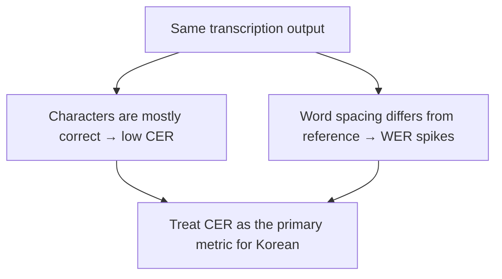

# STT Engine Benchmark — Summary (Repos · Results · Interpretation)

> This document summarizes results from running the same audio sources through multiple STT (speech-to-text) engines and scoring them on **accuracy (WER/CER)** and **speed (RTF)**.
> Both English and Korean were measured against human-written manual subtitles as the reference.
>
> **Measurement environment**: CPU — 12th Gen Intel Core i7-12850HX (2.10 GHz) · GPU — NVIDIA RTX A2000 8GB Laptop GPU.
> RTF figures are GPU-based unless noted otherwise; items marked `(CPU)` (SenseVoice-GGUF · Parakeet · Moonshine · VibeVoice-BitNet · Underdog-Bark-3.0 · faster-whisper large-v3-turbo · LFM3-Audio, English only) were measured on the CPU above.

---

## 1. Related repos by engine used

The engines included in the benchmark fall into five broad families: **Whisper family**, **Paraformer (SenseVoice) family**, **NVIDIA NeMo (Parakeet · Nemotron)**, **Moonshine**, and **LLM-based ASR**. The `Related repos` column holds two things — the **first line** is the engine's own repo (either the **original research/development repo** for the model, or a **runtime implementation repo** that runs that model), and the **second line, `Adopting apps`**, lists the downstream apps that actually use that engine (drawn from a survey of 6 apps used as references for real-time captioning/post-processing, filtered to those using the given engine).

| Engine | Family | Related repos | Supported languages | Notes |
|---|---|---|---|---|
| **faster-whisper** | OpenAI Whisper | [SYSTRAN/faster-whisper](https://github.com/SYSTRAN/faster-whisper) · [openai/whisper](https://github.com/openai/whisper) **Adopting apps**: [WhisperLive](https://github.com/collabora/WhisperLive) · [Hearsay](https://github.com/parkscloud/Hearsay) · [meetily](https://github.com/Zackriya-Solutions/meetily) · [Handy](https://github.com/cjpais/Handy) · [speech-to-speech](https://github.com/huggingface/speech-to-speech) · [VoiceStudio](https://github.com/debpalash/VoiceStudio) | 99 | Standard Whisper implementation optimized with the CTranslate2 runtime. Robust across languages |
| **SenseVoice** | Paraformer (non-autoregressive) | [FunAudioLLM/SenseVoice](https://github.com/FunAudioLLM/SenseVoice) · [modelscope/FunASR](https://github.com/modelscope/FunASR) **Adopting apps**: [speech-to-speech](https://github.com/huggingface/speech-to-speech) · [VoiceStudio](https://github.com/debpalash/VoiceStudio) | 50+ (ko/en/zh/ja/yue) | Very fast thanks to its non-autoregressive architecture. A multilingual model with a Chinese-centric focus |
| **SenseVoice-GGUF** | SenseVoice (same model, different runtime) | llama.cpp-based GGUF runtime | 50+ | A lightweight runtime that runs the same SenseVoice model on CPU (Q8 quantization) |
| **Parakeet** | NVIDIA NeMo FastConformer-TDT | [NVIDIA/NeMo](https://github.com/NVIDIA/NeMo) · [istupakov/onnx-asr](https://github.com/istupakov/onnx-asr) (runtime) **Adopting apps**: [meetily](https://github.com/Zackriya-Solutions/meetily) · [Handy](https://github.com/cjpais/Handy) · [speech-to-speech](https://github.com/huggingface/speech-to-speech) · [VoiceStudio](https://github.com/debpalash/VoiceStudio) | English + 25 European languages (**Korean not supported**) | A speed-first multilingual ASR model. Good CPU efficiency has made it a popular choice among related apps |
| **Moonshine** | Useful Sensors Moonshine | [usefulsensors/moonshine](https://github.com/usefulsensors/moonshine) **Adopting apps**: [VoiceStudio](https://github.com/debpalash/VoiceStudio) | English only | Low-power, low-latency ONNX short-form model. Aimed at embedded/on-device use. Good CPU efficiency |
| **MOSS** | LLM-based ASR | [OpenMOSS/MOSS-Transcribe-Diarize](https://github.com/OpenMOSS/MOSS-Transcribe-Diarize) | 50+ | A Whisper encoder paired with a small LLM decoder. Supports speaker diarization |
| **Qwen3-ASR** | LLM-based ASR | [QwenLM/Qwen3-ASR](https://github.com/QwenLM/Qwen3-ASR) | 52 (incl. ko/en) | A transcription model built on the Qwen3 LLM backbone. Scored at two sizes, 0.6B/1.7B (the same repo's ForcedAligner-0.6B is excluded from transcription scoring, since it only aligns existing text to audio timestamps rather than transcribing). A Korean fine-tune (TeamUNIVA/qwen3_asr_1.7b_ko_beta) was also scored |
| **Granite-Speech** | LLM-based ASR | [ibm-granite/granite-speech-models](https://github.com/ibm-granite/granite-speech-models) | English + 5 European (**no Korean**) | IBM Granite-Speech 3.3 — a two-pass Whisper-encoder + Granite-LLM design. Runs on GPU via transformers (needs `peft`) |
| **NeMo (2026)** | NVIDIA NeMo FastConformer/RNNT | [NVIDIA/NeMo](https://github.com/NVIDIA/NeMo) | 2 English-only + 40 (incl. ko, Nemotron-3.5) | Three new 2026 NeMo models — Parakeet-Unified · Nemotron-Speech (English), Nemotron-3.5 (multilingual, language set via `prompt`). Same NeMo lineage as the onnx Parakeet (v3) above but distinct new models; needs a dedicated Python-3.12 venv and runs whole-clip (600s) GPU inference |
| **VibeVoice-ASR** | LLM-based ASR | [microsoft/VibeVoice](https://github.com/microsoft/VibeVoice) · [microsoft/VibeASR.cpp](https://github.com/microsoft/VibeASR.cpp) (BitNet runtime) | 50+ (incl. ko/en) | Continuous acoustic+semantic speech tokenizers (7.5 Hz) + Qwen2.5 LLM decoder; joint ASR + speaker diarization + timestamps, no language parameter (auto-detect), hotwords/context supported. Scored as two variants — 7B (4-bit, GPU) and BitNet 1.5B (CPU, VibeASR.cpp). The Streaming-7B variant was excluded (does not fit an 8 GB GPU even in 4-bit) |
| **Underdog-Bark-3.0** | NVIDIA NeMo FastConformer-TDT fine-tune | [ConwayResearch/Underdog-Bark-3.0](https://huggingface.co/ConwayResearch/Underdog-Bark-3.0) · base [nvidia/parakeet-tdt-0.6b-v3](https://huggingface.co/nvidia/parakeet-tdt-0.6b-v3) | English only | A 0.6B English fine-tune of Parakeet-TDT-0.6B-v3. The custom ANS-compressed `model.bark` (163 MB) is unpacked with the official loader into transformers `ParakeetForTDT` (FP32); 0.25 s of leading silence is prepended per the model card. Needs a dedicated venv (`.venv-bark`, transformers ≥5.19 + constriction). License **CC-BY-NC-4.0 (non-commercial)** |
| **LFM3-Audio** | LLM-based ASR (audio LLM) | [LiquidAI/LFM3-Audio-2B](https://huggingface.co/LiquidAI/LFM3-Audio-2B) | 18 (incl. ko/en) | Any-to-any audio LLM (ASR · TTS · translation · voice chat): LFM3 backbone + causal audio encoder + LiquidCodec. Transcribes with the system prompt "Perform ASR in English./Korean."; bf16, no quantization. Needs a dedicated venv (`.venv-lfm3`, transformers ≥5.20.2). LFM Open License v1.0 |
| **Notesoop-STT-Ko** | Embedding-model-based CTC ASR | [Phsoft-ai/Notesoop-STT-Ko-v1](https://huggingface.co/Phsoft-ai/Notesoop-STT-Ko-v1) | Korean only | embeddinggemma-2 audio tower (frozen) + lightweight Conformer reader + 25k morpheme vocabulary + KenLM 3-gram beam search. Non-autoregressive; runs on the model's own 16 s windows (1 s overlap). Needs a dedicated venv (`.venv-notesoop`, Python 3.12, transformers 5.x, kenlm built from source with MinGW g++). Apache-2.0 |

> All 6 apps surveyed use a **Whisper-family engine (faster-whisper / whisper.cpp / WhisperX) as their core, default engine**, and **Parakeet · Moonshine**, which kept recurring across those apps, were additionally evaluated here for English (results in §2). Within the LLM-based ASR family, **Qwen3-ASR** was evaluated alongside MOSS, and Qwen3-ASR was scored for both English and Korean. In addition, **three new NeMo models NVIDIA released in 2026** (Parakeet-Unified · Nemotron-Speech · Nemotron-3.5) were added to the scoring (all three for English; for Korean, only the multilingual Nemotron-3.5). On top of that, **IBM Granite-Speech 3.3 (English)** and a **Qwen3-ASR Korean fine-tune (TeamUNIVA/qwen3_asr_1.7b_ko_beta)** were also scored. **Deepgram** is STT but a paid cloud API (key + internet required), so it was excluded from local benchmarking; **VibeVoice** is a family: VibeVoice-TTS · VibeVoice-Realtime are TTS and appear in the out-of-scope table below, but **VibeVoice-ASR is STT** and was scored (7B 4-bit on GPU and BitNet 1.5B on CPU; Streaming-7B was not runnable on 8 GB VRAM). **Underdog-Bark-3.0** (a Parakeet-TDT v3 fine-tune, English), **LFM3-Audio-2B** (LiquidAI audio LLM, English and Korean) and **Notesoop-STT-Ko-v1** (Korean only) were scored next. `whisper.cpp`, `WhisperX`, TensorRT, OpenVINO, `sherpa-onnx`, etc. are not new engines but rather **different runtimes** for existing models.

### Model lineup scored within the Whisper family

A single engine, faster-whisper, was scored across several model sizes/variants.

- **small / medium** — the base-size tier
- **large-v3** — the latest full-size generation
- **large-v3-turbo** — a lighter, faster variant of large-v3
- **distil-large-v3 / distil-large-v3.5** — distilled, ultra-fast variants (English-focused)

### Reference: repos reviewed but excluded as out of scope (not STT)

These repos were reviewed as STT candidates but excluded from the benchmark because they are **not speech recognition** — they're TTS, voice cloning, or translation.

| Repo / name | Nature |
|---|---|
| pocket-tts · dots.tts · Qwen3-TTS · kokoro · supertonic · VibeVoice-TTS · VibeVoice-Realtime | TTS (text-to-speech) |
| VoxCPM · voicebox · Seed-VC | Speech synthesis / voice cloning-conversion |
| translategemma · AirTranslate · Synthalingua | Translation / subtitle translation pipelines |

---

## 2. Benchmark results by engine/model (Korean · English)

> The evaluation window for both languages is the **first 10 minutes (600 seconds)**, scored against **human-written manual subtitles** as the reference.
> Lower is better for WER/CER. Lower RTF is also faster.

### 2-1. English results (normalized)

> **All engines re-measured on 2026-11-20 (2nd run, with RAM; these are the table values)** (same 600 s clips) with CPU utilization / VRAM / RAM sampling: CPU% is system-wide (psutil, all cores) and VRAM is the system-wide dedicated VRAM in use from NVML/nvidia-smi (includes the baseline held by other processes; capped by the 8 GB physical card), sampled about every 0.5 s (CPU runs about 1.2 s via nvidia-smi) during transcription only, excluding model load. Each cell is min / avg / max (CPU in %, VRAM and RAM in GB). RAM is the RSS of the measuring process plus its child processes during transcription (VibeVoice-BitNet includes the VibeASR.cpp child process). The VRAM maximum is a rough estimate of the model's minimum VRAM requirement (system-wide dedicated VRAM, including other processes' baseline), and the RAM maximum is a rough estimate of the minimum system RAM requirement (the key spec for CPU-only models). Rows with footnotes varied between measurements (history: 11-19 or earlier → 11-20 1st run → 11-20 2nd run = table value; see below the table); rows with RTF ≥ 2 (more than 2x slower than real time) were excluded.
>
> The three NeMo models recorded a torch peak of 16.0~16.9 GB allocated on the 8 GB card in the 11-20 2nd run (Nemotron-3.5 peaked at 18.65 GB in the 11-19 and 11-20 1st runs), i.e. they **spilled into shared system memory**, so their RTF is not directly comparable to the other engines. The VRAM column counts dedicated VRAM only (8 GB cap) and excludes what spilled into shared memory (torch peak 16.01 GB for Parakeet-Unified, 16.02 GB for Nemotron-Speech, 16.85 GB for Nemotron-3.5); their real requirement is about the torch peak, and on an 8 GB card they run on shared memory. The 12~14 GB of RAM seen for the NeMo models during transcription probably includes the spilled shared GPU memory (unconfirmed).

| Engine / model | WER | CER | RTF | CPU% (min/avg/max) | VRAM GB (min/avg/max) | RAM GB (min/avg/max) |
|---|---|---|---|---|---|---|
| SenseVoice | 0.2613 | 0.0966 | **0.010**¹ | 5.0 / 14.7 / 28.3 | 1.21 / 2.02 / 3.64 | 1.95 / 2.19 / 2.30 |
| SenseVoice-GGUF (CPU) | 0.2902 | 0.1269 | 0.058 | 29.2 / 41.2 / 45.5 | 0.00 / 0.00 / 0.00 | 0.54 / 0.82 / 0.84 |
| Parakeet · v3 (CPU) | 0.2469 | 0.1702 | 0.078 | 72.5 / 78.4 / 89.8 | 0.00 / 0.00 / 0.00 | 6.07 / 6.31 / 6.42 |
| Underdog-Bark-3.0 · 0.6B | 0.2270 | 0.1509 | 0.030 | 4.3 / 8.5 / 11.8 | 2.61 / 3.33 / 3.36 | 0.93 / 1.45 / 1.48 |
| Underdog-Bark-3.0 · 0.6B (CPU) | 0.2270 | 0.1509 | 0.087 | 10.7 / 40.1 / 68.4 | 0.00 / 0.00 / 0.15 | 4.54 / 5.02 / 5.14 |
| Moonshine · base (CPU) | 0.1341 | 0.0816 | 0.137 | 30.2 / 59.6 / 87.6 | 0.00 / 0.00 / 0.00 | 0.60 / 0.95 / 1.18 |
| Qwen3-ASR · 0.6B | 0.1747 | 0.1113 | 0.145² | 8.5 / 12.0 / 33.6 | 3.58 / 3.58 / 3.58 | 2.06 / 2.15 / 2.15 |
| Qwen3-ASR · 1.7B | 0.1417 | 0.0981 | 0.183 | 5.9 / 11.7 / 31.5 | 4.97 / 5.53 / 5.75 | 2.06 / 2.15 / 2.15 |
| Qwen3-ASR · 1.7B-ko (fine-tune) | 0.1809 | 0.1180 | 0.430³ | 9.2 / 12.4 / 25.5 | 4.97 / 5.53 / 5.75 | 2.06 / 2.15 / 2.16 |
| Granite-Speech 3.3 · 2B | 0.1224 | 0.0896 | 0.169 | 8.4 / 11.6 / 16.7 | 6.07 / 6.07 / 6.07 | 1.87 / 1.87 / 1.87 |
| NeMo · Parakeet-Unified (shared-memory spill) | 0.1190 | 0.0843 | 0.160 | 4.4 / 9.2 / 23.6 | 7.97 / 7.97 / 7.97 | 3.79 / 13.69 / 14.03 |
| NeMo · Nemotron-Speech (shared-memory spill) | 0.1664 | 0.1074 | 0.141 | 4.0 / 10.0 / 18.3 | 3.25 / 7.86 / 7.97 | 2.23 / 12.17 / 12.55 |
| NeMo · Nemotron-3.5 (shared-memory spill) | 0.1623 | 0.1001 | 0.145 | 4.2 / 10.2 / 17.7 | 3.25 / 7.75 / 7.98 | 2.17 / 12.20 / 12.80 |
| VibeVoice-ASR · 7B (4-bit) | 0.2318 | 0.1546 | 0.616 | 5.2 / 10.0 / 24.8 | 6.66 / 7.59 / 7.63 | 1.60 / 1.82 / 1.83 |
| VibeVoice-ASR-BitNet · 1.5B (CPU) | 0.2785 | 0.1797 | 0.429 | 12.6 / 41.0 / 53.2 | 0.00 / 0.00 / 0.15 | 0.54 / 12.15 / 13.95 |
| LFM3-Audio · 2B | 0.1107 | 0.0718 | 0.108 | 8.5 / 12.3 / 23.8 | 4.05 / 4.05 / 4.05 | 1.74 / 1.74 / 1.76 |
| LFM3-Audio · 2B (CPU) | 0.1080 | 0.0694 | 1.292 | 19.3 / 44.5 / 63.6 | 0.00 / 0.00 / 0.15 | 8.55 / 8.56 / 8.60 |
| faster-whisper · small | 0.1774 | 0.1163 | 0.030 | 8.1 / 15.7 / 31.9 | 0.78 / 0.96 / 1.02 | 1.09 / 1.12 / 1.27 |
| faster-whisper · medium | 0.0908 | 0.0627 | 0.065 | 10.3 / 14.6 / 26.0 | 2.06 / 2.38 / 2.46 | 1.05 / 1.12 / 1.25 |
| faster-whisper · large-v3 | 0.0750⁴ | 0.0554 | 0.164⁴ | 9.3 / 14.4 / 40.8 | 3.91 / 4.56 / 5.42 | 1.06 / 1.12 / 1.27 |
| **faster-whisper · large-v3-turbo** | **0.0681** | **0.0485** | 0.042⁵ | 8.9 / 13.5 / 28.5 | 2.16 / 2.38 / 2.49 | 1.06 / 1.11 / 1.24 |
| faster-whisper · large-v3-turbo (CPU) | 0.0763 | 0.0517 | 0.362 | 19.1 / 25.8 / 32.9 | 0.00 / 0.01 / 0.15 | 1.47 / 1.64 / 1.89 |
| faster-whisper · distil-large-v3 | 0.0901 | 0.0581 | 0.028⁶ | 7.5 / 14.0 / 20.6 | 2.03 / 2.23 / 2.33 | 1.06 / 1.11 / 1.26 |
| faster-whisper · distil-large-v3.5 | 0.2380⁷ | 0.1823 | 0.032⁷ | 8.5 / 12.9 / 20.6 | 2.03 / 2.25 / 2.33 | 1.06 / 1.12 / 1.22 |

> ¹ SenseVoice: RTF varied between measurements: previous 0.010 → 11-20 (1st) 0.020 → 11-20 (2nd, table value) 0.010 — machine-state difference suspected, unconfirmed.
>
> ² Qwen3-ASR · 0.6B: RTF varied between measurements: 11-19 0.151 → 11-20 (1st) 0.402 → 11-20 (2nd, table value) 0.145 — machine-state difference suspected, unconfirmed.
>
> ³ Qwen3-ASR · 1.7B-ko (fine-tune): RTF varied between measurements: 11-19 0.189 → 11-20 (1st) 0.190 → 11-20 (2nd, table value) 0.430 — machine-state difference suspected, unconfirmed.
>
> ⁴ faster-whisper · large-v3: WER norm varied between measurements: 08-22 0.0736 → 11-20 (1st) 0.1327 → 11-20 (2nd, table value) 0.0750 (CER norm 0.0540 → 0.0950 → 0.0554) — same settings, temperature-fallback nondeterminism suspected. The 11-20 (1st) run contained hallucinated segments. RTF varied between measurements: previous 0.377 → 11-20 (1st) 0.176 → 11-20 (2nd, table value) 0.164 — machine-state difference suspected, unconfirmed.
>
> ⁵ faster-whisper · large-v3-turbo: RTF varied between measurements: previous 0.128 → 11-20 (1st) 0.042 → 11-20 (2nd, table value) 0.042 — machine-state difference suspected, unconfirmed.
>
> ⁶ faster-whisper · distil-large-v3: RTF varied between measurements: previous 0.075 → 11-20 (1st) 0.027 → 11-20 (2nd, table value) 0.028 — machine-state difference suspected, unconfirmed.
>
> ⁷ faster-whisper · distil-large-v3.5: WER norm varied between measurements: previous 0.1919 → 11-20 (1st) 0.1623 → 11-20 (2nd, table value) 0.2380 (CER norm 0.1573 → 0.1133 → 0.1823) — same settings, temperature-fallback nondeterminism suspected. RTF varied between measurements: previous 0.083 → 11-20 (1st) 0.032 → 11-20 (2nd, table value) 0.032 — machine-state difference suspected, unconfirmed.

- The top English accuracy is **large-v3-turbo**, which is both more accurate than the full-size large-v3 (0.0681 vs 0.0750) and about 4x faster (RTF 0.042 vs 0.164). large-v3 is back near the top in the 2nd run, but its WER varied between measurements (08-22 0.0736 → 11-20 1st 0.1327 → 2nd 0.0750, footnote 4).
- **large-v3-turbo (CPU, int8)** holds essentially the same accuracy as GPU (FP16): WER 0.0681 → 0.0763 (~+1pp), CER 0.0485 → 0.0517. Only speed changes — RTF goes from 0.042 to 0.362 (an earlier run observed 0.48–0.68), roughly 9x slower. In short, int8 quantization costs speed, not accuracy.
- **distil-large-v3** delivers medium-level accuracy at the highest Whisper-family speed (RTF 0.028), making it the best-value option for English.
- **Moonshine (base)** is an ultra-lightweight English-only model, yet its WER of 0.1341 beats whisper-small (0.1774) — making it attractive for on-device, low-power English dictation.
- **Parakeet (v3)** came in lower than expected on this clip's English, at WER 0.2469. The main reason is that v3 is a **unified multilingual model**, putting it at a disadvantage versus an English-specialized variant (v2); the fixed-window chunking effect noted below is minimal (only about 4 boundaries).
- **Qwen3-ASR (1.7B)** posts a WER of 0.1417, beating whisper-small (0.1774) but falling short of medium (0.0908). It's a short-form model, so feeding it the full 600 seconds unchunked caused unstable long-form behavior — including entirely dropping the leading portion (e.g., unchunked input pushed the 0.6B WER up to 0.4697) — so, like Parakeet and Moonshine, it was chunked into fixed 120-second windows.
- **The three NeMo (2026) models** land at English WER 0.119–0.166, with the best, **Parakeet-Unified (0.1190)**, falling short of whisper-medium (0.0908) but beating whisper-small (0.1774), Qwen3-ASR, and Moonshine. Unlike the onnx Parakeet (v3), all three run **whole-clip GPU inference over the full 600 seconds** (no chunking), so their RTF is GPU-based, but in the 2026-11-19 and 2026-11-20 re-measurements the torch peak allocation was 16.0~16.9 GB on the 8 GB card (shared-memory spill), so the RTF (0.141–0.160) is not directly comparable to Whisper. Notably, Parakeet-Unified missed the entire opening sentence (~38 word deletions) yet still ranked first among the three NeMo models.
- **Qwen3-ASR Korean fine-tune (1.7b-ko)** posts an English WER of 0.1809, slightly worse than the base 1.7B (0.1417) — a small sacrifice in general English performance in exchange for the Korean specialization.
- **Granite-Speech 3.3 (2B)** posts an English WER of 0.1224, beating Moonshine (0.1341), Qwen3-ASR 1.7B (0.1417), and whisper-small (0.1774), and approaching medium (0.0908). Being short-form by design, it was chunked into fixed 30-second windows.
- **VibeVoice-ASR** posts English WER 0.2318 (7B, 4-bit) / 0.2785 (BitNet 1.5B, CPU) — near the bottom of the table (the 7B is ahead only of distil-large-v3.5, Parakeet, SenseVoice and SenseVoice-GGUF), but note the next remark: it transcribes **verbatim**. The BitNet RAM column (up to 13.95 GB) includes the VibeASR.cpp child process.
- **Underdog-Bark-3.0 (0.6B, English only)** posts WER 0.2270 / CER 0.1509 — about 2 points better than its base Parakeet v3 (0.2469) but far from the top of the table. GPU and CPU give identical WER/CER; only RTF differs (0.030 vs 0.087, similar to Parakeet v3 on CPU at 0.078; CPU peak RAM 5.14 GB). Its license is **CC-BY-NC-4.0 (non-commercial)**, so it cannot be used in commercial apps.
- **LFM3-Audio (2B)** posts English WER 0.1107 / CER 0.0718 (GPU), beating Granite-Speech 3.3 (0.1224), NeMo Parakeet-Unified (0.1190) and Qwen3-ASR 1.7B (0.1417), but behind large-v3-turbo (0.0681 GPU / 0.0763 CPU), large-v3 (0.0750), distil-large-v3 (0.0901) and medium (0.0908); in the 11-20 1st run large-v3 had fallen behind it at 0.1327 (footnote 4). Outside the Whisper family it is the best English row in this table. CPU (fp32) gives WER 0.1080 / CER 0.0694, effectively the same as GPU (bf16), at a peak RAM of 8.60 GB. Speeds (RTF 0.108 / CPU 1.292) were measured without the optional `causal_conv1d` kernel (PyTorch fallback), so they may be faster with it.

> **VibeVoice note (verbatim transcription)**: VibeVoice keeps fillers and repetitions, while the reference TED subtitles contain none (7B English hypothesis: 38 "um", 45 "uh"; reference: 0). In the 7B English graded output there are only 56 substitutions versus 275 insertions, i.e. most of the error is insertions. As a supplementary check on the earlier run (7B WER 0.2325 / CER 0.1541; the 11-20 re-measurement gives 0.2311 / 0.1541), with um/uh removed from the hypothesis (same normalization and scoring otherwise): 7B WER 0.2325 → 0.1768, CER 0.1541 → 0.1234; BitNet WER 0.2785 → 0.2221, CER 0.1797 → 0.1487. The table figures stay the unmodified ones (same protocol as every other engine).

> **LFM3 / Bark note (windowing)**: LFM3-Audio ran on **30 s fixed windows**. A single 600 s pass needed 13 GB VRAM and truncated the output, and 120 s windows dropped content (English WER 0.277), so window length was compared — English 60 s 0.118 / 30 s 0.111, Korean 60 s 0.459 / 30 s 0.357. The 30 s choice was **made on these same test clips**, so it may be slightly optimistic. Underdog-Bark-3.0's official figures use the same **120 s windows** as the base Parakeet entry. A single 600 s GPU pass gives a lower WER 0.1857 / CER 0.1289 but peaked at 10.18 GB and spilled into the 8 GB card's shared memory (its RTF of 0.066 is not comparable), so the table carries the 120 s-window values only.

> **Measurement caveats (fairness)**:
> - **The evaluation window is identical.** Every engine is scored on the same 600-second (first 10 minutes) clip, so this part is fair.
> - **Internal chunking differs by engine.** The earlier engines use **VAD-based chunking** that cuts at silence boundaries (faster-whisper = Silero VAD, SenseVoice/GGUF = FSMN-VAD, capped at 30 seconds). The newly added engines (Parakeet, Moonshine, Qwen3-ASR), by contrast, use a **fixed time window** — Parakeet uses a 120-second window because full-length inference failed due to a runtime limitation, and Moonshine uses a 30-second window since it's a short-form model. Qwen3-ASR also uses a 120-second window, but for a different reason than Parakeet: rather than a runtime limitation, it's a deliberate choice made from the start, because the model itself is short-form by design and silently produces poor results (e.g., dropping the leading portion) on unchunked long-form input. Fixed windows cut without regard to word boundaries, which can inflate WER somewhat. That said, Parakeet's 120-second window has only about 4 boundaries, so the impact is minimal, while Moonshine's 30-second window has about 19 boundaries, incurring a slight penalty. Granite-Speech is also short-form and uses the same 30-second window as Moonshine; the Qwen3-ASR Korean fine-tune (1.7b-ko) uses the same 120-second window as the base model.
> - **The three NeMo (2026) models run whole-clip GPU inference over the full 600 seconds, without chunking.** Unlike the newly added engines above that use fixed windows (onnx Parakeet, Moonshine, Qwen3-ASR), they incur no boundary-cutting penalty. Their RTF is GPU-based, but a torch peak allocation of 16.0~16.9 GB on the 8 GB card (2026-11-19 and 2026-11-20 re-measurements) means they spilled into shared system memory, so the RTF should be compared with caution.
> - **RTF is CPU based** for Parakeet, Moonshine, SenseVoice-GGUF (ONNX/GGUF), and VibeVoice-BitNet (native binary; its wall-clock RTF includes ~1.1 s of model load per 60-second chunk, 0.314 / 0.393 excluding load, earlier run), so it should not be directly compared to the GPU-measured RTF of Whisper and NeMo. WER/CER remain the core basis for accuracy comparison.

### 2-2. Korean results (normalized)

> Rows not tabulated: LFM3-Audio · 2B (CPU)¹⁸, Notesoop-STT-Ko-v1 (CPU)¹⁹ — excluded because RTF ≥ 2 (see footnotes below the table).

| Engine / model | WER | CER | RTF | CPU% (min/avg/max) | VRAM GB (min/avg/max) | RAM GB (min/avg/max) |
|---|---|---|---|---|---|---|
| SenseVoice | 0.6946 | 0.2164 | **0.009**⁸ | 6.4 / 16.1 / 27.6 | 1.21 / 1.73 / 2.50 | 1.95 / 2.17 / 2.29 |
| SenseVoice-GGUF (CPU) | 0.7032 | 0.2383 | 0.064 | 29.9 / 41.2 / 46.2 | 0.00 / 0.00 / 0.00 | 0.83 / 0.83 / 0.85 |
| Qwen3-ASR · 0.6B | 0.3849 | 0.1773 | 0.237 | 7.2 / 11.6 / 32.6 | 3.58 / 3.58 / 3.58 | 2.08 / 2.16 / 2.17 |
| Qwen3-ASR · 1.7B | 0.2626 | 0.1076 | 0.538 | 6.9 / 12.0 / 30.3 | 4.97 / 5.63 / 5.75 | 2.06 / 2.14 / 2.15 |
| Qwen3-ASR · 1.7B-ko (fine-tune) | 0.2164 | 0.0851 | 1.432⁹ | 6.9 / 11.6 / 24.3 | 4.97 / 5.68 / 5.81 | 2.06 / 2.13 / 2.16 |
| NeMo · Nemotron-3.5 (shared-memory spill) | 0.3644 | 0.1735 | 0.147 | 4.1 / 10.7 / 26.4 | 3.25 / 7.76 / 7.98 | 2.18 / 12.21 / 12.81 |
| VibeVoice-ASR · 7B (4-bit) | 0.3028¹⁰ | 0.1255 | 0.760 | 4.7 / 10.0 / 29.6 | 6.66 / 7.60 / 7.63 | 1.60 / 1.82 / 1.83 |
| VibeVoice-ASR-BitNet · 1.5B (CPU) | 0.5423 | 0.2175 | 0.501 | 12.4 / 40.7 / 50.5 | 0.00 / 0.00 / 0.15 | 0.54 / 12.38 / 13.95 |
| LFM3-Audio · 2B | 0.3567 | 0.1877 | 0.149¹¹ | 9.1 / 12.2 / 18.3 | 4.05 / 4.05 / 4.05 | 1.76 / 1.76 / 1.76 |
| Notesoop-STT-Ko-v1 | 0.4979 | 0.2561 | 0.026¹² | 9.4 / 27.7 / 64.8 | 1.86 / 2.38 / 2.41 | 2.14 / 2.27 / 2.28 |
| faster-whisper · small | 0.2541 | 0.1022 | 0.037 | 8.7 / 18.8 / 28.2 | 0.78 / 0.97 / 1.05 | 1.09 / 1.12 / 1.24 |
| faster-whisper · medium | 0.2079 | 0.0918 | 0.095 | 9.8 / 17.5 / 37.6 | 2.06 / 2.38 / 2.49 | 1.05 / 1.11 / 1.19 |
| faster-whisper · large-v3 | 0.2866¹³ | 0.1735 | 0.251¹³ | 8.2 / 14.8 / 31.2 | 3.91 / 4.73 / 5.42 | 1.06 / 1.12 / 1.26 |
| faster-whisper · large-v3-turbo | 0.1873¹⁴ | 0.0826 | 0.050¹⁴ | 7.7 / 14.9 / 27.2 | 2.16 / 2.40 / 2.49 | 1.06 / 1.11 / 1.22 |
| **faster-whisper · large-v3-turbo (CPU)** | **0.1591** | **0.0663** | 0.421¹⁵ | 19.5 / 26.0 / 33.8 | 0.00 / 0.00 / 0.15 | 1.52 / 1.66 / 1.89 |
| faster-whisper · distil-large-v3 | 0.9949 | 0.8412 | 0.054¹⁶ | 8.5 / 12.9 / 25.4 | 2.03 / 2.23 / 2.33 | 1.06 / 1.13 / 1.20 |
| faster-whisper · distil-large-v3.5 | 0.9991 | 0.9016 | 0.035¹⁷ | 8.6 / 12.6 / 24.6 | 2.03 / 2.24 / 2.33 | 1.06 / 1.13 / 1.23 |
| Parakeet · v3 | — (unsupported) | — | — | — | — | — |
| Moonshine | — (English only) | — | — | — | — | — |
| NeMo · Parakeet-Unified / Nemotron-Speech | — (English only) | — | — | — | — | — |
| Granite-Speech 3.3 | — (English only) | — | — | — | — | — |
| Underdog-Bark-3.0 | — (English only) | — | — | — | — | — |

> ⁸ SenseVoice: RTF varied between measurements: 11-20 (1st) 0.018 → 11-20 (2nd, table value) 0.009 — machine-state difference suspected, unconfirmed.
>
> ⁹ Qwen3-ASR · 1.7B-ko (fine-tune): RTF varied between measurements: 11-19 0.743 → 11-20 (1st) 0.735 → 11-20 (2nd, table value) 1.432 — machine-state difference suspected, unconfirmed.
>
> ¹⁰ VibeVoice-ASR · 7B (4-bit): WER norm varied between measurements: 11-20 (1st) 0.3122 → 11-20 (2nd, table value) 0.3028 (CER norm 0.1302 → 0.1255) — same settings, temperature-fallback nondeterminism suspected.
>
> ¹¹ LFM3-Audio · 2B: RTF varied between measurements: 11-19 0.145 → 11-20 (1st) 0.351 → 11-20 (2nd, table value) 0.149 — machine-state difference suspected, unconfirmed.
>
> ¹² Notesoop-STT-Ko-v1: RTF varied between measurements: 11-19 0.028 → 11-20 (1st) 0.061 → 11-20 (2nd, table value) 0.026 — machine-state difference suspected, unconfirmed.
>
> ¹³ faster-whisper · large-v3: WER norm varied between measurements: previous 0.2207 → 11-20 (1st) 0.2421 → 11-20 (2nd, table value) 0.2866 (CER norm 0.1207 → 0.1595 → 0.1735) — same settings, temperature-fallback nondeterminism suspected. RTF varied between measurements: previous 0.486 → 11-20 (1st) 0.226 → 11-20 (2nd, table value) 0.251 — machine-state difference suspected, unconfirmed.
>
> ¹⁴ faster-whisper · large-v3-turbo: WER norm varied between measurements: previous 0.1865 → 11-20 (1st) 0.1694 → 11-20 (2nd, table value) 0.1873 (CER norm 0.0855 → 0.0659 → 0.0826) — same settings, temperature-fallback nondeterminism suspected. RTF varied between measurements: previous 0.141 → 11-20 (1st) 0.052 → 11-20 (2nd, table value) 0.050 — machine-state difference suspected, unconfirmed.
>
> ¹⁵ faster-whisper · large-v3-turbo (CPU): RTF varied between measurements: previous 0.941 → 11-20 (1st) 0.395 → 11-20 (2nd, table value) 0.421 — machine-state difference suspected, unconfirmed.
>
> ¹⁶ faster-whisper · distil-large-v3: RTF varied between measurements: previous 0.193 → 11-20 (1st) 0.064 → 11-20 (2nd, table value) 0.054 — machine-state difference suspected, unconfirmed.
>
> ¹⁷ faster-whisper · distil-large-v3.5: RTF varied between measurements: previous 0.113 → 11-20 (1st) 0.043 → 11-20 (2nd, table value) 0.035 — machine-state difference suspected, unconfirmed.
>
> ¹⁸ LFM3-Audio · 2B (CPU): excluded as RTF ≥ 2 (more than 2x slower than real time) — measured RTF 2.656.
>
> ¹⁹ Notesoop-STT-Ko-v1 (CPU): excluded as RTF ≥ 2 (more than 2x slower than real time) — measured RTF 2.210 (first-pass value; the rerun was aborted).

- Top Korean accuracy also goes to **large-v3-turbo**, the only model that improves on medium (GPU WER varied between runs: 0.1694 in the 11-20 1st run → 0.1873 in the 2nd, footnote 14).
- **large-v3-turbo (CPU, int8)** scores WER 0.1591 / CER 0.0663 on Korean — lower (better) than the GPU (FP16) measurement of 0.1873 / 0.0826. Unlike English, where CPU was slightly worse, on this clip the int8 quantization noise happened to nudge beam search toward the correct tokens (a clip-specific coincidence, not a general trend). RTF is 0.050 → 0.421, about 8.4x slower (footnote 15).
- **The distil variants are unusable for Korean** (WER ~0.99). Because they were distilled with an English focus, their multilingual capability was stripped out.
- **The SenseVoice family lags far behind for Korean** (WER ~0.70) — a limitation of a Chinese-centric multilingual model.
- **Qwen3-ASR (1.7B)** posts a WER of 0.2626, roughly on par with small (0.2541), but falls short of medium (0.2079) and large-v3-turbo (0.1873 GPU).
- **Qwen3-ASR Korean fine-tune (1.7b-ko)** posts a Korean WER of 0.2164 / CER 0.0851, a clear **improvement over the base 1.7B** (WER 0.2626 / CER 0.1076) — exactly the fine-tune's purpose. Its CER of 0.0851 is behind only large-v3-turbo (0.0826 GPU / 0.0663 CPU). Its RTF of 1.432 means it ran slower than real time in the 2nd run (0.735 in the 11-20 1st run, footnote 9).
- **Parakeet (v3)** was excluded from Korean scoring because Korean isn't among its supported languages (English + 25 European languages). **Moonshine** was never a candidate to begin with, since it's English-only. **Granite-Speech** was also excluded from Korean scoring since it supports only English + 5 European languages.
- **NeMo Nemotron-3.5** posts a Korean WER of 0.3644 / CER 0.1735 — respectable for a multilingual model covering 40 languages, but short of Qwen3-ASR (1.7B) and the Whisper family. The other two NeMo models (Parakeet-Unified, Nemotron-Speech) are English-only and were excluded from Korean scoring.
- **VibeVoice-ASR** posts Korean WER 0.3028 / CER 0.1255 (7B, 4-bit; 0.3122 / 0.1302 in the 11-20 1st run, footnote 10) — the CER is decent, behind large-v3-turbo, medium, small and the Qwen3-ASR 1.7B but ahead of large-v3 (0.1735) and Nemotron-3.5 (0.1735). **BitNet (1.5B, CPU)** is much weaker at WER 0.5423 / CER 0.2175: its number formatting differs from the reference (e.g. spelled-out "팔월" vs "8월") and spacing is dropped, which inflates WER.
- **LFM3-Audio (2B)** posts Korean WER 0.3567 / CER 0.1877 (GPU) — lower-middle of the table. Its WER beats Nemotron-3.5 (0.3644) and Qwen3-ASR 0.6B (0.3849), but its CER is slightly worse than both (0.1735 / 0.1773), and it trails VibeVoice 7B (0.1255), Whisper small/medium/large-v3/turbo and Qwen3-ASR 1.7B. The CPU run (11-19: WER 0.3636 / CER 0.1918) is not tabulated: its 11-20 RTF was 2.656, i.e. excluded as RTF ≥ 2 (footnote 18). Korean was more sensitive to window length than English (30 s 0.357 vs 60 s 0.459).
- **Notesoop-STT-Ko-v1** (Korean only) posts GPU WER 0.4979 / CER 0.2561 at RTF 0.026 (about 38x real-time; 0.028 in the 11-19 run and 0.061 in the 11-20 1st run, footnote 12) — very fast but inaccurate on this clip: its CER is about 2x VibeVoice 7B and the highest in the entire Korean table (above even SenseVoice 0.2164 and SenseVoice-GGUF 0.2383). The card's lecture CER of 22.46% comes from AI Hub **lecture speech** it was trained on, whereas this clip is a stock-market commentary video, i.e. a different domain. A CPU run (11-19: WER 0.4944 / CER 0.2552, effectively the same as GPU) is not tabulated: the 11-20 first pass measured RTF 2.210 and the rerun was aborted, i.e. excluded as RTF ≥ 2 (footnote 19). GPU peak VRAM is 1.91 GB (RAM max 2.28 GB). It has no English support, so it is absent from the English table.

### 2-3. Speed (RTF) summary

| Rank | Engine | RTF | vs. real-time |
|---|---|---|---|
| 1 | SenseVoice | 0.009~0.010 | about 100x faster |
| 2 | faster-whisper (small~turbo) | 0.028~0.095 | about 10~36x faster |
| 3 | faster-whisper large-v3 | 0.16~0.25 | about 4~6x faster |
| — | MOSS | 0.33+ | about 3x on short clips, degrades sharply on long-form |
| — | VibeVoice-ASR 7B (4-bit, GPU) | 0.62~0.76 | about 1.3~1.6x faster |
| — | VibeVoice-ASR-BitNet (CPU, 8 threads) | 0.43~0.50 | about 2.0~2.3x faster (real-time-capable on CPU) |
| — | Notesoop-STT-Ko-v1 (GPU) | 0.026 | about 38x faster |
| — | Underdog-Bark-3.0 (GPU, 120 s windows) | 0.030 | about 33x faster |
| — | Underdog-Bark-3.0 (CPU) | 0.087 | about 12x faster |
| — | LFM3-Audio 2B (GPU, 30 s windows) | 0.11~0.15 | about 7~9x faster |
| — | LFM3-Audio 2B (CPU, English only) | 1.292 | about 0.8x (slower than real time) |

> MOSS suffers from an autoregressive decoding bottleneck that sharply slows it down on long-form transcription, making it unsuitable for continuous live captioning.
>
> LFM3-Audio ko CPU (RTF 2.656) and Notesoop ko CPU (RTF 2.210) are excluded because RTF ≥ 2 (footnotes 18, 19 under §2-2).

### 2-4. Runtime environment characteristics (streaming suitability · CPU · GPU hardware compatibility)

> Separately from accuracy/speed (§2-1~2-3), this summarizes **where (on what hardware) each engine can run**, based on the runtime each adapter in this repo actually uses.
> - **Streaming suitability** refers not to throughput (RTF) but to whether the architecture supports online/streaming output with *low latency while speech is ongoing*. This benchmark measured everything in offline batch mode, so this column reflects architectural potential.
> - Under **GPU hardware**, "NVIDIA only" means the runtime is CUDA-exclusive, so AMD/Apple/Intel GPUs get no acceleration.

| Engine / Model | Runtime (backend) | Streaming suitability | CPU support | GPU hardware compatibility | Context/hotword | Language auto-detect |
|---|---|---|---|---|---|---|
| **faster-whisper** | CTranslate2 | Unsuitable (offline batch, Silero VAD) | Yes (int8-optimized) | **NVIDIA only** — CTranslate2 is CUDA/cuDNN-exclusive | Yes (initial_prompt·hotwords·prefix, but adapter doesn't pass them) | Yes (language=None, once on the first 30s window) |
| **SenseVoice** | PyTorch (FunASR) | Semi-suitable (non-autoregressive, short chunk latency) | Yes | NVIDIA — adapter fixes cuda/cpu (ROCm/MPS only in theory via torch) | No (SenseVoice has no hotword argument) | Yes (language="auto", per-segment LID tag) |
| **SenseVoice-GGUF** | ggml / llama.cpp (native binary) | Semi-suitable (same model, subprocess so batch-leaning) | Yes (**CPU-only**) | None — shipped binary is a CPU build (rebuild ggml for Metal/CUDA/Vulkan = vendor-agnostic) | No (lightweight CLI, no biasing API) | Yes (SenseVoice model's built-in LID) |
| **Parakeet** | onnxruntime | Semi-suitable (FastConformer family, but the onnx path is offline) | Yes (CPU in this repo) | **Vendor-flexible** — CPU here, but onnxruntime-gpu(CUDA)·DirectML(AMD/Intel)·CoreML possible | No (no text-hint input path in onnx) | Yes (multilingual internal recognition, no language arg · Korean out of scope) |
| **Moonshine** | onnxruntime (default) / transformers (fallback) | Suitable (low-latency on-device design) | Yes (onnx path) | onnx=CPU/DirectML flexible, transformers fallback is NVIDIA (device=0) | No | N/A (English-only) |
| **MOSS** | PyTorch (transformers) | Unsuitable (autoregressive decoding bottleneck, degrades on long-form) | Possible but not recommended (float32) | NVIDIA — bf16 on cuda, else cpu | Prompt-capable (Qwen3 LLM decoder, not exposed by adapter) | Yes (multilingual, Whisper-encoder based · language unspecified) |
| **Qwen3-ASR** | PyTorch (transformers, bf16) | Unsuitable (utterance-level batch · LLM) | Possible but not recommended (bf16 LLM) | NVIDIA — cuda:0/bf16 | Yes (`context` free text, but adapter doesn't pass it) | Model supports it · adapter fixes it (adapter specifies the language) |
| **NeMo (2026)** | NVIDIA NeMo (torch) | **Suitable** (nemotron checkpoints are streaming variants · cache-aware) | Possible but impractical (assumes GPU) | **NVIDIA only** — NeMo is a CUDA ecosystem | Limited (prompt is for locale selection, not vocabulary boosting) | No (nemotron-3.5 specifies language via prompt; the others are English-only) |
| **Granite-Speech** | PyTorch (transformers, bf16 + peft) | Unsuitable (LLM 2-pass · 30s batch) | Possible but not recommended (bf16 2-pass) | NVIDIA — cuda:0/bf16 | Prompt-capable (LLM decoder apply_chat_template) | N/A (English + 5 EU languages, no auto-detect argument) |
| **VibeVoice-ASR** | PyTorch (transformers ≥5.3, bitsandbytes nf4) · BitNet variant: VibeASR.cpp (native binary) | Unsuitable (offline whole-clip / 60 s-chunk batch; the separate Streaming-7B model was not runnable) | 7B: possible but impractical · BitNet: Yes (**CPU-only**, RTF ~0.43–0.50 at 8 threads, peak RAM ~14.0 GB including the VibeASR.cpp child process) | NVIDIA — 7B 4-bit peaks at ~7.4 GB VRAM (near the 8 GB ceiling); Streaming-7B does not fit 8 GB; BitNet has no GPU path | Yes (hotwords/context supported, adapter doesn't pass them) | Yes (no language parameter, auto-detect) |
| **Underdog-Bark-3.0** | PyTorch (transformers ≥5.19 ParakeetForTDT, constriction) | Semi-suitable (FastConformer-TDT family, but this adapter does offline 120 s-window batches) | Yes (RTF ~0.09, peak RAM ~5.1 GB; CPU uses 120 s windows from the start) | NVIDIA — 120 s windows peak at ~3.3 GB VRAM (a 600 s single pass hits 10.2 GB, over the 8 GB card) | No | N/A (English only) |
| **LFM3-Audio** | PyTorch (transformers ≥5.20.2, trust_remote_code, GPU bf16 / CPU fp32) | Unsuitable (audio LLM, 30 s-window batches) | Possible but slower than real time (RTF ~1.3 on English, peak RAM ~8.6 GB; Korean 2.7, excluded) | NVIDIA — 30 s windows peak at ~4.1 GB VRAM (a 600 s single pass needs 13 GB) | Prompt-able (system prompt; the adapter only sets the language) | Model supports it, adapter fixes it (adapter names English/Korean) |
| **Notesoop-STT-Ko** | PyTorch (transformers 5.x, embedding_gemma2 + kenlm beam search) | Semi-suitable (non-autoregressive CTC, but 16 s-window batches) | Possible but slow (CPU RTF 2.2 on the first 11-20 pass, excluded; rerun aborted) | NVIDIA — peaks at ~1.9 GB VRAM (adapter is fixed to cuda/cpu) | No (KenLM 3-gram fixed, no external hint path) | N/A (Korean only) |

**Notes**

- **What "NVIDIA only" really means** — faster-whisper (CTranslate2) and NeMo are bound to CUDA/cuDNN at the runtime level, so AMD/Apple/Intel GPUs get no GPU acceleration. The torch-based ones (SenseVoice·MOSS·Qwen3·Granite) could in theory use ROCm (AMD) or MPS (Apple), but this repo's adapters branch only on `cuda:0`/`cpu`, making them effectively NVIDIA-only.
- **The most hardware-flexible axis is the onnx family** — the onnxruntime used by Parakeet·Moonshine can run on CPU plus DirectML (any DX12 GPU, incl. AMD·Intel), CoreML (Apple), or CUDA just by switching the execution provider. This repo, however, ran both on CPU (hence the `(CPU)` tags in the §2 RTF).
- **Minimum system RAM for CPU runs** — the RAM maximum in §2-1/§2-2 (RSS of the measuring process plus children, 2026-11-20 2nd run) is a rough estimate of the minimum system RAM: SenseVoice-GGUF ~0.9 GB, Moonshine ~1.2 GB, faster-whisper turbo int8 ~1.9 GB, Bark ~5.1 GB, Parakeet v3 ~6.4 GB, LFM3-Audio ~8.6 GB, VibeVoice-BitNet ~14.0 GB (including the VibeASR.cpp child process).
- **GGUF ships CPU-only** — SenseVoice-GGUF invokes the prebuilt `llama-funasr-sensevoice.exe` on CPU via subprocess. ggml itself can be rebuilt with Metal/CUDA/Vulkan backends for GPU, but the currently obtained asset is a CPU build.
- **CPU support "Yes" vs "possible but not recommended"** — "Yes" means practical speed on CPU (faster-whisper int8, SenseVoice, the onnx family, GGUF). "Possible but not recommended" (MOSS·Qwen3·NeMo·Granite) means a CPU branch exists in code, but bf16 LLMs / NeMo assume a GPU, making CPU very slow or impractical.
- **Streaming suitability is architecture-based** — suitable (Moonshine·NeMo streaming variants) are online/low-latency designs; semi-suitable (SenseVoice·Parakeet) can do pseudo-streaming via non-autoregression or chunking; unsuitable (faster-whisper·MOSS·Qwen3·Granite) are utterance/chunk batch models. This benchmark's RTF is all offline-batch measurement, not a direct measure of streaming latency. For English only, results of actually measuring streaming models with real-time playback are in §2-5.
- **Only two have native context/hotword support** — the ones with dedicated arguments are Qwen3-ASR (`context` free text) and faster-whisper (`initial_prompt`·`hotwords`·`prefix`). Note that neither adapter currently passes these, so using them just requires adding a parameter pass-through. granite-speech·MOSS are LLM decoders and can inject context via prompt, though not through a dedicated API, while NeMo's `prompt` is for locale selection rather than vocabulary boosting. SenseVoice·SenseVoice-GGUF·Parakeet·Moonshine have no text-hint input path at all.
- **Language auto-detect defaults to "detect once"** — even when auto-detection is supported, it usually decides once at the start (or the start of each segment) and locks that span. SenseVoice, being non-autoregressive with per-segment LID, is comparatively flexible at utterance-boundary switches; faster-whisper detects once on the first 30s window. Qwen3-ASR's model can auto-detect across languages, but this repo's adapter fixes the language (English/Korean); NeMo (nemotron-3.5) doesn't auto-detect but specifies the language via `prompt`. In every case, if languages are mixed within one utterance (code-switching), that segment is processed as a single language.
- **VibeVoice-ASR runtime notes** — the 7B (4-bit nf4 on the LM linears only) needs a dedicated Python-3.12 venv (`.venv-vibevoice`) and peaks at ~7.4 GB VRAM on this 8 GB GPU (a first run peaked at 12.5 GB and spilled into shared memory, so it was discarded and re-run after disabling the GQA-in-SDPA path and using a 10 s acoustic-tokenizer chunk). **Streaming-7B** does not fit an 8 GB GPU even in 4-bit (the model alone is 7.98 GB; a 10-minute run spilled into shared GPU memory and did not finish in 30+ minutes), so it is recorded as not runnable on 8 GB VRAM and needs the official repo (transformers <5 pinned, separate venv `.venv-vibevoice-stream`). **BitNet** runs on CPU via a MinGW-w64 GCC build of VibeASR.cpp (MSVC unsupported), 8 threads, greedy decoding, in 60-second chunks (a single 600 s call fails because the VAE asks for a ~138 GB compute arena). All variants output speaker labels and timestamps, and take no language parameter.
- **Underdog-Bark-3.0 / LFM3-Audio / Notesoop runtime notes** — all three need a dedicated venv (`.venv-bark`: transformers 5.19 + constriction; `.venv-lfm3`: transformers ≥5.20.2, 5.22.2 installed, torch 2.8.0+cu128; `.venv-notesoop`: Python 3.12, transformers 5.x, kenlm). Bark unpacks `model.bark` (custom ANS compression) to FP32 with the official loader; a 600 s single GPU pass peaked at 10.18 GB and spilled past 8 GB into shared memory, and a single-pass CPU run fails on attention allocation, so both use 120 s windows. LFM3 runs bf16 with no quantization; a 600 s single pass needs 13 GB VRAM and truncates the output, so it uses 30 s windows (chosen on this clip, see the note above), and its speeds were measured without the `causal_conv1d` kernel (PyTorch fallback). Notesoop silently falls back to greedy CTC when KenLM is missing, so the adapter fails explicitly in `load()`; on Windows kenlm must be built from source with MinGW g++.

### 2-5. English real-time streaming results (normalized)

> Only true streaming models were included (NeMo Nemotron·Kyutai·Voxtral·sherpa-onnx Zipformer). As an exception, NeMo Parakeet-Unified was measured too, marked as **buffered streaming** — the installed NeMo 3.0.0 does not implement this model's streaming convolution mode (`conv_context_style: dcc`) and the model card states it supports only buffered streaming, so it was measured with NeMo's buffered method, which re-encodes [left 5.6 s | chunk | right] audio for every chunk.
> The input is the English TED 600 s clip, fed **at real-time playback speed in each model's native chunk size**, with no external VAD. **Real-time kept (O)** means RTF < 1 and a lag of 2 s or less at the time the last chunk is processed; a failure is retried once, and the run is aborted if the lag exceeds 30 s. Settings that failed twice in the 30 s check were excluded from the main measurement.
> CPU rows were measured with the measuring process **pinned to the P-cores (logical CPUs 0~15)**; GPU rows were not pinned. Word output and finalization latency use the word timestamps of faster-whisper large-v3-turbo at the word end time (approximate). Measured on 2026-11-24; CPU%·VRAM·RAM are measured the same way as in §2-1. Bold values are the lowest WER in each of the GPU group and the CPU group. Details: `.docs/2026-11-23 145043 stt-streaming-en-benchmark.ko.md`

| Model | Device | Streaming setting | WER | CER | RTF | Chunk processing avg / p95 (ms) | Real-time kept (max lag s) | First-result latency (ms) | Word output latency avg / p95 (ms) | Finalization latency avg / p95 (ms) | CPU% min/avg/max | VRAM (GB) min/avg/max | RAM (GB) min/avg/max |
|---|---|---|---|---|---|---|---|---|---|---|---|---|---|
| NeMo Nemotron-Speech | GPU | [70,1] 160ms | 0.1884 | 0.1218 | 0.482 | 77 / 138 | O (0.26) | 1899 | 366 / 647 | 339 / 638 | 2.1 / 5.0 / 37.5 | 2.74 / 2.74 / 2.74 | 4.02 / 4.02 / 4.04 |
| NeMo Nemotron-Speech | GPU | [70,6] 560ms | 0.1829 | 0.1196 | 0.184 | 103 / 190 | O (0.22) | 1897 | 562 / 955 | 540 / 943 | 0.6 / 3.4 / 19.6 | 2.74 / 2.74 / 2.74 | 4.02 / 4.02 / 4.04 |
| NeMo Nemotron-Speech | GPU | [70,13] 1120ms | 0.1719 | 0.1124 | 0.111 | 124 / 200 | O (0.24) | 2424 | 857 / 1442 | 838 / 1426 | 0.4 / 2.7 / 23.0 | 2.74 / 2.74 / 2.74 | 4.02 / 4.02 / 4.04 |
| NeMo Nemotron-3.5 | GPU | [56,3] 320ms | 0.1664 | 0.1039 | 0.325 | 104 / 170 | O (0.21) | 2529 | 487 / 747 | 443 / 718 | 1.5 / 4.4 / 18.9 | 2.82 / 2.82 / 2.82 | 4.32 / 4.32 / 4.34 |
| NeMo Nemotron-3.5 | GPU | [56,6] 560ms | 0.1609 | 0.0998 | 0.173 | 97 / 206 | O (0.24) | 2981 | 582 / 938 | 545 / 916 | 0.9 / 3.7 / 35.6 | 2.82 / 2.82 / 2.82 | 4.32 / 4.32 / 4.34 |
| NeMo Nemotron-3.5 | GPU | [56,13] 1120ms | 0.1630 | 0.1016 | 0.152 | 170 / 250 | O (0.29) | 3688 | 929 / 1491 | 893 / 1435 | 0.9 / 4.6 / 25.0 | 2.82 / 2.82 / 2.82 | 3.83 / 3.83 / 3.83 |
| NeMo Parakeet-Unified (buffered) | GPU | [70,2,0] 160ms | 0.1224 | 0.0775 | 0.828 | 133 / 173 | O (1.49) | -11983 | 599 / 1016 | 570 / 1016 | 3.6 / 8.5 / 29.2 | 2.65 / 2.66 / 2.66 | 4.01 / 4.19 / 4.71 |
| NeMo Parakeet-Unified (buffered) | GPU | [70,2,1] 160ms + 80ms | 0.1066 | 0.0652 | 0.710 | 114 / 149 | O (0.28) | 1204 | 445 / 629 | 418 / 621 | 3.2 / 6.3 / 21.0 | 2.65 / 2.66 / 2.66 | 4.03 / 4.09 / 4.19 |
| NeMo Parakeet-Unified (buffered) | GPU | [70,7,0] 560ms | 0.1059 | 0.0646 | 0.243 | 136 / 195 | O (0.28) | 1901 | 1164 / 1470 | 1136 / 1460 | 1.4 / 3.9 / 24.0 | 2.65 / 2.66 / 2.66 | 4.08 / 4.37 / 4.74 |
| NeMo Parakeet-Unified (buffered) | GPU | [70,7,1] 560ms + 80ms | 0.0928 | 0.0588 | 0.241 | 135 / 193 | O (0.28) | 1340 | 665 / 980 | 640 / 978 | 1.5 / 3.8 / 19.6 | 2.65 / 2.66 / 2.66 | 4.08 / 4.36 / 4.71 |
| NeMo Parakeet-Unified (buffered) | GPU | [70,13,0] 1040ms | 0.0935 | 0.0591 | 0.134 | 139 / 272 | O (0.31) | 2465 | 1872 / 2383 | 1845 / 2366 | 0.6 / 3.5 / 22.4 | 2.65 / 2.68 / 2.68 | 4.08 / 4.15 / 4.18 |
| NeMo Parakeet-Unified (buffered) | GPU | [70,13,1] 1040ms + 80ms | 0.1025 | 0.0645 | 0.128 | 133 / 267 | O (0.29) | 1363 | 896 / 1408 | 871 / 1395 | 0.7 / 3.0 / 19.5 | 2.65 / 2.68 / 2.68 | 4.08 / 4.16 / 4.18 |
| Kyutai STT 1B | GPU | delay 0.5s | 0.2098 | 0.1799 | 0.601 | 48 / 66 | O (0.66) | 991 | 665 / 889 | 638 / 839 | 39.5 / 54.9 / 75.7 | 2.80 / 2.80 / 2.80 | 1.67 / 1.69 / 1.73 |
| Kyutai STT 2.6B | GPU | delay 2.5s | **0.0839** | 0.0553 | 0.949 | 76 / 88 | O (0.15) | 4154 | 2389 / 2588 | 2353 / 2542 | 7.0 / 49.6 / 60.1 | 5.91 / 5.91 / 5.91 | 1.66 / 1.69 / 1.72 |
| Voxtral Mini Realtime | GPU | delay 480ms | — | — | — | — | X (failed 3 times in 30 s check, excluded) | — | — | — | — | — | — |
| NeMo Nemotron-Speech | CPU | [70,1] 160ms | — | — | — | — | X (failed 2 times in 30 s check, excluded) | — | — | — | — | — | — |
| NeMo Nemotron-Speech | CPU | [70,6] 560ms | 0.1829 | 0.1196 | 0.383 | 214 / 281 | O (0.38) | 2107 | 677 / 1062 | 655 / 1049 | 44.0 / 51.0 / 61.5 | 0.00 / 0.00 / 0.15 | 5.05 / 5.06 / 5.08 |
| NeMo Nemotron-Speech | CPU | [70,13] 1120ms | 0.1726 | 0.1129 | 0.202 | 226 / 301 | O (0.37) | 2524 | 959 / 1534 | 941 / 1519 | 19.9 / 28.5 / 37.6 | 0.00 / 0.00 / 0.15 | 5.05 / 5.06 / 5.08 |
| NeMo Nemotron-3.5 | CPU | [56,3] 320ms | 0.1664 | 0.1037 | 0.649 | 207 / 260 | O (0.33) | 2724 | 596 / 848 | 551 / 822 | 66.2 / 69.2 / 77.1 | 0.00 / 0.00 / 0.15 | 4.24 / 4.25 / 4.26 |
| NeMo Nemotron-3.5 | CPU | [56,6] 560ms | 0.1609 | 0.0998 | 0.391 | 219 / 288 | O (0.39) | 3096 | 711 / 1079 | 673 / 1045 | 41.0 / 52.0 / 65.5 | 0.00 / 0.00 / 0.15 | 4.23 / 4.25 / 4.26 |
| NeMo Nemotron-3.5 | CPU | [56,13] 1120ms | 0.1630 | 0.1016 | 0.176 | 197 / 252 | O (0.41) | 3698 | 960 / 1535 | 923 / 1476 | 8.7 / 27.0 / 38.9 | 0.00 / 0.00 / 0.15 | 4.23 / 4.25 / 4.26 |
| NeMo Parakeet-Unified (buffered) | CPU | [70,2,0] 160ms | — | — | — | — | X (failed 2 times in 30 s check, excluded) | — | — | — | — | — | — |
| NeMo Parakeet-Unified (buffered) | CPU | [70,2,1] 160ms + 80ms | — | — | — | — | X (failed 2 times in 30 s check, excluded) | — | — | — | — | — | — |
| NeMo Parakeet-Unified (buffered) | CPU | [70,7,0] 560ms | 0.1059 | 0.0646 | 0.586 | 328 / 397 | O (0.49) | 2057 | 1357 / 1668 | 1329 / 1657 | 40.8 / 64.6 / 75.5 | 0.00 / 0.00 / 0.15 | 5.41 / 5.54 / 5.72 |
| NeMo Parakeet-Unified (buffered) | CPU | [70,7,1] 560ms + 80ms | **0.0928** | 0.0588 | 0.842 | 471 / 541 | O (0.60) | 1560 | 1006 / 1326 | 981 / 1316 | 52.8 / 70.3 / 78.3 | 0.00 / 0.00 / 0.15 | 5.28 / 5.44 / 5.70 |
| NeMo Parakeet-Unified (buffered) | CPU | [70,13,0] 1040ms | 0.0935 | 0.0591 | 0.400 | 416 / 496 | O (0.58) | 2744 | 2150 / 2653 | 2124 / 2643 | 13.8 / 42.9 / 56.8 | 0.00 / 0.00 / 0.15 | 5.33 / 5.55 / 5.69 |
| NeMo Parakeet-Unified (buffered) | CPU | [70,13,1] 1040ms + 80ms | 0.1025 | 0.0645 | 0.404 | 420 / 504 | O (0.59) | 1666 | 1185 / 1696 | 1160 / 1695 | 19.4 / 43.3 / 67.3 | 0.00 / 0.01 / 0.15 | 5.24 / 5.52 / 5.69 |
| Kyutai STT 1B | CPU | delay 0.5s | — | — | — | — | X (failed 2 times in 30 s check, excluded) | — | — | — | — | — | — |
| Kyutai STT 2.6B | CPU | delay 2.5s | — | — | — | — | X (failed 2 times in 30 s check, excluded) | — | — | — | — | — | — |
| Voxtral Mini Realtime | CPU | delay 480ms | — | — | — | — | X (failed 2 times in 30 s check, excluded) | — | — | — | — | — | — |
| sherpa-onnx Zipformer | CPU | chunk-16 (about 320ms) | 0.4319 | 0.2477 | 0.093 | 30 / 43 | O (0.08) | 1227 | 770 / 990 | 701 / 918 | 44.0 / 59.2 / 71.6 | 0.00 / 0.00 / 0.15 | 0.41 / 0.41 / 0.42 |

> Footnotes for empty and excluded rows (2026-11-24)
>
> 1. Voxtral Mini Realtime GPU (delay 480ms, 4-bit): in the 30 s check, RTF was 1.10 / 1.10 / 1.12, slower than real time in all 3 runs, so it was excluded from the main measurement (average chunk processing about 88ms > 80ms chunk). The bf16 original has 8.86 GB of weights and does not fit in 8 GB VRAM, so only 4-bit was tried.
> 2. CPU excluded rows (failed the P-core-pinned 30 s check twice, 1st / 2nd RTF): Nemotron-Speech [70,1] 160ms (1.10 / 1.10, average chunk processing 175ms), Parakeet-Unified (buffered) [70,2,0] 160ms (2.14 / 2.17, 347ms), [70,2,1] 160ms + 80ms (2.16 / 2.15, 344ms), Kyutai STT 1B (2.20 / 2.25, 180ms, chunk 80ms), Kyutai STT 2.6B (5.33 / 5.30, 424ms), Voxtral Mini Realtime (7.41 / 7.21, 577ms). Processing takes longer than the chunk length, so they cannot keep up with real time.
> 3. CPU row measurement conditions: CPU rows were measured with the measuring process pinned to the P-cores (logical CPUs 0~15) (harness `--affinity 0-15`). In measurements before pinning, Windows placed the process on E-cores (low-power cores), so processing speed fluctuated 2~6x, and Nemotron-3.5 [56,3]·Parakeet-Unified [70,7,0]·[70,7,1] failed to keep real time. After pinning, all three settings passed. The pre-pinning results are kept in `.temp/2026-11-24-stream-bench/`. GPU rows are pre-pinning measurements.

> Streaming settings: values that set how much more trailing sound the model listens to before emitting text (lookahead·latency). Smaller means text appears sooner but less accurately; larger means it appears later but more accurately. 1 frame = 80ms.
>
> - NeMo Nemotron family `[left, right]` (`att_context_size`): left = number of past frames referenced, right = number of future frames looked ahead. Chunk = (right + 1) × 80ms. Example: `[70,6]` → references 70 past frames (5.6 s) and processes in 560ms units.
> - NeMo Parakeet-Unified `[left, chunk, right]` (`att_chunk_context_size`): chunk = chunk frames × 80ms, right = number of frames listened to after the chunk (1 = 80ms lookahead). Example: `[70,7,1]` → 560ms chunk + 80ms lookahead.
> - Kyutai `delay Ns`: output delay fixed in the model. It processes in 80ms frames and emits text about N seconds after speech.
> - Voxtral `delay 480ms`: output delay chosen at run time (the recommended value within the 80ms~2.4s setting range).
> - Zipformer `chunk-16`: chunk size fixed at model training (about 320ms, confirmed at measurement).

---

## 3. Explanation of benchmark terms and final interpretation

### 3-1. Term glossary

| Term | Meaning | Interpretation |
|---|---|---|
| **WER** (Word Error Rate) | Word error rate — the proportion of **words** that are wrong/missing/inserted relative to the reference | Closer to 0 is more accurate. Sensitive to word spacing (word boundaries) |
| **CER** (Character Error Rate) | Character error rate — the same calculation done at the **character** level | Less affected by word spacing, making it a more reliable metric for Korean |
| **RTF** (Real-Time Factor) | Real-time factor = processing time ÷ audio length | RTF 0.1 = processes 10 minutes of audio in 1 minute (10x real-time). Lower is faster |
| **Normalized** | Scored after lowercasing + removing punctuation/speaker labels + cleaning up whitespace | A fairer figure with excessive false errors from notation differences stripped out |
| **CPU%** | System-wide CPU utilization (average over 24 logical cores, 0–100%). Min/avg/max of ~0.5 s samples during the measured interval | Not this process alone; includes other apps. §2-5 CPU rows are pinned to 16 P-cores, so using all 16 shows as about 67% (16/24) at most (§2-1·2-2 are not pinned) |
| **VRAM (GB)** | System-wide dedicated VRAM usage (NVML/nvidia-smi). Min/avg/max in the same way | Not per-process; includes what other apps already used (min around 0.15 GB). Capped by the 8 GB card; overflow into shared GPU memory is not included |
| **RAM (GB)** | Sum of RSS of the measuring process and its child processes (current usage, not the increase from start). Min/avg/max in the same way | Includes model weights, Python/torch libraries and CUDA host memory; excludes other apps and the OS file cache. The max is a rough minimum-spec estimate |

### 3-2. Why WER and CER diverge (especially for Korean)

For Korean, SenseVoice shows a gap where **WER is very high but CER is comparatively low**.
This happens because the content (characters) is largely correct, but **word spacing (word boundaries) differs from the reference**, causing word-level WER to flag a large number of false errors.
Since the reference itself can be subjective about spacing, **it makes sense to treat CER as the primary metric for Korean accuracy.**

### 3-3. How reference quality affects the numbers

Initially, YouTube auto-generated captions were used as the reference, but since these **share the same class of ASR errors** as the STT engines being tested, errors partly canceled out, biasing the numbers to look optimistically low.
After switching the reference to **human-written manual subtitles**, that cancellation effect disappeared and WER rose somewhat — and this is the more honest, absolute accuracy figure. **All results in this document are based on manual subtitles.**

### 3-4. Key takeaways

1. **Scaling up the model improves accuracy, but the gain varies by language.** Going from small to medium roughly halves English WER (thanks to English's large share of training data), while the Korean improvement is smaller.
2. **Bigger isn't always better.** The lighter **large-v3-turbo** variant was both more accurate and much faster than the full-size large-v3 in both languages.
3. **Speed and accuracy are largely a trade-off**, but optimized variants like turbo and distil bend that curve favorably.
4. **Multilingual robustness matters.** Whisper-family models degrade gracefully across languages, but models specialized for English (distil) or centered on Chinese (SenseVoice) collapse sharply on Korean.
5. **Verbatim transcribers pay for fillers.** VibeVoice-ASR keeps "um"/"uh" and repetitions that the reference omits, so its English WER (0.2318) overstates its content errors (0.1768 with um/uh removed, computed on the earlier 0.2325 run); the official table keeps the unmodified numbers. It also bundles speaker diarization and timestamps, which the Whisper-family adapters here do not.
6. **VibeVoice-BitNet is a real-time-capable CPU option** (RTF ~0.43–0.50 at 8 threads, peak RAM ~14 GB) but only moderately accurate in English (WER 0.2785) and weak in Korean (WER 0.5423); on an 8 GB GPU the 7B 4-bit fits only barely (~7.4 GB).
7. **After Whisper, LFM3-Audio-2B is the best open English option here.** English WER 0.1107 beats Granite-Speech, Parakeet-Unified and Qwen3-ASR, but it trails large-v3-turbo (0.0681), large-v3 (0.0750 in the 11-20 2nd run; it had fallen behind LFM3-Audio at 0.1327 in the 1st run), medium and distil-large-v3. Keep in mind that the 30 s window was chosen on this same clip.
8. **Fine-tuned and domain-specific models need a matching domain.** Underdog-Bark-3.0 improves English WER only ~2 points over its base Parakeet v3 (0.2469 → 0.2270) and is non-commercial (CC-BY-NC-4.0). Notesoop is very fast (RTF 0.026) but was trained on lectures and scores a weak CER of 0.2561 on a stock-market commentary clip.

### 3-5. Final interpretation and recommendations

| Situation | Recommendation |
|---|---|
| English accuracy is top priority | **large-v3-turbo** (WER 0.0681, even more accurate than large-v3) |
| Fastest English (minimal accuracy trade-off) | **distil-large-v3** (RTF 0.028, WER ≈ medium) |
| English on-device / ultra-lightweight CPU | **Moonshine** (WER 0.1341, an ultra-lightweight English model that beats whisper-small) |
| English on GPU / whole-clip (no chunking needed) | **NeMo Parakeet-Unified** (WER 0.1190, whole 600s on GPU) |
| English on GPU / short-form (LLM two-pass) | **Granite-Speech 3.3 (2B)** (WER 0.1224, beats whisper-small · Moonshine) |
| Korean accuracy is top priority | **large-v3-turbo** (GPU WER 0.1873 / CER 0.0826; CPU int8 0.1591 / 0.0663 on this clip) |
| Korean open-source fine-tune alternative | **Qwen3-ASR 1.7b-ko** (WER 0.2164, improves on base 1.7B; RTF 1.432 in the 2nd run, slower than real time) |
| Lowest latency / ultra-lightweight (trading off accuracy) | **SenseVoice** (RTF 0.009~0.010, but inaccurate for Korean) |
| CPU-only environment | **SenseVoice-GGUF** (multilingual) / **Moonshine** (English) |
| Using Parakeet/Moonshine/distil for Korean | Avoid (Parakeet/Moonshine don't support Korean, distil WER ~0.99) |
| Overall recommendation for live captioning | **large-v3-turbo** (best accuracy in both languages + comfortable RTF < 0.06) |

**Overall**: The best balance of accuracy and speed, in most situations, is **faster-whisper's large-v3-turbo**.
For extreme low-latency needs, consider SenseVoice; without a GPU, consider SenseVoice-GGUF; for speaker diarization needs, consider MOSS (unsuitable for long-form/live use).
For **English-only on-device** use, the ultra-lightweight **Moonshine** is a good choice, with accuracy that surpasses whisper-small.
The distil family, Parakeet, and Moonshine should be used **for English only**, not for Korean.

- **English live captioning (streaming)**: Among true streaming models, the highest accuracy is **Kyutai STT 2.6B (GPU)** with WER 0.0839, but its average word output latency is 2389 ms and its RTF 0.949 is close to the real-time limit. The balance of accuracy and latency is **NeMo Nemotron-3.5 [56,6] 560ms (GPU, WER 0.1609)**, and the lowest latency is **Nemotron-Speech [70,1] 160ms (GPU)** (average word output latency 366 ms, WER 0.1884). The buffered-streaming Parakeet-Unified [70,7,1] 560ms + 80ms is the most accurate on GPU at WER 0.0928. On CPU with P-core pinning, settings of 320 ms or more keep real time, but the 160 ms settings and Kyutai·Voxtral were excluded, and Voxtral was also excluded on GPU (4-bit) at RTF 1.10. sherpa-onnx Zipformer is the fastest (RTF 0.093) but its accuracy is low at WER 0.4319. (§2-5)

> These figures are relative comparisons based on specific audio clips (an English TED talk / a Korean current-affairs video) and may vary with domain, speaker, and recording quality.
